# Try On Studio

> **Production Deployment:** [https://try-on-studio-beta.vercel.app](https://try-on-studio-beta.vercel.app)  
> **GitHub Repository:** [https://github.com/gamalwessam21/TryOnStudio](https://github.com/gamalwessam21/TryOnStudio)  
> **Authoritative Backend API:** `https://clothesai3d.runasp.net`  
> **Backend OpenAPI / Swagger UI:** `https://clothesai3d.runasp.net/swagger`  
> **Swagger JSON Specification:** `https://clothesai3d.runasp.net/swagger/v1/swagger.json`  
> **Primary Git Branches:** `main` (Production) & `dev` (Active Integration)

---

## Table of Contents

1. [Project Overview](#1-project-overview)
2. [Actual Technology Stack](#2-actual-technology-stack)
3. [Verified Project Structure](#3-verified-project-structure)
4. [Application Architecture & Data Flow](#4-application-architecture--data-flow)
5. [Features & User Journeys](#5-features--user-journeys)
   - [5.1 Product Discovery & 360° Rotational Rack](#51-product-discovery--360-rotational-rack)
   - [5.2 Realtime Virtual Try-On (Decart WebRTC)](#52-realtime-virtual-try-on-decart-webrtc)
   - [5.3 MediaPipe Hand-Swipe Gesture Navigation](#53-mediapipe-hand-swipe-gesture-navigation)
   - [5.4 AI Fashion Stylist (Backend Gemini Integration)](#54-ai-fashion-stylist-backend-gemini-integration)
   - [5.5 AI Camera Body Size Scan & Fit Estimation](#55-ai-camera-body-size-scan--fit-estimation)
   - [5.6 Single-Product Checkout & Idempotency](#56-single-product-checkout--idempotency)
   - [5.7 Stripe Payments & Backend Payment Verification](#57-stripe-payments--backend-payment-verification)
   - [5.8 Customer Loyalty Rewards & Verification Behavior](#58-customer-loyalty-rewards--verification-behavior)
   - [5.9 Digital Receipts & Tokenized Session Persistence](#59-digital-receipts--tokenized-session-persistence)
   - [5.10 Bi-Directional Arabic (RTL) & English (LTR) Localization](#510-bi-directional-arabic-rtl--english-ltr-localization)
   - [5.11 Responsive Mobile & Desktop Layouts](#511-responsive-mobile--desktop-layouts)
6. [Complete Backend Swagger API Reference](#6-complete-backend-swagger-api-reference)
   - [6.1 Standard Error Response Structure](#61-standard-error-response-structure)
   - [6.2 Health & Media Endpoints](#62-health--media-endpoints)
   - [6.3 Catalog & Categories Endpoints](#63-catalog--categories-endpoints)
   - [6.4 Sizing & Camera Body Scan Endpoints](#64-sizing--camera-body-scan-endpoints)
   - [6.5 Virtual Try-On Token Endpoint](#65-virtual-try-on-token-endpoint)
   - [6.6 AI Fashion Assistant Endpoints](#66-ai-fashion-assistant-endpoints)
   - [6.7 Orders & Payment Verification Endpoints](#67-orders--payment-verification-endpoints)
   - [6.8 Customer Loyalty Program Endpoints](#68-customer-loyalty-program-endpoints)
   - [6.9 Frontend Serverless Helper Routes (Non-Swagger)](#69-frontend-serverless-helper-routes-non-swagger)
7. [Order, Stripe, Receipt & Loyalty Workflows](#7-order-stripe-receipt--loyalty-workflows)
8. [Environment Variables & Local Setup](#8-environment-variables--local-setup)
9. [Security, Authorization & Reliability](#9-security-authorization--reliability)
10. [Testing & Quality Assurance](#10-testing--quality-assurance)
11. [Deployment Architecture](#11-deployment-architecture)
12. [Developer Contribution Guide & Git Workflow](#12-developer-contribution-guide--git-workflow)
13. [Audit Documentation Index](#13-audit-documentation-index)

---

## 1. Project Overview

### What is Try On Studio?
**Try On Studio** is an AI-powered virtual dressing room and interactive fashion e-commerce web application. It bridges the gap between digital browsing and physical garment trial by allowing shoppers to:
- Browse live fashion catalogs organized into categories and view multi-color variants.
- Spin garments through a physical **360° interactive rack** with 24-frame multi-angle image sequences.
- Step into an interactive **WebRTC live video mirror** powered by Decart AI (`lucy-vton-latest`) to drape clothing onto their live camera feed in real time.
- Switch garments and color variants hands-free using **MediaPipe Pose hand-swipe gesture navigation**.
- Measure and estimate recommended top sizes with high precision via a guided **camera body scan** that uploads 20 high-resolution video frames to the backend.
- Consult an embedded **AI Fashion Assistant** powered by Google Gemini on the backend (`gemini-3.5-flash`), grounded with live catalog inventory, personal undertone analysis, and body proportion guidance.
- Complete purchases seamlessly through **Cash on Delivery (COD)** or **Stripe Hosted Checkout**, redeem verified **Loyalty Points**, and inspect downloadable/printable **Digital Receipts**.
- Toggle between full **English (LTR)** and natural **Arabic (RTL)** localization with zero UI layout breakage.

### Target Users
- **Online Fashion Shoppers:** Customers who want to preview garment fit, drape, and colorways on their own body before purchasing.
- **Sizing-Conscious Buyers:** Shoppers uncertain about brand-specific sizing who need an instant, camera-based measurement check.
- **Bilingual Audiences:** Full bilingual accessibility for English and Arabic speakers with native Right-to-Left (RTL) support and price isolation.

### Verified Operational Capabilities vs. External Dependencies

| Capability | Operational Status | Technical Implementation |
| :--- | :---: | :--- |
| **Catalog & 360° Rack** | **Verified Live** | 100% dynamic; loads 15 garments, 4 categories, and 24-frame multi-angle rotational series from the authoritative backend. |
| **Virtual Try-On** | **Verified Live** | Requests short-lived Decart tokens (`POST /api/tryon/token`) and streams video over WebRTC via `@decartai/sdk` (`lucy-vton-latest`). |
| **Gesture Navigation** | **Verified Live** | Runs local `@mediapipe/tasks-vision` pose estimation in WebAssembly on the client CPU/GPU to detect horizontal wrist swipes. |
| **AI Stylist (Gemini)** | **Verified Live** | Natively handled by the backend (`https://clothesai3d.runasp.net/api/assistant/chat`) using `gemini-3.5-flash`; grounded with live items. |
| **AI Body Size Scan** | **Verified Live** | Captures 20 canvas frames over 3 seconds with dynamic JPEG compression ($\le 2\text{ MB/frame}$, $\le 20\text{ MB total}$) to `/api/fashion-items/{id}/size-scan`. |
| **Single-Product Checkout** | **Verified Live** | Submits single-item orders with RFC4122 v4 `Idempotency-Key` headers for Cash on Delivery (COD) and card payments. |
| **Stripe Payments** | **Verified Live** | Creates Stripe sessions; verifies payment with Stripe; synchronizes status to backend via `POST /api/orders/{orderNumber}/verify-payment`. |
| **Loyalty Program** | **Demo Mode** | Authoritative points ledger verified (`GET /api/loyalty/rules`). The backend OTP challenge operates in **Demo Mode** with test code `123456` (real SMS delivery requires upstream telecom configuration). |
| **Digital Receipts** | **Verified Live** | Renders order breakdown; requires `X-Receipt-Token`; preserves token across page reloads via tab-scoped `sessionStorage`. |
| **Localization** | **Verified Live** | 280 English and 280 Arabic dictionary keys with 1:1 parity and `<bdi>` tag protection for prices and product names. |

---

## 2. Actual Technology Stack

Every package and library documented below is verified against `package.json` and production imports:

### Frontend Core & Build Tooling
- **React (`^19.1.0`)**: Modern declarative UI framework utilizing React 19 functional components and hooks (`useState`, `useEffect`, `useCallback`, `useMemo`, `useRef`, `useContext`).
- **React DOM (`^19.1.0`)**: Client-side DOM rendering engine.
- **TypeScript (`~5.8.3`)**: Statically typed JavaScript targeting ES2022 under strict compiler flags (`tsconfig.app.json`).
- **Vite (`^6.3.5`)**: High-performance bundler with Hot Module Replacement (HMR) and Rollup production optimizations.
- **@vitejs/plugin-react (`^4.4.1`)**: Fast React Babel/SWC transform plugin.

### Routing & Navigation
- **React Router DOM (`^7.6.0`)**: Declarative client-side routing featuring nested layouts (`<Layout />`), URL parameter matching (`/orders/:orderNumber`), search params (`useSearchParams`), and programmatic navigation (`useNavigate`).

### Computer Vision, Realtime AI & Gestures
- **@decartai/sdk (`^0.2.14`)**: Official Decart AI SDK establishing encrypted WebRTC peer connections with Decart's `lucy-vton-latest` generative model.
- **@mediapipe/tasks-vision (`1.2.0`)**: Google MediaPipe WebAssembly vision engine for client-side skeletal tracking (`PoseLandmarker`) using `pose_landmarker_lite.task` from Google Storage CDN.
- **Google Gemini API (`gemini-3.5-flash`)**: Multimodal LLM natively configured on the backend server for styling advice and product recommendations.

### Styling & Design System
- **Pure CSS3 with Custom Properties**: Modular CSS architecture without utility-class runtime bloat:
  - `src/styles/tokens.css`: Dark luxury palette (`--bg-primary: #0a0b0e`, `--accent-gold: #c6a75a`), spacing, and elevations.
  - `src/styles/global.css`: Reset stylesheets, responsive typography, and accessibility focus outlines.
  - `src/styles/studio.css`: Camera mirror viewfinder, 360° rotational rack, variant swatches, and size scan UI.
  - `src/styles/commerce.css`: Checkout forms, loyalty rewards ledger, digital receipts, and AI assistant drawer.

### Icons & Presentation
- **lucide-react (`^1.65.0`)**: Tree-shakeable SVG iconography for shopping bags, cameras, sparkles, rulers, and badges.

### Testing & Code Quality
- **Vitest (`^3.2.7` / `^3.1.3`)**: Vite-native test runner for unit and contract testing.
- **jsdom (`^26.1.0`)**: Headless DOM environment for React hook and component testing.
- **ESLint (`^9.25.0`)**: Code linter configured for React Hooks and TypeScript rules.

### Backend Infrastructure
- **ASP.NET Core Backend**: Hosted at `https://clothesai3d.runasp.net` (database, media CDN, AI size scanning, Gemini assistant, order persistence, and loyalty ledger).
- **Vercel Serverless Function Helper**: Hosted on `/api/payments/stripe` to initiate Stripe Hosted Checkout sessions with server-side secrets.

---

## 3. Verified Project Structure

The project structure is organized by domain features and clean separation of concerns:

```
TryOnStudio/
├── api/                                # Vercel Serverless Edge/Node Functions
│   ├── assistant/
│   │   └── chat.ts                     # Optional edge proxy (assistant is natively on backend)
│   └── payments/
│       └── stripe.ts                   # Stripe Hosted Checkout creation helper
├── docs/                               # Integration Audit Deliverables & Specifications
│   ├── API_INTEGRATION_MATRIX.md       # Complete mapping of 21 backend and edge endpoints
│   ├── FRONTEND_INTEGRATION_AUDIT.md   # Feature-by-feature technical audit & vulnerability report
│   └── PRODUCTION_READINESS_CHECKLIST.md # Quality gates, user journey test results & checklist
├── public/                             # Public Static Assets
│   └── favicon.svg                     # Application brand icon
├── reference/                          # Technical Specifications & UI Design References
│   ├── BACKEND_COMMERCE_SPEC.md        # Authoritative backend contract specifications
│   ├── FRONTEND_GUIDE.md               # Original integration handoff guide
│   ├── FRONTEND_MESSAGE.md             # Functional expectations for virtual try-on
│   └── FRONTEND_MESSAGE_SIZE_SCAN.md   # Functional expectations for AI size scanning
├── src/                                # Frontend Source Code
│   ├── __tests__/                      # Automated Vitest Test Suites
│   │   ├── commerce.test.ts            # Unit tests for pricing, validation, and loyalty math
│   │   ├── liveBackend.test.ts         # Contract tests verifying live ASP.NET backend schemas
│   │   └── tryOnStudio.test.ts         # Frame validation, error formatter, and gesture tests
│   ├── app/                            # Root Application Shell, Context Providers & Pages
│   │   ├── pages/                      # Top-Level Page Views
│   │   │   ├── BrowsePage.tsx          # Full catalog browsing, category filtering, search
│   │   │   ├── CheckoutPage.tsx        # Customer order creation, shipping, loyalty, payment
│   │   │   ├── FashionAssistantPage.tsx# Standalone AI Stylist chat view
│   │   │   ├── HowItWorksPage.tsx      # Step-by-step visual interactive guide
│   │   │   ├── LoyaltyPage.tsx         # OTP verification, points ledger, tier rewards
│   │   │   ├── ReceiptPage.tsx         # Digital receipt, Stripe confirmation, printable view
│   │   │   ├── SizeGuidePage.tsx       # Standard size charts & body scan launchpad
│   │   │   └── StudioPage.tsx          # Main dressing room (Live Mirror, 360 Rack, Variants)
│   │   ├── App.tsx                     # Router definitions, providers wrapper, route table
│   │   ├── CommerceContext.tsx         # Commerce, Checkout, Stripe, Loyalty & Assistant state
│   │   └── StudioContext.tsx           # Catalog, Categories, Selected Garment, 360 Rack state
│   ├── components/                     # Shared UI Components
│   │   ├── GarmentImage.tsx            # Resilient image component with SVG fallback
│   │   └── Layout.tsx                  # App shell (Sidebar, Header, Search, Mobile Drawer)
│   ├── features/                       # Domain-Specific Interactive Subsystems
│   │   ├── assistant/                  # AI Fashion Stylist Interface
│   │   │   ├── AssistantFloatingDrawer.tsx # Sliding bottom-right chat drawer
│   │   │   └── FashionAssistantPanel.tsx   # Reusable chat message list & prompt input
│   │   ├── catalog/                    # Garment Display & Selection
│   │   │   ├── ClothingRack360.tsx     # 24-frame interactive rotational rack viewer
│   │   │   ├── GarmentSelectorPanel.tsx# Category tabs, search results, item cards
│   │   │   └── SelectedOutfitCard.tsx  # Selected garment meta, color swatches, buy button
│   │   ├── size-scan/                  # AI Body Size Measurement
│   │   │   ├── SizeResultCard.tsx      # Recommended size, confidence, and fit notes
│   │   │   ├── SizeScanPanel.tsx       # Countdown overlay, guidance wireframes, progress
│   │   │   └── useSizeScan.ts          # State machine managing capture & API submission
│   │   └── tryon/                      # Realtime Virtual Try-On & Computer Vision
│   │       ├── CameraMirrorPanel.tsx   # WebRTC video viewfinder, mirror toggle, snapshot
│   │       ├── swipeDetector.ts        # MediaPipe landmark geometry & swipe velocity math
│   │       ├── useDecartTryOn.ts       # Decart WebRTC peer connection & token manager
│   │       ├── useGestureNavigation.ts # MediaPipe PoseLandmarker hook & gesture dispatcher
│   │       └── WorkflowStepsRail.tsx   # 4-stage visual progress rail (Select, Mirror, Scan, Buy)
│   ├── hooks/                          # Reusable Platform Hooks
│   │   └── useCamera.ts                # Camera permissions, device enumeration & stream lifecycle
│   ├── i18n/                           # Internationalization & Localization
│   │   └── LanguageContext.tsx         # English / Arabic state, RTL toggle, dictionary & t()
│   ├── services/                       # Typed HTTP API Client Services
│   │   ├── captureFrames.ts            # Canvas frame extractor & dynamic JPEG compression
│   │   ├── commerceApi.ts              # Orders, Stripe, Loyalty & Assistant client methods
│   │   └── fashionApi.ts               # Catalog, Sizes, TryOn token & Size Scan client methods
│   ├── styles/                         # CSS Design System
│   │   ├── commerce.css                # Checkout, Cart, Loyalty, Receipt & Drawer styling
│   │   ├── global.css                  # Typography, reset, accessibility outlines, shell
│   │   ├── studio.css                  # Studio workspace, 360 rack, camera viewfinder, swatches
│   │   └── tokens.css                  # Color palette, spacing, elevations, font families
│   ├── types/                          # TypeScript Type Definitions
│   │   ├── api.ts                      # Backend catalog, variant, size & scan interfaces
│   │   └── commerce.ts                 # Orders, checkout, Stripe, loyalty & assistant interfaces
│   ├── utils/                          # Pure Helper Functions
│   │   ├── commerceHelpers.ts          # Price converters (USD to EGP), phone formatting, OTP
│   │   └── garmentHelpers.ts           # Try-on prompt builder, category mapping, image resolver
│   ├── main.tsx                        # Application entry point (mounts React root)
│   └── vite-env.d.ts                   # Vite environment variable typings
├── .env.example                        # Template for required environment variables
├── eslint.config.js                    # ESLint 9 configuration
├── index.html                          # Single-page HTML entry point
├── package.json                        # Dependencies, scripts, and project metadata
├── tsconfig.api.json                   # Serverless API functions TypeScript configuration
├── tsconfig.app.json                   # Application TypeScript configuration (strict mode)
├── tsconfig.json                       # Root TypeScript project references configuration
├── tsconfig.node.json                  # Vite configuration TypeScript rules
├── vercel.json                         # Vercel deployment routing, SPA rewrites & functions
└── vite.config.ts                      # Vite build configuration, React plugin & local API proxy
```

---

## 4. Application Architecture & Data Flow

### 4.1 System Architecture

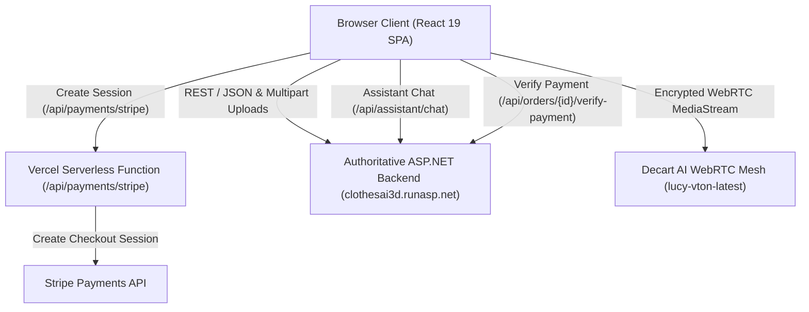

### 4.2 Application Bootstrap & Provider Hierarchy
When a user visits Try On Studio:
1. `index.html` loads `/src/main.tsx`.
2. Global style files are imported (`tokens.css`, `global.css`, `studio.css`, `commerce.css`).
3. React 19 creates the root via `createRoot(document.getElementById('root')!)` and mounts `<App />` within `<StrictMode>`.
4. The provider tree initializes in the following order:
   - **`LanguageProvider`**: Detects saved language (`en` or `ar`) and updates `<html lang="..." dir="...">`.
   - **`BrowserRouter`**: React Router 7 router instance.
   - **`StudioProvider`**: Automatically pings `/api/health`, fetches categories, global manufactured sizes, items, and 360-rack rotation frames; syncs active item with URL query params (`?item=1`).
   - **`CommerceProvider`**: Inquires Stripe gateway status, fetches authoritative loyalty rules (`/api/loyalty/rules`), maintains active checkout draft, manages loyalty verification tokens in memory, and initializes recent confirmed orders from tab-scoped `sessionStorage`.
   - **`<Layout />`**: Renders persistent navigation sidebar, top header (search, language toggle, API health indicator), page `<Outlet />`, and `<AssistantFloatingDrawer />`.

---

## 5. Features & User Journeys

### 5.1 Product Discovery & 360° Rotational Rack
- **User Actions:** Browse garments by category tabs (T-Shirts, Polo Shirts, Hoodies, Jackets), search by keyword, view prices in dual currency (EGP & USD), and inspect multi-angle rotational views.
- **Components:** `ClothingRack360.tsx`, `GarmentSelectorPanel.tsx`, `SelectedOutfitCard.tsx`, `GarmentImage.tsx`.
- **Endpoints:** `GET /api/categories`, `GET /api/fashion-items`, `GET /api/fashion-items/rack`.
- **Rotational Math:** `ClothingRack360.tsx` tracks horizontal mouse drag or touch swipe:
  $$\text{frameIndex} = \left\lfloor \frac{\Delta x}{\text{containerWidth}} \times 24 \right\rfloor \pmod{24}$$

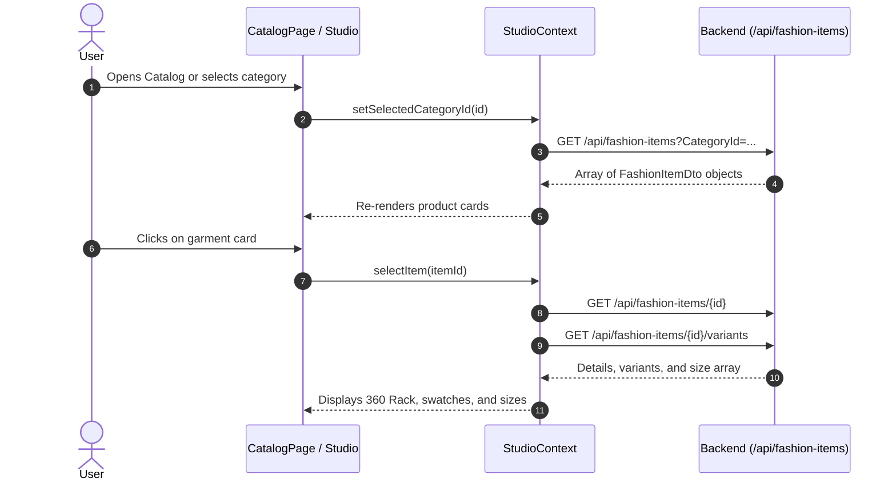

### 5.2 Realtime Virtual Try-On (Decart WebRTC)
- **User Actions:** Click **Start Camera** in the studio mirror to drape the selected garment and colorway onto their live camera feed.
- **Components:** `CameraMirrorPanel.tsx`, `WorkflowStepsRail.tsx`.
- **Services & Hooks:** `useDecartTryOn.ts`, `useCamera.ts`, `fashionApi.getTryOnToken()`.
- **Decart Client Token Protocol:**
  - `POST /api/tryon/token` on the backend returns `{ apiKey: string, expiresAt: string }` (~2 min validity).
  - The token is temporary and must be requested before connecting or reconnecting.
  - The token is passed via `apiKeyProvider` callback to `createDecartClient()`.
  - Tokens are held **strictly in volatile React memory** (never in `localStorage`).
- **WebRTC PeerConnection:**
  - Model: `models.realtime('lucy-vton-latest')`.
  - Prompts are generated by `buildTryOnPrompt()` with `enhance: false`.
  - Colorway switching calls `applyGarmentToSession()` without breaking the active WebRTC stream.

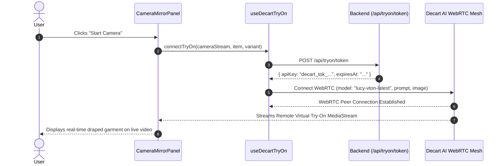

### 5.3 MediaPipe Hand-Swipe Gesture Navigation
- **User Actions:** While standing 1–2 meters in front of the camera during a try-on session, users swipe their hand left or right in the air to cycle between outfit variants without touching their device.
- **Detector:** `useGestureNavigation.ts` & `swipeDetector.ts`.
- **WASM Asset:** `@mediapipe/tasks-vision@1.2.0` loading `pose_landmarker_lite.task`.
- **Anti-False-Positive Rules:**
  - Hand must be elevated above the hip landmark line ($y_{\text{wrist}} < y_{\text{hip}}$).
  - Landmark visibility must exceed $0.50$.
  - Horizontal movement must exceed 40% of shoulder width ($\frac{|\Delta x|}{\text{shoulderWidth}} \ge 0.40$).
  - Directional ratio: $\frac{|\Delta x|}{|\Delta y|} \ge 1.30$.
  - 1.5-second cooldown enforced after each triggered swipe.

### 5.4 AI Fashion Stylist (Backend Gemini Integration)
- **User Actions:** Open the floating assistant drawer or visit `/assistant` to ask for styling recommendations based on skin undertones, body proportions, occasion, and budget.
- **Endpoints:** `GET /api/assistant/chat` and `POST /api/assistant/chat` on `https://clothesai3d.runasp.net`.
- **Architecture:** The assistant is natively configured on the ASP.NET Core backend with `gemini-3.5-flash`. No frontend Gemini API key is required.
- **Grounding Pipeline:**
  - Request body delivers `messages` (up to 16 turns), `language` (`en` or `ar`), and optional `context` (selected item, scanned size, style preferences, verified points).
  - The server grounds responses against the live catalog and returns `reply`, `model`, and up to 4 `recommendedItems`.
  - Frontend renders rich recommendation cards with links to view and try on recommended items.

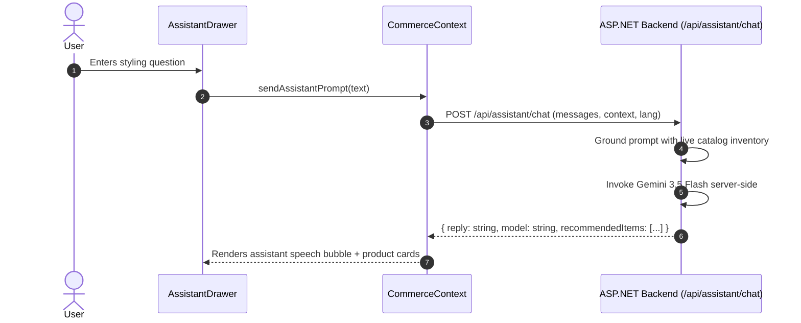

### 5.5 AI Camera Body Size Scan & Fit Estimation
- **User Actions:** Launch the guided body scan from the studio or size guide page. Step back 1–2m for a 3-second countdown while 20 frames are captured.
- **Engine:** `captureFrames.ts` draws un-mirrored `<video>` frames onto an HTML5 canvas.
- **Dynamic Compression:** Frames are downscaled to max 1280px. JPEG quality automatically steps down (0.84 → 0.70 → 0.50 → 0.35) ensuring each frame is $\le 2\text{ MB}$ and total upload $\le 20\text{ MB}$.
- **Backend API:** `POST /api/fashion-items/{id}/size-scan` (multipart/form-data with `frames` field, accepts 8–40 images).
- **Borderline Rule:** When `borderline` is `true`, the frontend displays `sizeRange` (e.g. `"M-L"`) instead of `size` to indicate a boundary fit.

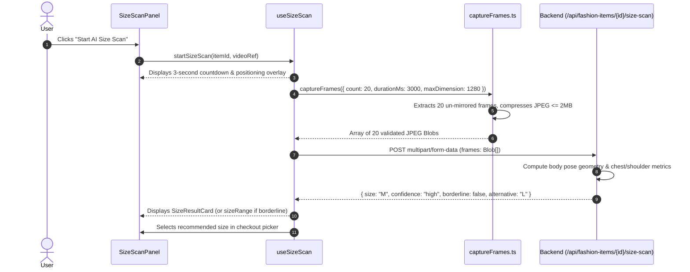

### 5.6 Single-Product Checkout & Idempotency
- **User Actions:** Select a garment, variant color, and size, enter shipping name and phone, and place an order using Cash on Delivery (COD) or Card.
- **Important Backend Rule:** `POST /api/orders` supports **one product per order** (`fashionItemId`, `variantId`, `size`, `quantity`). It does not support a multi-product `items[]` array. Multi-product shopping cart checkout requires a backend contract update before it can be integrated.
- **Order Totals:** Order prices and totals are recalculated and validated by the backend. The frontend cannot manipulate final totals.
- **Idempotency:** Generates an RFC4122 v4 UUID transmitted via header: `Idempotency-Key: chk_<uuid>`.

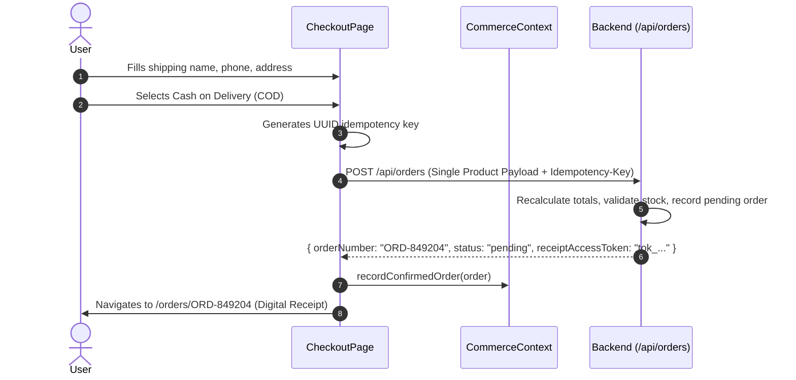

### 5.7 Stripe Payments & Backend Payment Verification
- **User Actions:** Select "Credit / Debit Card (Stripe)" on checkout. Redirected to Stripe Hosted Checkout, then returned to `/orders/{orderNumber}?session_id={CHECKOUT_SESSION_ID}`.
- **Flow:**
  1. Frontend creates hosted checkout session via serverless helper `POST /api/payments/stripe`.
  2. Browser redirects to Stripe Hosted Checkout.
  3. After payment, Stripe redirects to `/orders/{orderNumber}?session_id=cs_...`.
  4. `ReceiptPage.tsx` verifies the session with Stripe.
  5. `ReceiptPage.tsx` calls `POST /api/orders/{orderNumber}/verify-payment` with `{ "sessionId": "cs_..." }`.
  6. The ASP.NET Core backend marks the database record as `paid`.

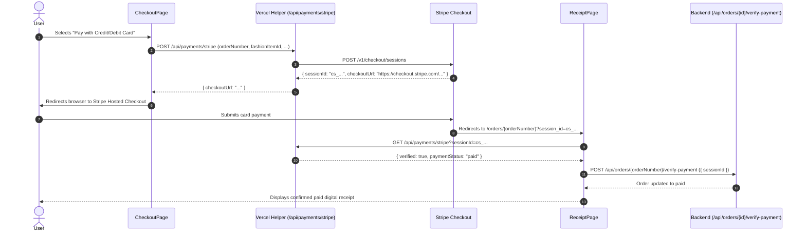

### 5.8 Customer Loyalty Rewards & Verification Behavior
- **User Actions:** Enter phone number on `/loyalty`, confirm OTP code, inspect points ledger and tier status, and apply discounts during checkout.
- **Endpoints:** `GET /api/loyalty/rules`, `POST /api/loyalty/verify-request`, `POST /api/loyalty/verify-confirm`, `GET /api/loyalty/account`.
- **Token Handling:**
  - `POST /api/loyalty/verify-confirm` returns a short-lived `verificationToken`.
  - The token must be sent as `Authorization: Bearer <token>` when accessing `GET /api/loyalty/account`.
  - The token must also be sent as `loyaltyVerificationToken` when redeeming points in `POST /api/orders`.
  - Held strictly in volatile React memory (never in `localStorage`).
- **Backend Demo Mode:** The backend returns `"Demo mode: no SMS is sent. Enter the code 123456."`. Entering `123456` verifies the customer and returns a bearer token.

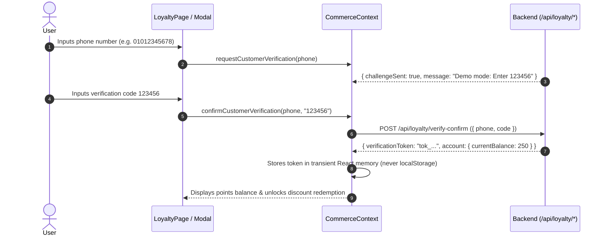

### 5.9 Digital Receipts & Tokenized Session Persistence
- **User Actions:** Access `/orders/{orderNumber}` to review line items, payment status, transaction references, and print physical or PDF receipts.
- **Header Requirement:** `GET /api/orders/{orderNumber}` requires the `X-Receipt-Token` header.
- **Tab-Scoped Persistence:** Orders recorded upon creation are cached in `sessionStorage` (`tryonstudio_session_orders`). Refreshing the browser tab within the same session reloads the receipt with its authorization token intact without leaking it across sessions.

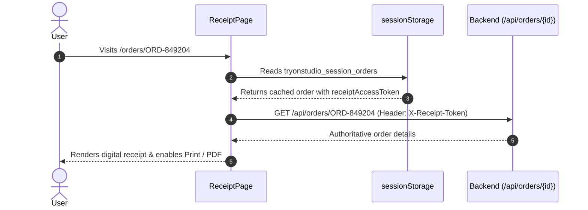

### 5.10 Bi-Directional Arabic (RTL) & English (LTR) Localization
- **User Actions:** Toggle the language button in the top navigation header (`العربية` / `English`).
- **Architecture:** `LanguageContext.tsx` maintains 280 English and 280 Arabic translation keys.
- **RTL Mirroring:** Updates document direction via `<html dir="rtl" lang="ar">`.
- **`<bdi>` Bi-Directional Isolation:** Prevents alphanumeric reversals on mixed-language strings:
  - Product names (`Monospace Tee`)
  - Numeric prices (`formatEgp(2500, 'ar')` $\rightarrow$ `<bdi>2,500 ج.م</bdi>`)
  - Sizes (`<bdi>XXL</bdi>`)

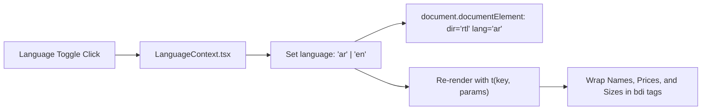

### 5.11 Responsive Mobile & Desktop Layouts
- **Handsets (< 640px):** Single-column stacked layouts, sticky bottom action bar, compact floating action button for AI Stylist, and slide-out navigation drawer with Escape-key dismiss.
- **Tablets (640px – 1024px):** Dual-column layout with collapsible navigation bar.
- **Desktop (1024px – 1440px+):** Multi-column studio experience with live camera mirror, side-by-side 360° rack, and variant selector.

---

## 6. Complete Backend Swagger API Reference

All backend endpoints are defined in the Swagger/OpenAPI specification at `https://clothesai3d.runasp.net/swagger/v1/swagger.json`.

Base URL: `https://clothesai3d.runasp.net`

### 6.1 Standard Error Response Structure
Every failed request returns an `ErrorResponse` payload:
```json
{
  "error": "Human-readable error description.",
  "code": "error_code_identifier",
  "errors": {
    "FieldName": ["Validation error message"]
  }
}
```
- `error` (string, nullable): Main error message read by `fashionApi.ts` and `commerceApi.ts`.
- `code` (string, nullable): Machine-readable error code.
- `errors` (object, nullable): Dictionary of field-level validation errors (ASP.NET ModelState).

---

### 6.2 Health & Media Endpoints

#### `GET /api/health`
- **Purpose:** Server and storage health telemetry.
- **Parameters:** None.
- **Responses:**
  - `200 OK`: `HealthResponse`
    ```json
    {
      "status": "healthy",
      "database": "ok",
      "storage": "writable",
      "products": 15,
      "mediaFiles": 425,
      "missingFiles": 0,
      "aiSizeService": "ok"
    }
    ```
  - `503 Service Unavailable`: Server or database failure.

#### `GET /api/media/{id}`
- **Purpose:** Static image file retrieval.
- **Path Parameter:** `id` (string, required) — Media file GUID.
- **Query Parameter:** `v` (optional cache-busting version, e.g. `?v=2`).
- **Responses:**
  - `200 OK`: Binary image file (image/jpeg or image/png).
  - `304 Not Modified`: Cached asset.
  - `404 Not Found`: Media file does not exist.

---

### 6.3 Catalog & Categories Endpoints

#### `GET /api/categories`
- **Purpose:** All categories with item counts for navigation and filters.
- **Parameters:** None.
- **Responses:**
  - `200 OK`: Array of `CategoryDto`
    ```json
    [
      { "id": 1, "name": "T-Shirts", "slug": "t-shirts", "itemCount": 7 },
      { "id": 2, "name": "Polo Shirts", "slug": "polo-shirts", "itemCount": 2 },
      { "id": 3, "name": "Hoodies & Sweatshirts", "slug": "hoodies", "itemCount": 4 },
      { "id": 4, "name": "Jackets & Outerwear", "slug": "jackets", "itemCount": 2 }
    ]
    ```

#### `GET /api/categories/{categoryId}/fashion-items`
- **Purpose:** Garments belonging to one category.
- **Path Parameter:** `categoryId` (integer, required, minimum: 1).
- **Responses:**
  - `200 OK`: Array of `FashionItemDto`.
  - `404 Not Found`: Category does not exist.

#### `GET /api/fashion-items`
- **Purpose:** List, filter, and search clothing items. Both query parameters are optional.
- **Query Parameters:**
  - `CategoryId` (integer, optional, min: 1, max: 2147483647).
  - `Search` (string, optional, maxLength: 100).
- **Responses:**
  - `200 OK`: Array of `FashionItemDto`
    ```json
    [
      {
        "id": 1,
        "name": "Monospace Tee",
        "description": "Your t-shirt is your second skin...",
        "price": 20.0,
        "categoryId": 1,
        "categoryName": "T-Shirts",
        "thumbnailUrl": "https://clothesai3d.runasp.net/api/media/...",
        "variantCount": 1
      }
    ]
    ```
  - `400 Bad Request`: Invalid search query or category ID.

#### `GET /api/fashion-items/rack`
- **Purpose:** Garments for the 360° interactive rack, each with ordered rotational frames.
- **Query Parameter:** `Take` (integer, optional, min: 1, max: 20, default: 6).
- **Responses:**
  - `200 OK`: Array of `RackItemDto`
    ```json
    [
      {
        "id": "1",
        "name": "Monospace Tee",
        "price": 20.0,
        "frames": [
          "https://clothesai3d.runasp.net/api/media/...v=2",
          "https://clothesai3d.runasp.net/api/media/...v=2"
        ]
      }
    ]
    ```
  - `400 Bad Request`: `Take` is out of allowable bounds.

#### `GET /api/fashion-items/{id}`
- **Purpose:** Full garment details, color variants, and offered sizes.
- **Path Parameter:** `id` (integer, required).
- **Responses:**
  - `200 OK`: `FashionItemDetailsDto`
    ```json
    {
      "id": 1,
      "name": "Monospace Tee",
      "description": "Your t-shirt is your second skin...",
      "price": 20.0,
      "categoryId": 1,
      "categoryName": "T-Shirts",
      "variants": [
        {
          "id": 1,
          "colorName": "Pure Blue",
          "colorHex": "#0051ba",
          "imageUrl": "https://clothesai3d.runasp.net/api/media/...",
          "tryOnPrompt": "A person wearing a royal blue crewneck t-shirt"
        }
      ],
      "availableSizes": ["S", "M", "L", "XL", "XXL"]
    }
    ```
  - `404 Not Found`: Item not found.

#### `GET /api/fashion-items/{id}/variants`
- **Purpose:** Color variants of one item.
- **Path Parameter:** `id` (integer, required).
- **Responses:**
  - `200 OK`: Array of `FashionVariantDto`.
  - `404 Not Found`: Item not found.

---

### 6.4 Sizing & Camera Body Scan Endpoints

#### `GET /api/sizes`
- **Purpose:** Every size code the system accepts, ordered smallest to largest.
- **Parameters:** None.
- **Responses:**
  - `200 OK`: `["XS", "S", "M", "L", "XL", "XXL", "XXXL"]`.

#### `GET /api/fashion-items/{id}/sizes`
- **Purpose:** Sizes this specific product is manufactured in (ordered XS..XXXL).
- **Path Parameter:** `id` (integer, required).
- **Responses:**
  - `200 OK`: Array of strings, e.g. `["S", "M", "L", "XL", "XXL"]`.
  - `404 Not Found`: Item not found.

#### `POST /api/fashion-items/{id}/size-check`
- **Purpose:** Checks a recommended size against the product's offered manufactured sizes.
- **Path Parameter:** `id` (integer, required).
- **Headers:** `Content-Type: application/json`.
- **Request Body:** `SizeCheckRequest`
  ```json
  {
    "size": "M"
  }
  ```
  - `size` (string, required, minLength: 1, maxLength: 10).
- **Responses:**
  - `200 OK`: `SizeCheckResponse`
    ```json
    {
      "fashionItemId": 1,
      "requestedSize": "M",
      "isAvailable": true,
      "availableSizes": ["S", "M", "L", "XL", "XXL"],
      "nearestAvailableSizes": []
    }
    ```
  - `400 Bad Request`: Missing or invalid size string.
  - `404 Not Found`: Item not found.

#### `POST /api/fashion-items/{id}/size-scan`
- **Purpose:** Recommends a size for this item from camera frames (AI body scan).
- **Path Parameter:** `id` (integer, required).
- **Headers:** `Content-Type: multipart/form-data`.
- **Request Body:** Multipart form data containing:
  - `frames`: Array of binary image files (8 to 40 JPEG/PNG images, max 2 MB per image, max 20 MB total upload).
- **Responses:**
  - `200 OK`: `SizeScanResultDto`
    ```json
    {
      "size": "M",
      "alternative": "L",
      "borderline": false,
      "sizeRange": "M-L",
      "confidence": "high"
    }
    ```
    - **Borderline Rule:** When `borderline` is `true`, the UI displays `sizeRange` (e.g. `"M-L"`) instead of `size`.
    - `confidence`: `"high"` | `"medium"` | `"low"` | `"n/a"`.
  - `400 Bad Request`: Corrupt or unreadable image data.
  - `404 Not Found`: Item not found.
  - `409 Conflict`: Product does not offer sizes (size scan not applicable).
  - `422 Unprocessable Entity`: Body pose could not be extracted. Specific codes:
    - `no_pose`: No full human pose detected.
    - `too_close`: User is too close to camera (feet or head cropped).
    - `turned`: User is turned sideways; must face camera directly.
    - `bad_height`: Full body height not measurable.
  - `429 Too Many Requests`: Rate limit reached.
  - `502 Bad Gateway`: Upstream AI sizing service unavailable.

---

### 6.5 Virtual Try-On Token Endpoint

#### `POST /api/tryon/token`
- **Purpose:** Requests a short-lived Decart AI client token before connecting or reconnecting WebRTC.
- **Parameters:** None.
- **Request Body:** Empty `{}`.
- **Responses:**
  - `200 OK`: `TryOnTokenDto`
    ```json
    {
      "apiKey": "eyJhbGciOiJFZERTQSIs...",
      "expiresAt": "2026-11-11T04:15:00.000Z"
    }
    ```
    - `apiKey`: Short-lived Decart client token (~2 min validity). Never persisted in storage.
    - `expiresAt`: ISO 8601 timestamp.
  - `429 Too Many Requests`: Rate limit exceeded.
  - `502 Bad Gateway`: Backend Decart API key is not configured on the server.

---

### 6.6 AI Fashion Assistant Endpoints

The AI Fashion Assistant is natively hosted and executed on the ASP.NET Core backend. No frontend Gemini API key is required.

#### `GET /api/assistant/chat`
- **Purpose:** Inquires whether the assistant is configured on the server (no secrets returned).
- **Parameters:** None.
- **Responses:**
  - `200 OK`: `AssistantStatusDto`
    ```json
    {
      "configured": true,
      "provider": "google-gemini",
      "model": "gemini-3.5-flash",
      "usdToEgpRate": 50.0
    }
    ```

#### `POST /api/assistant/chat`
- **Purpose:** Sends session chat history and context to the backend AI stylist.
- **Headers:** `Content-Type: application/json`.
- **Request Body:** `AssistantChatRequest`
  ```json
  {
    "messages": [
      { "role": "user", "content": "What shirts do you recommend for casual Fridays?" }
    ],
    "language": "en",
    "context": {
      "selectedItem": {
        "id": 1,
        "name": "Monospace Tee",
        "categoryName": "T-Shirts",
        "priceUsd": 20.0,
        "selectedColor": "Pure Blue",
        "availableColors": ["Pure Blue"],
        "availableSizes": ["S", "M", "L", "XL", "XXL"]
      },
      "outfitConfirmed": true,
      "tryOnActive": false,
      "scannedSize": "M",
      "stylePreferences": {
        "aesthetic": "minimal",
        "fit": "regular",
        "undertone": "cool",
        "budgetEgp": 2000.0
      },
      "verifiedLoyaltyPoints": 250
    }
  }
  ```
  - `messages`: Array of `AssistantMessageDto` (up to 16 turns; user content max 1200 characters; last turn must be from user).
  - `language`: `"en"` | `"ar"`.
  - `context`: Optional `AssistantContextDto`.
- **Responses:**
  - `200 OK`: `AssistantChatResponseDto`
    ```json
    {
      "reply": "I recommend our Monospace Tee...",
      "model": "gemini-3.5-flash",
      "recommendedItems": [
        {
          "id": 1,
          "name": "Monospace Tee",
          "categoryName": "T-Shirts",
          "priceUsd": 20.0,
          "priceEgp": 1000.0,
          "thumbnailUrl": "https://clothesai3d.runasp.net/api/media/...",
          "variantCount": 1
        }
      ]
    }
    ```
  - `400 Bad Request`: `code`: `empty_messages`, `invalid_turn`, `message_too_long`.
  - `429 Too Many Requests`: `code`: `provider_rate_limited`.
  - `502 Bad Gateway`: `code`: `ai_unavailable`.
  - `503 Service Unavailable`: `code`: `ai_unconfigured`.

---

### 6.7 Orders & Payment Verification Endpoints

#### `POST /api/orders`
- **Purpose:** Places an order (Cash on Delivery or Card).
- **Important Rule:** Supports **one product per order** (`fashionItemId`, `variantId`, `size`, `quantity`). It does not accept multi-product `items[]`. Multi-product cart checkout requires a backend contract update.
- **Headers:**
  - `Content-Type: application/json`
  - `Idempotency-Key: <uuid>` (recommended UUID v4 header to prevent double submission).
- **Request Body:** `CreateOrderDto`
  ```json
  {
    "fashionItemId": 1,
    "variantId": 1,
    "size": "M",
    "quantity": 1,
    "customer": {
      "fullName": "Mohamed Gamal",
      "phone": "01012345678"
    },
    "paymentMethod": "cod",
    "pointsToRedeem": 100,
    "loyaltyVerificationToken": "6d77bdf8..."
  }
  ```
  - `fashionItemId` (integer, required, min: 1).
  - `quantity` (integer, required, min: 1, max: 20).
  - `customer` (object, required): `fullName` ($\ge 3$ chars, $\ge 2$ words), `phone` (valid format).
  - `paymentMethod` (string, required): `"cod"` or `"stripe"`.
  - `variantId` (integer, optional, nullable).
  - `size` (string, optional, nullable; required if item offers sizes).
  - `pointsToRedeem` (integer, optional, multiple of redemption block points, e.g. 100).
  - `loyaltyVerificationToken` (string, optional, required if `pointsToRedeem` > 0).
- **Backend Price Validation:** Order prices, discounts, and final totals are recalculated and verified by the backend. Client values are not trusted blindly.
- **Responses:**
  - `200 OK` / `201 Created`: `OrderDto`
    ```json
    {
      "orderNumber": "ORD-849204",
      "receiptNumber": "REC-849204",
      "transactionReference": "COD-849204",
      "customerName": "Mohamed Gamal",
      "customerPhoneMasked": "010••••••78",
      "currency": "EGP",
      "items": [
        {
          "fashionItemId": 1,
          "productName": "Monospace Tee",
          "categoryName": "T-Shirts",
          "variantId": 1,
          "colorName": "Pure Blue",
          "imageUrl": "https://clothesai3d.runasp.net/api/media/...",
          "size": "M",
          "quantity": 1,
          "unitPriceEgp": 1000.0,
          "unitPriceUsd": 20.0,
          "lineTotalEgp": 1000.0
        }
      ],
      "subtotalEgp": 1000.0,
      "discountEgp": 10.0,
      "pointsRedeemed": 100,
      "finalTotalEgp": 990.0,
      "paymentMethod": "cod",
      "paymentStatus": "pending_collection",
      "orderStatus": "confirmed",
      "createdAt": "2026-11-11T04:18:00Z",
      "pointsEarned": 99,
      "updatedLoyaltyBalance": 150,
      "checkoutUrl": null,
      "receiptAccessToken": "tok_sec_984392"
    }
    ```
  - `400 Bad Request`: Validation failure (e.g. missing customer or invalid phone).
  - `401 Unauthorized`: Invalid or expired loyalty verification token.
  - `404 Not Found`: Garment or variant does not exist.
  - `409 Conflict`: Item or size is out of stock.
  - `429 Too Many Requests`: Rate limit reached.

#### `GET /api/orders/{orderNumber}`
- **Purpose:** Retrieves an order and digital receipt.
- **Path Parameter:** `orderNumber` (string, required).
- **Required Header:** `X-Receipt-Token: <receiptAccessToken>`.
- **Responses:**
  - `200 OK`: `OrderDto`.
  - `404 Not Found`: Order not found or `X-Receipt-Token` invalid/missing.

#### `POST /api/orders/{orderNumber}/verify-payment`
- **Purpose:** Confirms a Stripe Checkout payment with Stripe itself and updates the order status to `paid`.
- **Path Parameter:** `orderNumber` (string, required).
- **Headers:** `Content-Type: application/json`.
- **Request Body:** `VerifyPaymentDto`
  ```json
  {
    "sessionId": "cs_test_a1b2c3d4..."
  }
  ```
  - `sessionId` (string, required, maxLength: 200).
- **Responses:**
  - `200 OK`: `OrderDto` (with `paymentStatus: "paid"` and updated `transactionReference`).
  - `400 Bad Request`: Session ID mismatch or payment unconfirmed.
  - `404 Not Found`: Order not found.
  - `502 Bad Gateway`: Stripe API error.

---

### 6.8 Customer Loyalty Program Endpoints

#### `GET /api/loyalty/rules`
- **Purpose:** Returns authoritative rules for how points are earned and spent.
- **Parameters:** None.
- **Responses:**
  - `200 OK`: `LoyaltyRulesDto`
    ```json
    {
      "earnUnitAmountEgp": 10.0,
      "pointsEarnedPerUnit": 1,
      "redemptionBlockPoints": 100,
      "redemptionBlockValueEgp": 10.0,
      "minRedemptionPoints": 100,
      "maxRedemptionRatio": 1.0
    }
    ```
    - `earnUnitAmountEgp`: 10 EGP spent per unit.
    - `pointsEarnedPerUnit`: 1 point earned per unit (10 EGP = 1 point).
    - `redemptionBlockPoints`: 100 points per redemption block.
    - `redemptionBlockValueEgp`: 10 EGP discount per block (100 points = 10 EGP).
    - `minRedemptionPoints`: 100 points minimum to redeem.
    - `maxRedemptionRatio`: 1.0 (100% of merchandise can be paid with points).

#### `POST /api/loyalty/verify-request`
- **Purpose:** Initiates customer identity verification by sending an OTP code.
- **Backend Demo Mode:** The backend returns `"Demo mode: no SMS is sent. Enter the code 123456."`.
- **Request Body:** `LoyaltyVerifyRequestDto`
  ```json
  {
    "phone": "01012345678"
  }
  ```
  - `phone` (string, required, maxLength: 30).
- **Responses:**
  - `200 OK`: `LoyaltyVerifyRequestResponseDto`
    ```json
    {
      "challengeSent": true,
      "expiresInSeconds": 300,
      "message": "Demo mode: no SMS is sent. Enter the code 123456."
    }
    ```
  - `400 Bad Request`: Invalid phone number.
  - `429 Too Many Requests`: OTP rate limit exceeded.

#### `POST /api/loyalty/verify-confirm`
- **Purpose:** Validates the verification code and returns a short-lived bearer token and account ledger.
- **Request Body:** `LoyaltyVerifyConfirmRequestDto`
  ```json
  {
    "phone": "01012345678",
    "code": "123456"
  }
  ```
  - `phone` (string, required, maxLength: 30).
  - `code` (string, required, minLength: 4, maxLength: 12).
- **Responses:**
  - `200 OK`: `LoyaltyVerifyConfirmResponseDto`
    ```json
    {
      "verificationToken": "6d77bdf85618...",
      "expiresAt": "2026-11-11T04:45:00Z",
      "account": {
        "customerPhoneMasked": "010••••••78",
        "currentBalance": 250,
        "lifetimeEarned": 500,
        "lifetimeRedeemed": 250,
        "availableDiscountEgp": 20.0,
        "rules": { ... },
        "transactions": []
      }
    }
    ```
  - `400 Bad Request`: Incorrect or expired verification code.

#### `GET /api/loyalty/account`
- **Purpose:** Authoritative balance and transaction history of the verified customer.
- **Required Header:** `Authorization: Bearer <verificationToken>`.
- **Responses:**
  - `200 OK`: `LoyaltyAccountDto`.
  - `401 Unauthorized`: Token missing, invalid, or expired.

---

### 6.9 Frontend Serverless Helper Routes (Non-Swagger)

These endpoints are implemented in `api/` on Vercel as frontend helper utilities. They are **not** part of the backend Swagger specification.

#### `POST /api/payments/stripe` (Vercel Serverless Function)
- **Purpose:** Initiates a hosted Stripe Checkout session with server-side secrets.
- **Implementation:** `api/payments/stripe.ts`.
- **Request Body:**
  ```json
  {
    "orderNumber": "ORD-849204",
    "fashionItemId": 1,
    "variantId": 1,
    "size": "M",
    "quantity": 1,
    "verifiedDiscountEgp": 10.0,
    "idempotencyKey": "chk_uuid"
  }
  ```
- **Responses:**
  - `200 OK`: `{ "sessionId": "cs_...", "checkoutUrl": "https://checkout.stripe.com/...", "mode": "sandbox" }`.
  - `400 Bad Request`: Missing persisted backend order number (`missing_persisted_order`).

#### `GET /api/payments/stripe` (Vercel Serverless Function)
- **Purpose:** Queries Stripe configuration status, or verifies a session via `?sessionId=cs_...`.
- **Implementation:** `api/payments/stripe.ts`.

---

## 7. Order, Stripe, Receipt & Loyalty Workflows

### 7.1 Single-Product Order Creation & Price Validation
1. The user selects a garment, color variant, and size.
2. The user proceeds to `/checkout` and provides their full name and phone number.
3. The client submits a single-product payload to `POST /api/orders` with an `Idempotency-Key` header.
4. The ASP.NET Core backend recalculates the subtotal, validates any applied loyalty discount against the `loyaltyVerificationToken`, and persists the order as `pending`.
5. The backend returns `OrderDto` containing the authoritative `orderNumber`, `finalTotalEgp`, and `receiptAccessToken`.

### 7.2 Stripe Hosted Checkout & Backend Synchronization
1. If payment method is `"stripe"`, the client sends order metadata to the Vercel helper `POST /api/payments/stripe`.
2. Vercel creates a Stripe Checkout session in piastres ($1\text{ EGP} = 100\text{ piastres}$) and returns a `checkoutUrl`.
3. The user is redirected to Stripe to enter payment details.
4. Stripe redirects back to TryOnStudio at `/orders/{orderNumber}?session_id={CHECKOUT_SESSION_ID}`.
5. `ReceiptPage.tsx` verifies the session with Stripe.
6. **Crucial Backend Step:** When verified as `paid`, `ReceiptPage.tsx` immediately calls `POST /api/orders/{orderNumber}/verify-payment` with `{ "sessionId": "..." }`. The ASP.NET Core backend marks the database record as `paid`.

### 7.3 Digital Receipt & `X-Receipt-Token` Authorization
1. The receipt page requires the `X-Receipt-Token` header for `GET /api/orders/{orderNumber}`.
2. Upon order creation, `receiptAccessToken` is cached in tab-scoped `sessionStorage` (`tryonstudio_session_orders`).
3. If the user refreshes `/orders/:orderNumber`, the token is retrieved from `sessionStorage` and sent as `X-Receipt-Token`, preserving authorization without exposing the token in URLs.

### 7.4 Loyalty Verification & Redemption Rules
1. The user inputs their mobile phone on `/loyalty` or during checkout.
2. `POST /api/loyalty/verify-request` triggers the verification challenge (in demo mode, code `123456`).
3. `POST /api/loyalty/verify-confirm` validates the code and returns `verificationToken`.
4. The token is sent as `Authorization: Bearer <token>` to view the ledger, and as `loyaltyVerificationToken` in `POST /api/orders` to redeem points.
5. Tokens are held exclusively in volatile React memory and expire after their server-designated lifetime.

---

## 8. Environment Variables & Local Setup

### 8.1 Environment Variables Reference

| Variable Name | Exposure | Required / Optional | Purpose | Default / Example Value |
| :--- | :---: | :---: | :--- | :--- |
| `VITE_API_BASE_URL` | Public (Vite) | **Required** | Authoritative ASP.NET Core backend URL | `https://clothesai3d.runasp.net` |
| `VITE_COMMERCE_API_BASE_URL` | Public (Vite) | Optional | Commerce override (defaults to `VITE_API_BASE_URL`) | `https://clothesai3d.runasp.net` |
| `STRIPE_SECRET_KEY` | Server-Side Only | **Required** for Card Pay | Stripe secret API key used in `api/payments/stripe.ts` | `sk_test_...` or `sk_live_...` |
| `USD_TO_EGP_RATE` | Server-Side Only | Optional | Fallback currency conversion multiplier | `50` |

> [!NOTE]
> The AI Fashion Assistant is handled directly by the ASP.NET Core backend at `/api/assistant/chat`. No frontend `GEMINI_API_KEY` is required.
> If running the optional local Vercel serverless proxy (`api/assistant/chat.ts`), `GEMINI_API_KEY` can be provided server-side in `.env.local`.

> [!CAUTION]
> `STRIPE_SECRET_KEY` must **never** be prefixed with `VITE_`. It resides strictly in serverless runtime environments.

### 8.2 Local Development Setup

#### Prerequisites
- Node.js LTS (v18.x, v20.x, or v24.x).
- npm (v9+ or v10+).
- Built-in or USB webcam (for virtual try-on and size scanning).

#### Installation & Startup
```bash
# 1. Clone the repository
git clone https://github.com/gamalwessam21/TryOnStudio.git
cd TryOnStudio

# 2. Checkout the dev branch
git checkout dev

# 3. Install dependencies
npm install

# 4. Configure environment variables
cp .env.example .env
```

Ensure `.env` contains:
```env
VITE_API_BASE_URL=https://clothesai3d.runasp.net
STRIPE_SECRET_KEY=sk_test_your_stripe_key_here
```

```bash
# 5. Start the local Vite development server
npm run dev
```
Open `http://localhost:5173` in your browser.

### 8.3 Available Scripts

| Script Command | Purpose |
| :--- | :--- |
| `npm run dev` | Starts local Vite development server with local serverless API simulation on port `5173`. |
| `npm run build` | Compiles TypeScript and builds optimized production bundles into `dist/`. |
| `npm run preview` | Starts a local static HTTP server to preview the production build. |
| `npm run typecheck` | Executes TypeScript strict compiler checks without emitting files (`tsc -b --noEmit`). |
| `npm run lint` | Runs ESLint 9 across all source and API files. |
| `npm test` | Runs all 30 unit and live backend contract tests using Vitest. |

---

## 9. Security, Authorization & Reliability

- **Zero Exposure of Private API Keys:** Verified. Neither `STRIPE_SECRET_KEY` nor any backend secrets are present in frontend bundles.
- **Serverless Rate Limiting:** `api/assistant/chat.ts` enforces a token-bucket rate limit of 18 requests per minute per IP.
- **PII Scrubbing:** Raw 13–19 digit sequences (credit cards) and telephone numbers are scrubbed from prompts before transmission.
- **Transient Memory Isolation:** Decart client tokens and Loyalty bearer tokens are stored strictly in React state memory, preventing XSS extraction.
- **Scoped Session Persistence:** Digital receipt tokens are persisted strictly within tab-scoped `sessionStorage`, isolating proof-of-purchase credentials to the active tab.
- **Idempotency Protection:** All order submissions transmit an RFC4122 v4 UUID via `Idempotency-Key` to prevent duplicate billing during network timeouts.
- **Frame Size & Count Boundaries:** Size-scan captures are constrained to 8–40 frames (exactly 20 captured), $\le 2\text{ MB}$ per frame, and $\le 20\text{ MB}$ total multipart payload.
- **CORS Allowed Origins:** The authoritative backend allows `https://try-on-studio-beta.vercel.app` and `http://localhost:5173`.

---

## 10. Testing & Quality Assurance

Automated testing is managed by **Vitest** with a **jsdom** environment:

```bash
npm test
```

### Verified Test Results (30/30 Tests Passed)
1. **`src/__tests__/liveBackend.test.ts` (1 contract test suite covering 12 endpoints):**
   - Verifies live connectivity, health telemetry, category tree, product details, variant swatches, global sizes, product sizes, size-checks, 360-rack rotational frames, Decart token generation, and body scan error responses on `https://clothesai3d.runasp.net`.
2. **`src/__tests__/commerce.test.ts` (19 unit tests):**
   - Customer full name and phone number validation.
   - Egyptian phone normalization and privacy masking (`010••••••78`).
   - Currency conversion (USD to EGP) and dual-currency price formatting.
   - Authoritative loyalty points earning and redemption mathematics.
   - Idempotency key generation (`generateIdempotencyKey`).
3. **`src/__tests__/tryOnStudio.test.ts` (10 unit tests):**
   - MediaPipe hand-swipe gesture detector recognizing right swipes (`next`) and left swipes (`prev`).
   - Gating against false positives (ignoring hand gestures below hip line or steep vertical motions).
   - Cooldown timer enforcement (1500ms lock).
   - Frame count and byte boundary validation for AI body size scans.
   - User-facing error message formatting for AI scan failure modes.

---

## 11. Deployment Architecture

### Vercel Deployment Configuration
The application is deployed on Vercel as an SPA with serverless API functions via `vercel.json`:
```json
{
  "rewrites": [
    {
      "source": "/((?!api/).*)",
      "destination": "/index.html"
    }
  ]
}
```
- Client-side SPA routes (`/`, `/browse`, `/size-guide`, `/assistant`, `/checkout`, `/orders/:id`, `/loyalty`, `/how-it-works`) are rewritten to `/index.html`.
- Requests starting with `/api/` route directly to the corresponding serverless functions in `api/`.

### Production Deployment URLs
- **Production URL:** `https://try-on-studio-beta.vercel.app`
- **Production Alias:** `https://try-on-studio-gamal15.vercel.app`

> [!IMPORTANT]
> The browser's `navigator.mediaDevices.getUserMedia` API strictly requires a secure context (**HTTPS** or `localhost`). Vercel's automated SSL certificates fulfill this requirement.

---

## 12. Developer Contribution Guide & Git Workflow

### Branch Strategy
- **`main`**: Protected production branch. Deploys directly to the production environment. **Direct commits or pushes to `main` are strictly forbidden.**
- **`dev`**: Active integration and development branch. All feature branches must branch off and merge into `dev`.
- **`feature/<name>`** or **`audit/<name>`**: Isolated feature branches for individual tasks.

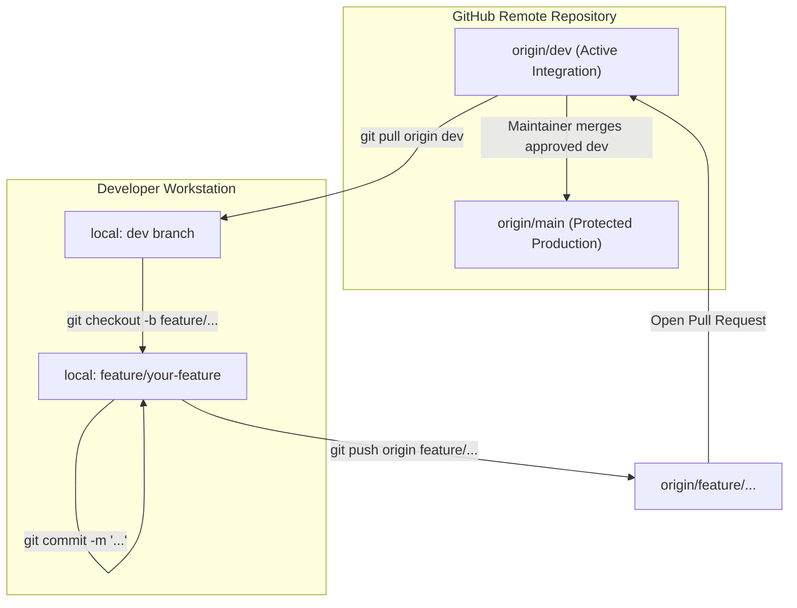

### Developer Command Playbook

#### 1. Update your local `dev` branch:
```bash
git checkout dev
git pull origin dev
```

#### 2. Create a feature branch:
```bash
git checkout -b feature/your-feature-name
```

#### 3. Run quality checks before committing:
```bash
npm run typecheck
npm run lint
npm test
npm run build
```

#### 4. Stage, commit, and push:
```bash
git add .
git commit -m "feat: implement your feature description"
git push -u origin feature/your-feature-name
```

#### 5. Open a Pull Request:
Open a Pull Request on GitHub targeting the **`dev`** base branch for review.

---

## 13. Audit Documentation Index

For technical audit reports, integration matrices, and verification checklists, refer to the documents in `docs/`:
- [Frontend Integration Audit Report](docs/FRONTEND_INTEGRATION_AUDIT.md) — Comprehensive feature-by-feature audit findings, vulnerability checks, and defect resolutions.
- [API Integration Matrix](docs/API_INTEGRATION_MATRIX.md) — Detailed specifications for all 21 backend and edge endpoints.
- [Production Readiness Checklist](docs/PRODUCTION_READINESS_CHECKLIST.md) — Production readiness verification, user journey tests, and security checklist.
