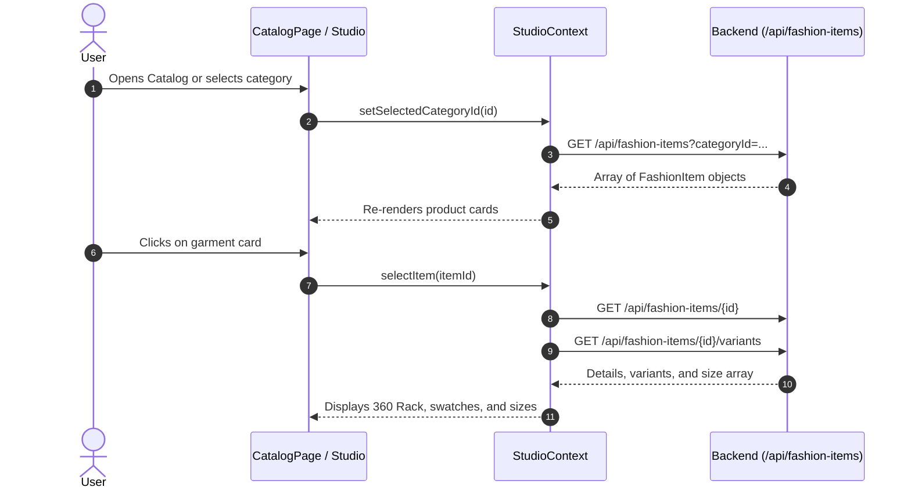
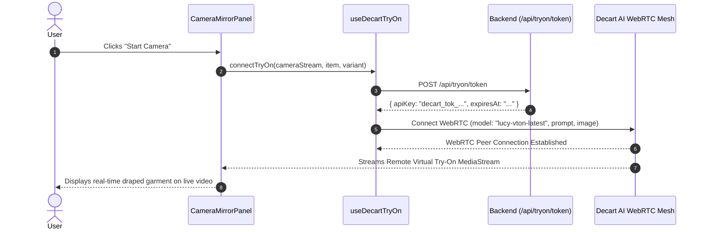
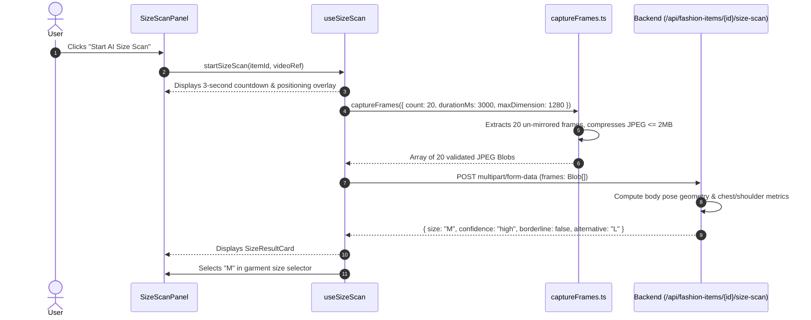
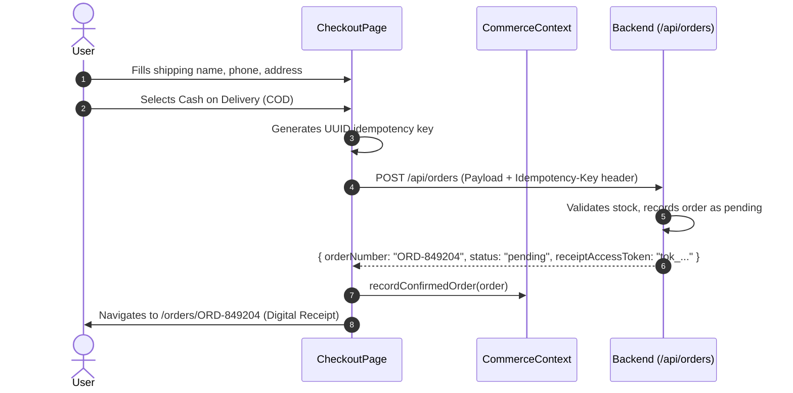
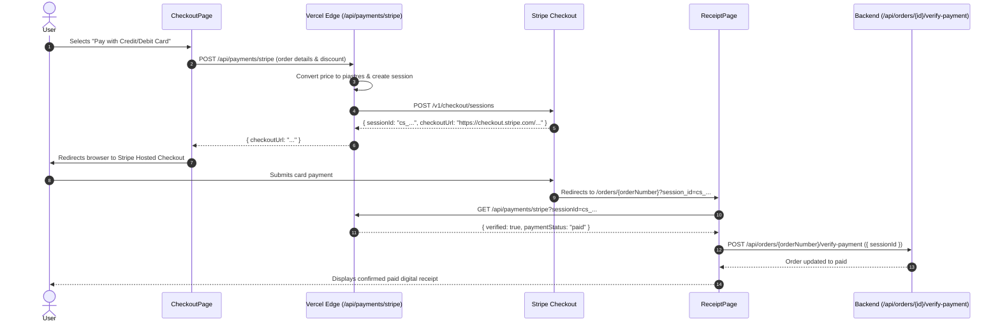
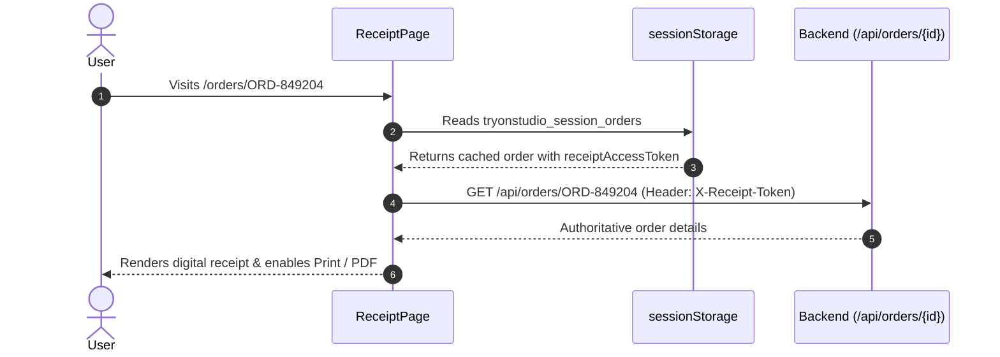
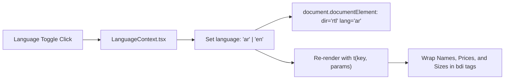
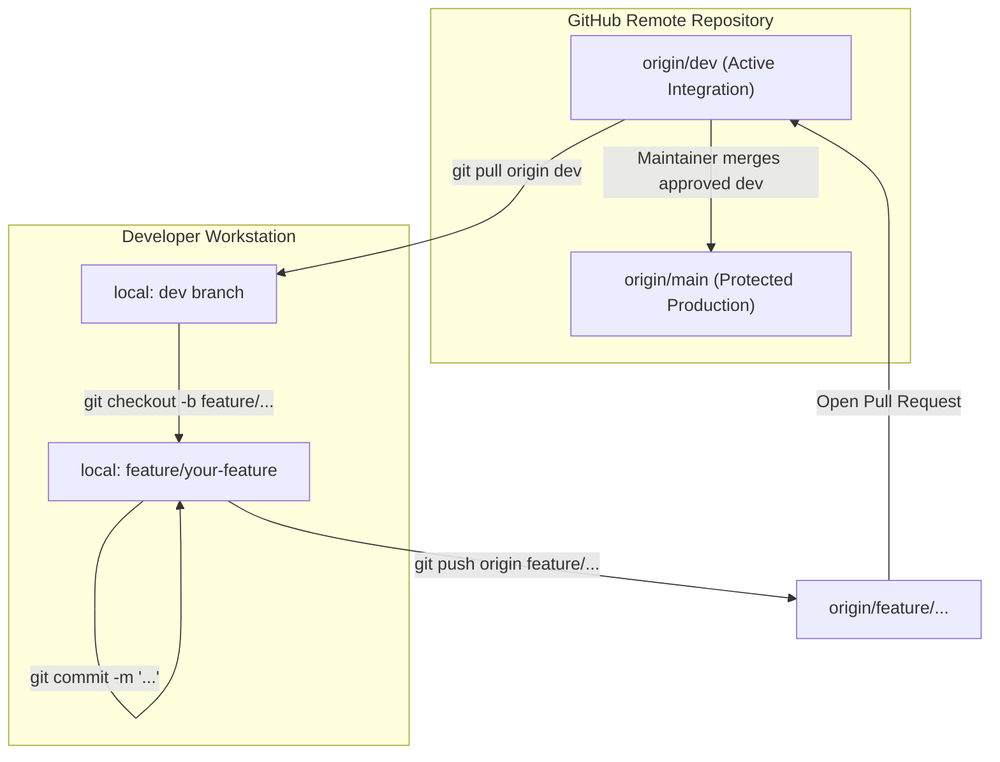

# Try On Studio

> **Production Deployment:** [https://try-on-studio-beta.vercel.app](https://try-on-studio-beta.vercel.app)  
> **GitHub Repository:** [https://github.com/gamalwessam21/TryOnStudio](https://github.com/gamalwessam21/TryOnStudio)  
> **Authoritative Backend API:** `https://clothesai3d.runasp.net`  
> **Backend OpenAPI / Swagger:** `https://clothesai3d.runasp.net/swagger/v1/swagger.json`  
> **Primary Git Branches:** `main` (Production) & `dev` (Active Integration)

---

## Table of Contents

1. [Project Overview](#1-project-overview)
2. [Actual Technology Stack](#2-actual-technology-stack)
3. [Verified Project Structure](#3-verified-project-structure)
4. [Application Architecture & Data Flow](#4-application-architecture--data-flow)
5. [Features & User Journeys](#5-features--user-journeys)
   - [5.1 Product Discovery & 360° Rotational Rack](#51-product-discovery--360-rotational-rack)
   - [5.2 Realtime Virtual Try-On (Decart WebRTC)](#52-realtime-virtual-try-on-decart-webrtc)
   - [5.3 MediaPipe Hand-Swipe Gesture Navigation](#53-mediapipe-hand-swipe-gesture-navigation)
   - [5.4 AI Fashion Stylist (Google Gemini 3.5 Flash)](#54-ai-fashion-stylist-google-gemini-35-flash)
   - [5.5 AI Camera Body Size Scan & Fit Estimation](#55-ai-camera-body-size-scan--fit-estimation)
   - [5.6 Checkout, Idempotency & Order Creation](#56-checkout-idempotency--order-creation)
   - [5.7 Stripe Payments & Server-Side Verification](#57-stripe-payments--server-side-verification)
   - [5.8 Customer Loyalty Rewards & Points Redemption](#58-customer-loyalty-rewards--points-redemption)
   - [5.9 Digital Receipts & Tokenized Persistence](#59-digital-receipts--tokenized-persistence)
   - [5.10 Bi-Directional Arabic (RTL) & English (LTR) Localization](#510-bi-directional-arabic-rtl--english-ltr-localization)
   - [5.11 Responsive Mobile & Desktop Layouts](#511-responsive-mobile--desktop-layouts)
6. [Backend API Documentation](#6-backend-api-documentation)
7. [Checkout, Stripe & Receipt Architecture](#7-checkout-stripe--receipt-architecture)
8. [Loyalty Program & Verification Behavior](#8-loyalty-program--verification-behavior)
9. [Environment Variables & Local Setup](#9-environment-variables--local-setup)
10. [Security, Authorization & Reliability](#10-security-authorization--reliability)
11. [Testing & Quality Assurance](#11-testing--quality-assurance)
12. [Deployment Architecture](#12-deployment-architecture)
13. [Developer Contribution Guide & Git Workflow](#13-developer-contribution-guide--git-workflow)
14. [Audit Documentation Index](#14-audit-documentation-index)

---

## 1. Project Overview

### What is Try On Studio?
**Try On Studio** is an AI-powered virtual dressing room and interactive fashion e-commerce web application. It addresses online apparel shopping friction—unpredictable garment fit, sizing ambiguity, high return rates, and cart abandonment—by enabling shoppers to visualize garments on their live camera feed, measure body dimensions using computer vision, and interact hands-free with clothing racks.

### Target Users
- **Online Fashion Shoppers:** Customers who want to preview garment fit, drape, and colorways on their own body before purchasing.
- **Sizing-Conscious Buyers:** Shoppers uncertain about brand-specific sizing who need an instant, camera-based measurement check.
- **Bilingual Audiences:** Full bilingual accessibility for English and Arabic speakers with native Right-to-Left (RTL) support and price isolation.

### Verified Operational Capabilities vs. External Dependencies

| Capability | Operational Status | Technical Implementation |
| :--- | :---: | :--- |
| **Catalog & 360° Rack** | **Verified Live** | 100% dynamic; loads 15 garments, 4 categories, and 24-frame multi-angle rotational series from the authoritative backend. |
| **Virtual Try-On** | **Verified Live** | Requests short-lived Decart tokens (`POST /api/tryon/token`) and streams video over WebRTC via `@decartai/sdk` (`lucy-vton-latest`). |
| **Gesture Navigation** | **Verified Live** | Runs local `@mediapipe/tasks-vision` pose estimation in WebAssembly on the client CPU/GPU to detect horizontal wrist swipes. |
| **AI Stylist (Gemini)** | **Verified Live** | Grounded in catalog inventory; runs via Vercel serverless edge (`api/assistant/chat.ts`) and backend fallback (`gemini-3.5-flash`). |
| **AI Body Size Scan** | **Verified Live** | Captures 20 canvas frames over 3 seconds with dynamic JPEG compression ($\le 2\text{ MB/frame}$, $\le 20\text{ MB total}$) to `/api/fashion-items/{id}/size-scan`. |
| **Checkout & Orders** | **Verified Live** | Submits orders with RFC4122 v4 `Idempotency-Key` headers for Cash on Delivery (COD) and card payments. |
| **Stripe Payments** | **Verified Live** | Creates Stripe sessions in piastres ($1\text{ EGP} = 100\text{ piastres}$); verifies session and updates backend order via `verify-payment`. |
| **Loyalty Program** | **Demo Mode** | Authoritative points ledger verified (`GET /api/loyalty/rules`). The backend OTP challenge operates in **Demo Mode** with test code `123456` (real SMS delivery requires upstream telecom configuration). |
| **Digital Receipts** | **Verified Live** | Renders order breakdown; preserves `X-Receipt-Token` across page reloads via tab-scoped `sessionStorage`. |
| **Localization** | **Verified Live** | 280 English and 280 Arabic dictionary keys with 1:1 parity and `<bdi>` tag protection for prices and product names. |

---

## 2. Actual Technology Stack

Every package and library documented below is verified against `package.json` and production imports:

### Frontend Core & Build Tooling
- **React (`^19.1.0`)**: Modern declarative UI framework utilizing React 19 functional components and hooks (`useState`, `useEffect`, `useCallback`, `useMemo`, `useRef`, `useContext`).
- **React DOM (`^19.1.0`)**: Client-side DOM rendering engine.
- **TypeScript (`~5.8.3`)**: Statically typed JavaScript targeting ES2022 under strict compiler flags (`tsconfig.app.json`).
- **Vite (`^6.3.5`)**: High-performance bundler with Hot Module Replacement (HMR) and Rollup production optimizations.
- **@vitejs/plugin-react (`^4.4.1`)**: Fast React Babel/SWC transform plugin.

### Routing & Navigation
- **React Router DOM (`^7.6.0`)**: Declarative client-side routing featuring nested layouts (`<Layout />`), URL parameter matching (`/orders/:orderNumber`), search params (`useSearchParams`), and programmatic navigation (`useNavigate`).

### Computer Vision, Realtime AI & Gestures
- **@decartai/sdk (`^0.2.14`)**: Official Decart AI SDK establishing encrypted WebRTC peer connections with Decart's `lucy-vton-latest` generative model.
- **@mediapipe/tasks-vision (`1.2.0`)**: Google MediaPipe WebAssembly vision engine for client-side skeletal tracking (`PoseLandmarker`) using `pose_landmarker_lite.task` from Google Storage CDN.
- **Google Gemini API (`gemini-3.5-flash` with fallback to `gemini-2.5-flash-lite`)**: Multimodal LLM powering the AI Fashion Stylist with real-time catalog grounding.

### Styling & Design System
- **Pure CSS3 with Custom Properties**: Modular CSS architecture without utility-class runtime bloat:
  - `src/styles/tokens.css`: Dark luxury palette (`--bg-primary: #0a0b0e`, `--accent-gold: #c6a75a`), spacing, and elevations.
  - `src/styles/global.css`: Reset stylesheets, responsive typography, and accessibility focus outlines.
  - `src/styles/studio.css`: Camera mirror viewfinder, 360° rotational rack, variant swatches, and size scan UI.
  - `src/styles/commerce.css`: Checkout forms, loyalty rewards ledger, digital receipts, and AI assistant drawer.

### Icons & Presentation
- **lucide-react (`^1.65.0`)**: Tree-shakeable SVG iconography for shopping bags, cameras, sparkles, rulers, and badges.

### Testing & Code Quality
- **Vitest (`^3.2.7` / `^3.1.3`)**: Vite-native test runner for unit and contract testing.
- **jsdom (`^26.1.0`)**: Headless DOM environment for React hook and component testing.
- **ESLint (`^9.25.0`)**: Code linter configured for React Hooks and TypeScript rules.

### Infrastructure & External APIs
- **ASP.NET Core Backend**: Hosted at `https://clothesai3d.runasp.net` (database, media CDN, size scanning, order persistence).
- **Vercel Serverless Functions**: Node.js/Edge handlers in `api/` for secure Gemini proxying and Stripe checkout session management.
- **Stripe API**: Hosted checkout sessions and payment verification.

---

## 3. Verified Project Structure

The project structure is organized by domain features and clean separation of concerns:

```
TryOnStudio/
├── api/                                # Vercel Serverless Edge/Node Functions
│   ├── assistant/
│   │   └── chat.ts                     # Google Gemini AI Stylist endpoint (rate-limited, grounded)
│   └── payments/
│       └── stripe.ts                   # Stripe Hosted Checkout creation & session verification
├── docs/                               # Integration Audit Deliverables & Specifications
│   ├── API_INTEGRATION_MATRIX.md       # Complete mapping of 21 backend and edge endpoints
│   ├── FRONTEND_INTEGRATION_AUDIT.md   # Feature-by-feature technical audit & vulnerability report
│   └── PRODUCTION_READINESS_CHECKLIST.md # Quality gates, user journey test results & checklist
├── public/                             # Public Static Assets
│   └── favicon.svg                     # Application brand icon
├── reference/                          # Technical Specifications & UI Design References
│   ├── BACKEND_COMMERCE_SPEC.md        # Authoritative backend contract specifications
│   ├── FRONTEND_GUIDE.md               # Original integration handoff guide
│   ├── FRONTEND_MESSAGE.md             # Functional expectations for virtual try-on
│   └── FRONTEND_MESSAGE_SIZE_SCAN.md   # Functional expectations for AI size scanning
├── src/                                # Frontend Source Code
│   ├── __tests__/                      # Automated Vitest Test Suites
│   │   ├── commerce.test.ts            # Unit tests for pricing, validation, and loyalty math
│   │   ├── liveBackend.test.ts         # Contract tests verifying live ASP.NET backend schemas
│   │   └── tryOnStudio.test.ts         # Frame validation, error formatter, and gesture tests
│   ├── app/                            # Root Application Shell, Context Providers & Pages
│   │   ├── pages/                      # Top-Level Page Views
│   │   │   ├── BrowsePage.tsx          # Full catalog browsing, category filtering, search
│   │   │   ├── CheckoutPage.tsx        # Customer order creation, shipping, loyalty, payment
│   │   │   ├── FashionAssistantPage.tsx# Standalone AI Stylist chat view
│   │   │   ├── HowItWorksPage.tsx      # Step-by-step visual interactive guide
│   │   │   ├── LoyaltyPage.tsx         # OTP verification, points ledger, tier rewards
│   │   │   ├── ReceiptPage.tsx         # Digital receipt, Stripe confirmation, printable view
│   │   │   ├── SizeGuidePage.tsx       # Standard size charts & body scan launchpad
│   │   │   └── StudioPage.tsx          # Main dressing room (Live Mirror, 360 Rack, Variants)
│   │   ├── App.tsx                     # Router definitions, providers wrapper, route table
│   │   ├── CommerceContext.tsx         # Commerce, Checkout, Stripe, Loyalty & Assistant state
│   │   └── StudioContext.tsx           # Catalog, Categories, Selected Garment, 360 Rack state
│   ├── components/                     # Shared UI Components
│   │   ├── GarmentImage.tsx            # Resilient image component with SVG fallback
│   │   └── Layout.tsx                  # App shell (Sidebar, Header, Search, Mobile Drawer)
│   ├── features/                       # Domain-Specific Interactive Subsystems
│   │   ├── assistant/                  # AI Fashion Stylist Interface
│   │   │   ├── AssistantFloatingDrawer.tsx # Sliding bottom-right chat drawer
│   │   │   └── FashionAssistantPanel.tsx   # Reusable chat message list & prompt input
│   │   ├── catalog/                    # Garment Display & Selection
│   │   │   ├── ClothingRack360.tsx     # 24-frame interactive rotational rack viewer
│   │   │   ├── GarmentSelectorPanel.tsx# Category tabs, search results, item cards
│   │   │   └── SelectedOutfitCard.tsx  # Selected garment meta, color swatches, buy button
│   │   ├── size-scan/                  # AI Body Size Measurement
│   │   │   ├── SizeResultCard.tsx      # Recommended size, confidence, and fit notes
│   │   │   ├── SizeScanPanel.tsx       # Countdown overlay, guidance wireframes, progress
│   │   │   └── useSizeScan.ts          # State machine managing capture & API submission
│   │   └── tryon/                      # Realtime Virtual Try-On & Computer Vision
│   │       ├── CameraMirrorPanel.tsx   # WebRTC video viewfinder, mirror toggle, snapshot
│   │       ├── swipeDetector.ts        # MediaPipe landmark geometry & swipe velocity math
│   │       ├── useDecartTryOn.ts       # Decart WebRTC peer connection & token manager
│   │       ├── useGestureNavigation.ts # MediaPipe PoseLandmarker hook & gesture dispatcher
│   │       └── WorkflowStepsRail.tsx   # 4-stage visual progress rail (Select, Mirror, Scan, Buy)
│   ├── hooks/                          # Reusable Platform Hooks
│   │   └── useCamera.ts                # Camera permissions, device enumeration & stream lifecycle
│   ├── i18n/                           # Internationalization & Localization
│   │   └── LanguageContext.tsx         # English / Arabic state, RTL toggle, dictionary & t()
│   ├── services/                       # Typed HTTP API Client Services
│   │   ├── captureFrames.ts            # Canvas frame extractor & dynamic JPEG compression
│   │   ├── commerceApi.ts              # Orders, Stripe, Loyalty & Assistant client methods
│   │   └── fashionApi.ts               # Catalog, Sizes, TryOn token & Size Scan client methods
│   ├── styles/                         # CSS Design System
│   │   ├── commerce.css                # Checkout, Cart, Loyalty, Receipt & Drawer styling
│   │   ├── global.css                  # Typography, reset, accessibility outlines, shell
│   │   ├── studio.css                  # Studio workspace, 360 rack, camera viewfinder, swatches
│   │   └── tokens.css                  # Color palette, spacing, elevations, font families
│   ├── types/                          # TypeScript Type Definitions
│   │   ├── api.ts                      # Backend catalog, variant, size & scan interfaces
│   │   └── commerce.ts                 # Orders, checkout, Stripe, loyalty & assistant interfaces
│   ├── utils/                          # Pure Helper Functions
│   │   ├── commerceHelpers.ts          # Price converters (USD to EGP), phone formatting, OTP
│   │   └── garmentHelpers.ts           # Try-on prompt builder, category mapping, image resolver
│   ├── main.tsx                        # Application entry point (mounts React root)
│   └── vite-env.d.ts                   # Vite environment variable typings
├── .env.example                        # Template for required environment variables
├── eslint.config.js                    # ESLint 9 configuration
├── index.html                          # Single-page HTML entry point
├── package.json                        # Dependencies, scripts, and project metadata
├── tsconfig.api.json                   # Serverless API functions TypeScript configuration
├── tsconfig.app.json                   # Application TypeScript configuration (strict mode)
├── tsconfig.json                       # Root TypeScript project references configuration
├── tsconfig.node.json                  # Vite configuration TypeScript rules
├── vercel.json                         # Vercel deployment routing, SPA rewrites & functions
└── vite.config.ts                      # Vite build configuration, React plugin & local API proxy
```

---

## 4. Application Architecture & Data Flow

### 4.1 System Architecture


### 4.2 Application Bootstrap & Provider Hierarchy
When a user visits Try On Studio:
1. `index.html` loads `/src/main.tsx`.
2. Global style files are imported (`tokens.css`, `global.css`, `studio.css`, `commerce.css`).
3. React 19 creates the root via `createRoot(document.getElementById('root')!)` and mounts `<App />` within `<StrictMode>`.
4. The provider tree initializes in the following order:
   - **`LanguageProvider`**: Detects saved language (`en` or `ar`) and updates `<html lang="..." dir="...">`.
   - **`BrowserRouter`**: React Router 7 router instance.
   - **`StudioProvider`**: Automatically pings `/api/health`, fetches categories, global manufactured sizes, items, and 360-rack rotation frames; syncs active item with URL query params (`?item=1`).
   - **`CommerceProvider`**: Inquires Stripe gateway status, fetches authoritative loyalty rules (`/api/loyalty/rules`), maintains active checkout draft, manages loyalty verification tokens in memory, and initializes recent confirmed orders from tab-scoped `sessionStorage`.
   - **`<Layout />`**: Renders persistent navigation sidebar, top header (search, language toggle, API health indicator), page `<Outlet />`, and `<AssistantFloatingDrawer />`.

---

## 5. Features & User Journeys

### 5.1 Product Discovery & 360° Rotational Rack
- **User Actions:** Browse garments by category tabs (T-Shirts, Polo Shirts, Hoodies, Jackets), search by keyword, view prices in dual currency (EGP & USD), and inspect multi-angle rotational views.
- **Components:** `ClothingRack360.tsx`, `GarmentSelectorPanel.tsx`, `SelectedOutfitCard.tsx`, `GarmentImage.tsx`.
- **Endpoints:** `GET /api/categories`, `GET /api/fashion-items`, `GET /api/fashion-items/rack?take=6`.
- **Rotational Math:** `ClothingRack360.tsx` tracks horizontal mouse drag or touch swipe. It scrubs through 24 ordered media frames:
  $$\text{frameIndex} = \left\lfloor \frac{\Delta x}{\text{containerWidth}} \times 24 \right\rfloor \pmod{24}$$



### 5.2 Realtime Virtual Try-On (Decart WebRTC)
- **User Actions:** Click **Start Camera** in the studio mirror to drape the selected garment and colorway onto their live camera feed.
- **Components:** `CameraMirrorPanel.tsx`, `WorkflowStepsRail.tsx`.
- **Services & Hooks:** `useDecartTryOn.ts`, `useCamera.ts`, `fashionApi.getTryOnToken()`.
- **Decart Client Token Protocol:**
  - `fashionApi.getTryOnToken()` invokes `POST /api/tryon/token`.
  - Backend issues an ephemeral JWT `{ apiKey: string, expiresAt: string }` (~2 min validity).
  - The token is passed via `apiKeyProvider` to `createDecartClient()`.
  - Tokens are held **strictly in volatile React memory** (never in `localStorage`).
- **WebRTC PeerConnection:**
  - Model: `models.realtime('lucy-vton-latest')`.
  - Prompts are generated by `buildTryOnPrompt()` with `enhance: false`.
  - Colorway switching calls `applyGarmentToSession()` without breaking the active WebRTC stream.



### 5.3 MediaPipe Hand-Swipe Gesture Navigation
- **User Actions:** While standing 1–2 meters in front of the camera during a try-on session, users swipe their hand left or right in the air to cycle between outfit variants without touching their device.
- **Detector:** `useGestureNavigation.ts` & `swipeDetector.ts`.
- **WASM Asset:** `@mediapipe/tasks-vision@1.2.0` loading `pose_landmarker_lite.task`.
- **Anti-False-Positive Rules:**
  - Hand must be elevated above the hip landmark line ($y_{\text{wrist}} < y_{\text{hip}}$).
  - Landmark visibility must exceed $0.50$.
  - Horizontal movement must exceed 40% of shoulder width ($\frac{|\Delta x|}{\text{shoulderWidth}} \ge 0.40$).
  - Directional ratio: $\frac{|\Delta x|}{|\Delta y|} \ge 1.30$.
  - 1.5-second cooldown enforced after each triggered swipe.

### 5.4 AI Fashion Stylist (Google Gemini 3.5 Flash)
- **User Actions:** Open the floating assistant drawer or visit `/assistant` to ask for styling recommendations based on skin undertones, body proportions, occasion, and budget.
- **Endpoints:** `POST /api/assistant/chat` (Vercel serverless function & backend fallback).
- **Grounding Pipeline:**
  - Intercepts incoming messages and scrubs PII (credit cards and telephone numbers).
  - Enforces rate limits (18 requests per minute per IP).
  - Fetches live items from `/api/fashion-items` and details from `/api/fashion-items/{id}`.
  - Injects catalog names, categories, and prices into Gemini's system instructions.
  - Model: `gemini-3.5-flash` (with fallback to `gemini-2.5-flash-lite`).
  - Regex parses suggested item IDs (`ITEM#(\d+)` or `RECOMMEND_ID:(\d+)`) and renders clickable product cards.


### 5.5 AI Camera Body Size Scan & Fit Estimation
- **User Actions:** Launch the guided body scan from the studio or size guide page. Step back 1–2m for a 3-second countdown while 20 frames are captured.
- **Engine:** `captureFrames.ts` draws un-mirrored `<video>` frames onto an HTML5 canvas.
- **Dynamic Compression:** Frames are downscaled to max 1280px. JPEG quality automatically steps down (0.84 → 0.70 → 0.50 → 0.35) ensuring each frame is $\le 2\text{ MB}$ and total upload $\le 20\text{ MB}$.
- **Backend API:** `POST /api/fashion-items/{id}/size-scan` (multipart/form-data).
- **Result Output:** Displays recommended size, confidence metric, borderline warnings, and alternative sizes. Auto-selects the recommended size in the checkout size picker.



### 5.6 Checkout, Idempotency & Order Creation
- **User Actions:** Configure size and quantity, input customer name and phone number, choose Cash on Delivery (COD) or Card, apply loyalty discounts, and place an order.
- **Endpoint:** `POST /api/orders`.
- **Idempotency:** Generates an RFC4122 v4 UUID transmitted via header: `Idempotency-Key: chk_<uuid>`.
- **Validation:** Customer name must be $\ge 2$ words and $\ge 3$ characters; phone must match Egyptian mobile format (`01xxxxxxxxx` or `+20...`).



### 5.7 Stripe Payments & Server-Side Verification
- **User Actions:** Select "Credit / Debit Card (Stripe)" on checkout. Redirected to Stripe Hosted Checkout, then returned to `/orders/{orderNumber}?session_id={CHECKOUT_SESSION_ID}`.
- **Endpoints:** `POST /api/payments/stripe`, `GET /api/payments/stripe?sessionId=...`, and `POST /api/orders/{orderNumber}/verify-payment`.
- **Currency Conversion:** Product USD prices are converted to Egyptian Pounds (EGP) and sent to Stripe in piastres ($1\text{ EGP} = 100\text{ piastres}$).
- **Backend Sync:** Upon return, `ReceiptPage.tsx` verifies the session via `api/payments/stripe` and immediately synchronizes with the backend via `confirmOrderStripeSession()`.



### 5.8 Customer Loyalty Rewards & Points Redemption
- **User Actions:** Enter phone number on `/loyalty`, confirm OTP code, inspect points ledger and tier status, and apply discounts during checkout.
- **Endpoints:** `GET /api/loyalty/rules`, `POST /api/loyalty/verify-request`, `POST /api/loyalty/verify-confirm`, `GET /api/loyalty/account`.
- **Live Rules Verified:**
  - Earning: 1 point earned per 10 EGP spent (`earnUnitAmountEgp: 10`, `pointsEarnedPerUnit: 1`).
  - Redemption: 100 points = 10 EGP discount (`redemptionBlockPoints: 100`, `redemptionBlockValueEgp: 10`).
  - Minimum points to redeem: 100 points (`minRedemptionPoints: 100`).
  - Maximum allowable redemption: 100% of eligible subtotal (`maxRedemptionRatio: 1.0`).
- **Backend Demo Mode:** The backend returns `"Demo mode: no SMS is sent. Enter the code 123456."`. Entering `123456` completes verification.


### 5.9 Digital Receipts & Tokenized Persistence
- **User Actions:** Access `/orders/{orderNumber}` to review line items, payment status, transaction references, and print physical or PDF receipts.
- **Endpoints:** `GET /api/orders/{orderNumber}` (with `X-Receipt-Token` header).
- **Tab-Scoped Persistence:** Orders recorded upon creation are cached in `sessionStorage` (`tryonstudio_session_orders`). Refreshing the browser tab within the same session reloads the receipt with its authorization token intact without leaking it across sessions.



### 5.10 Bi-Directional Arabic (RTL) & English (LTR) Localization
- **User Actions:** Toggle the language button in the top navigation header (`العربية` / `English`).
- **Architecture:** `LanguageContext.tsx` maintains 280 English and 280 Arabic translation keys.
- **RTL Mirroring:** Updates document direction via `<html dir="rtl" lang="ar">`.
- **`<bdi>` Bi-Directional Isolation:** Prevents alphanumeric reversals on mixed-language strings:
  - Product names (`Monospace Tee`)
  - Numeric prices (`formatEgp(2500, 'ar')` $\rightarrow$ `<bdi>2,500 ج.م</bdi>`)
  - Sizes (`<bdi>XXL</bdi>`)



### 5.11 Responsive Mobile & Desktop Layouts
- **Handsets (< 640px):** Single-column stacked layouts, sticky bottom action bar, compact floating action button for AI Stylist, and slide-out navigation drawer with Escape-key dismiss.
- **Tablets (640px – 1024px):** Dual-column layout with collapsible navigation bar.
- **Desktop (1024px – 1440px+):** Multi-column studio experience with live camera mirror, side-by-side 360° rack, and variant selector.

---

## 6. Backend API Documentation

All backend requests resolve against `VITE_API_BASE_URL` (defaulting to `https://clothesai3d.runasp.net`).

### 6.1 ASP.NET Core Backend Endpoints

| HTTP Method | Route | Purpose | Request Body / Parameters | Key Response Fields | Authentication / Headers | Caller Service / Component |
| :--- | :--- | :--- | :--- | :--- | :--- | :--- |
| `GET` | `/api/health` | Backend server & storage health | None | `{ status, database, products, aiSizeService }` | None | `fashionApi.getHealth()` |
| `GET` | `/api/categories` | Garment categories list | None | Array of `{ id, name, slug, itemCount }` | None | `fashionApi.getCategories()` |
| `GET` | `/api/categories/{id}/fashion-items` | Category-filtered items | Path: `{id}` | Array of `FashionItem` | None | `fashionApi.getCategoryItems()` |
| `GET` | `/api/fashion-items` | Catalog search & listing | Query: `?categoryId=&search=` | Array of `FashionItem` | None | `fashionApi.getFashionItems()` |
| `GET` | `/api/fashion-items/{id}` | Detailed garment metadata | Path: `{id}` | `FashionItemDetails` (variants, sizes) | None | `fashionApi.getFashionItemDetails()` |
| `GET` | `/api/fashion-items/{id}/variants` | Color variant swatches | Path: `{id}` | Array of `FashionVariant` | None | `fashionApi.getFashionItemVariants()` |
| `GET` | `/api/fashion-items/rack` | 24-frame 360° rotational rack | Query: `?take=6` | Array of `{ id, name, price, frames: [] }` | None | `fashionApi.getRackItems()` |
| `GET` | `/api/sizes` | Globally accepted sizes | None | `["XS","S","M","L","XL","XXL","XXXL"]` | None | `fashionApi.getSizes()` |
| `GET` | `/api/fashion-items/{id}/sizes` | Offered manufactured sizes | Path: `{id}` | Array of strings (`["S","M","L"]`) | None | `fashionApi.getItemSizes()` |
| `POST` | `/api/fashion-items/{id}/size-check` | Verify size availability | Body: `{ size: "M" }` | `{ isAvailable: boolean, availableSizes: [] }` | `Content-Type: application/json` | `fashionApi.checkSize()` |
| `POST` | `/api/tryon/token` | Ephemeral Decart client token | Body: `{}` | `{ apiKey: string, expiresAt: string }` | None | `fashionApi.getTryOnToken()` |
| `POST` | `/api/fashion-items/{id}/size-scan` | AI camera body measurement | Multipart: `frames` (8–40 Blobs) | `{ size, alternative, borderline, confidence }` | `multipart/form-data`, Timeout: 65s | `fashionApi.scanSize()` |
| `POST` | `/api/orders` | Create customer order | Body: `CreateOrderPayload` | `PersistedOrder` (`orderNumber`, `status`) | Header: `Idempotency-Key` | `commerceApi.createOrder()` |
| `GET` | `/api/orders/{orderNumber}` | Retrieve digital receipt | Path: `{orderNumber}` | `PersistedOrder` | Header: `X-Receipt-Token` | `commerceApi.getOrder()` |
| `POST` | `/api/orders/{orderNumber}/verify-payment` | Backend Stripe payment sync | Body: `{ sessionId: string }` | `PersistedOrder` (`paymentStatus: 'paid'`) | `Content-Type: application/json` | `commerceApi.confirmOrderStripeSession()` |
| `GET` | `/api/loyalty/rules` | Points earning & redemption rules | None | `{ earnUnitAmountEgp, redemptionBlockPoints, ... }` | None | `commerceApi.getLoyaltyRules()` |
| `POST` | `/api/loyalty/verify-request` | Request loyalty phone OTP | Body: `{ phone: string }` | `{ challengeSent: boolean, message: string }` | Rate limited | `commerceApi.requestLoyaltyVerification()` |
| `POST` | `/api/loyalty/verify-confirm` | Confirm OTP & issue bearer token | Body: `{ phone: string, code: string }` | `{ verificationToken: string, account: {} }` | `Content-Type: application/json` | `commerceApi.confirmLoyaltyVerification()` |
| `GET` | `/api/loyalty/account` | Customer balance & transactions | None | `LoyaltyAccountSummary` | Header: `Authorization: Bearer <token>` | `commerceApi.getLoyaltyAccount()` |
| `GET` | `/api/media/{id}` | Static image CDN | Path: `{id}` with `?v=2` | Binary image | None | `<GarmentImage />` |

### 6.2 Vercel Serverless Gateway Endpoints (`api/`)

| HTTP Method | Route | Purpose | Parameters / Body | Key Response Fields | Authentication | Implementation File |
| :--- | :--- | :--- | :--- | :--- | :--- | :--- |
| `GET` | `/api/assistant/chat` | Query Gemini readiness | None | `{ configured: boolean, provider, model }` | None | `api/assistant/chat.ts` |
| `POST` | `/api/assistant/chat` | AI Stylist chat inference | Body: `{ messages, language, context }` | `{ reply: string, model, recommendedItems: [] }` | Rate Limit (18 req/min) | `api/assistant/chat.ts` |
| `GET` | `/api/payments/stripe` | Stripe gateway status / verify | Optional Query: `?sessionId=` | `{ stripeConfigured: boolean, mode, ... }` | Server Secret | `api/payments/stripe.ts` |
| `POST` | `/api/payments/stripe` | Create hosted checkout session | Body: `{ orderNumber, fashionItemId, ... }` | `{ sessionId: string, checkoutUrl: string }` | Server Secret | `api/payments/stripe.ts` |

---

## 7. Checkout, Stripe & Receipt Architecture

The purchase lifecycle is strictly coordinated between the client SPA, Vercel serverless layer, Stripe Hosted Checkout, and the authoritative ASP.NET Core backend:

1. **Cart Preparation:** `prepareCheckoutFromItem()` creates a `CheckoutDraftItem`.
2. **Authoritative Order Persistence First:**
   - The user submits shipping info on `/checkout`.
   - The frontend generates an idempotency key (`generateIdempotencyKey('chk')`) and posts to `/api/orders`.
   - The backend validates stock, recalculates prices, records the order in `pending` status, issues a `receiptAccessToken`, and returns `PersistedOrder`.
3. **Stripe Hosted Session Generation:**
   - If payment method is `stripe`, `POST /api/payments/stripe` creates a session referencing the verified backend order number.
   - Prices are converted to piastres. Any verified loyalty discount is deducted.
   - User is redirected to `https://checkout.stripe.com/...`.
4. **Authoritative Backend Confirmation:**
   - Upon return to `/orders/{orderNumber}?session_id=cs_...`, `ReceiptPage.tsx` verifies the session via `/api/payments/stripe`.
   - When verified as `paid`, `ReceiptPage.tsx` immediately invokes:
     `POST /api/orders/{orderNumber}/verify-payment` with `{ sessionId }`.
   - The ASP.NET Core backend marks the database record as `paid` and assigns a transaction reference.
5. **Receipt Authorization & Persistence:**
   - The confirmed order is cached in `sessionStorage` under `tryonstudio_session_orders`.
   - If the customer reloads the page, the order is retrieved using header `X-Receipt-Token: <token>`, preserving authorization across tab refreshes.

---

## 8. Loyalty Program & Verification Behavior

- **Authoritative Mathematical Rules (from `/api/loyalty/rules`):**
  - **Earning:** 1 point earned for every 10 EGP spent (`earnUnitAmountEgp = 10`, `pointsEarnedPerUnit = 1`).
  - **Redemption:** 100 points = 10 EGP discount (`redemptionBlockPoints = 100`, `redemptionBlockValueEgp = 10`).
  - **Minimum Threshold:** 100 points minimum required to redeem (`minRedemptionPoints = 100`).
  - **Maximum Discount Cap:** 100% of eligible merchandise (`maxRedemptionRatio = 1.0`).
- **OTP Challenge & Demo Mode:**
  - `POST /api/loyalty/verify-request` sends a verification challenge.
  - **Current Backend Behavior:** Operates in **Demo Mode** without active cellular SMS dispatch. The endpoint returns `"Demo mode: no SMS is sent. Enter the code 123456."`. Entering `123456` verifies the customer and returns a bearer token.
- **Token Security:** Verification tokens are retained exclusively in transient React state (`loyaltyVerificationToken`) and are **never** persisted to `localStorage` or `sessionStorage`.

---

## 9. Environment Variables & Local Setup

### 9.1 Environment Variables Reference

| Variable Name | Exposure | Required / Optional | Purpose | Default / Example Value |
| :--- | :---: | :---: | :--- | :--- |
| `VITE_API_BASE_URL` | Public (Vite) | **Required** | Authoritative ASP.NET Core backend URL | `https://clothesai3d.runasp.net` |
| `VITE_COMMERCE_API_BASE_URL` | Public (Vite) | Optional | Commerce override (defaults to `VITE_API_BASE_URL`) | `https://clothesai3d.runasp.net` |
| `GEMINI_API_KEY` | Server-Side Only | **Required** for AI Stylist | Google Gemini API key used in `api/assistant/chat.ts` | `AIzaSy...` |
| `GEMINI_MODEL` | Server-Side Only | Optional | Primary Gemini model ID | `gemini-3.5-flash` |
| `STRIPE_SECRET_KEY` | Server-Side Only | **Required** for Card Pay | Stripe secret API key used in `api/payments/stripe.ts` | `sk_test_...` or `sk_live_...` |
| `USD_TO_EGP_RATE` | Server-Side Only | Optional | Fallback currency conversion multiplier | `50` |

> [!CAUTION]
> `GEMINI_API_KEY` and `STRIPE_SECRET_KEY` must **never** be prefixed with `VITE_`. They reside strictly in serverless runtime environments.

### 9.2 Local Development Setup

#### Prerequisites
- Node.js LTS (v18.x, v20.x, or v24.x).
- npm (v9+ or v10+).
- Built-in or USB webcam (for virtual try-on and size scanning).

#### Installation & Startup
```bash
# 1. Clone the repository
git clone https://github.com/gamalwessam21/TryOnStudio.git
cd TryOnStudio

# 2. Checkout the dev branch
git checkout dev

# 3. Install dependencies
npm install

# 4. Configure environment variables
cp .env.example .env
```

Ensure `.env` contains:
```env
VITE_API_BASE_URL=https://clothesai3d.runasp.net
GEMINI_API_KEY=your_gemini_api_key_here
STRIPE_SECRET_KEY=sk_test_your_stripe_key_here
```

```bash
# 5. Start the local Vite development server
npm run dev
```
Open `http://localhost:5173` in your browser.

### 9.3 Available Scripts

| Script Command | Purpose |
| :--- | :--- |
| `npm run dev` | Starts local Vite development server with local serverless API simulation on port `5173`. |
| `npm run build` | Compiles TypeScript and builds optimized production bundles into `dist/`. |
| `npm run preview` | Starts a local static HTTP server to preview the production build. |
| `npm run typecheck` | Executes TypeScript strict compiler checks without emitting files (`tsc -b --noEmit`). |
| `npm run lint` | Runs ESLint 9 across all source and API files. |
| `npm test` | Runs all 30 unit and live backend contract tests using Vitest. |

---

## 10. Security, Authorization & Reliability

- **Zero Exposure of Private API Keys:** Verified. Neither `GEMINI_API_KEY` nor `STRIPE_SECRET_KEY` is present in frontend bundles.
- **Serverless Rate Limiting:** `api/assistant/chat.ts` enforces a token-bucket rate limit of 18 requests per minute per IP.
- **PII Scrubbing:** Raw 13–19 digit sequences (credit cards) and telephone numbers are scrubbed from prompts before transmission to Gemini.
- **Transient Memory Isolation:** Decart client tokens and Loyalty bearer tokens are stored strictly in React state memory, preventing XSS extraction.
- **Scoped Session Persistence:** Digital receipt tokens are persisted strictly within tab-scoped `sessionStorage`, isolating proof-of-purchase credentials to the active tab.
- **Idempotency Protection:** All order submissions transmit an RFC4122 v4 UUID via `Idempotency-Key` to prevent duplicate billing during network timeouts.
- **Frame Size & Count Boundaries:** Size-scan captures are constrained to 8–40 frames (exactly 20 captured), $\le 2\text{ MB}$ per frame, and $\le 20\text{ MB}$ total multipart payload.
- **CORS Allowed Origins:** The authoritative backend allows `https://try-on-studio-beta.vercel.app` and `http://localhost:5173`.

---

## 11. Testing & Quality Assurance

Automated testing is managed by **Vitest** with a **jsdom** environment:

```bash
npm test
```

### Verified Test Results (30/30 Tests Passed)
1. **`src/__tests__/liveBackend.test.ts` (1 contract test suite covering 12 endpoints):**
   - Verifies live connectivity, health telemetry, category tree, product details, variant swatches, global sizes, product sizes, size-checks, 360-rack rotational frames, Decart token generation, and body scan error responses on `https://clothesai3d.runasp.net`.
2. **`src/__tests__/commerce.test.ts` (19 unit tests):**
   - Customer full name and phone number validation.
   - Egyptian phone normalization and privacy masking (`010••••••78`).
   - Currency conversion (USD to EGP) and dual-currency price formatting.
   - Authoritative loyalty points earning and redemption mathematics.
   - Idempotency key generation (`generateIdempotencyKey`).
3. **`src/__tests__/tryOnStudio.test.ts` (10 unit tests):**
   - MediaPipe hand-swipe gesture detector recognizing right swipes (`next`) and left swipes (`prev`).
   - Gating against false positives (ignoring hand gestures below hip line or steep vertical motions).
   - Cooldown timer enforcement (1500ms lock).
   - Frame count and byte boundary validation for AI body size scans.
   - User-facing error message formatting for AI scan failure modes.

---

## 12. Deployment Architecture

### Vercel Deployment Configuration
The application is deployed on Vercel as an SPA with serverless API functions via `vercel.json`:
```json
{
  "rewrites": [
    {
      "source": "/((?!api/).*)",
      "destination": "/index.html"
    }
  ]
}
```
- Client-side SPA routes (`/`, `/browse`, `/size-guide`, `/assistant`, `/checkout`, `/orders/:id`, `/loyalty`, `/how-it-works`) are rewritten to `/index.html`.
- Requests starting with `/api/` route directly to the corresponding serverless functions in `api/`.

### Production Deployment URLs
- **Production URL:** `https://try-on-studio-beta.vercel.app`
- **Production Alias:** `https://try-on-studio-gamal15.vercel.app`

> [!IMPORTANT]
> The browser's `navigator.mediaDevices.getUserMedia` API strictly requires a secure context (**HTTPS** or `localhost`). Vercel's automated SSL certificates fulfill this requirement.

---

## 13. Developer Contribution Guide & Git Workflow

### Branch Strategy
- **`main`**: Protected production branch. Deploys directly to the production environment. **Direct commits or pushes to `main` are strictly forbidden.**
- **`dev`**: Active integration and development branch. All feature branches must branch off and merge into `dev`.
- **`feature/<name>`** or **`audit/<name>`**: Isolated feature branches for individual tasks.



### Developer Command Playbook

#### 1. Update your local `dev` branch:
```bash
git checkout dev
git pull origin dev
```

#### 2. Create a feature branch:
```bash
git checkout -b feature/your-feature-name
```

#### 3. Run quality checks before committing:
```bash
npm run typecheck
npm run lint
npm test
npm run build
```

#### 4. Stage, commit, and push:
```bash
git add .
git commit -m "feat: implement your feature description"
git push -u origin feature/your-feature-name
```

#### 5. Open a Pull Request:
Open a Pull Request on GitHub targeting the **`dev`** base branch for review.

---

## 14. Audit Documentation Index

For technical audit reports, integration matrices, and verification checklists, refer to the documents in `docs/`:
- [Frontend Integration Audit Report](docs/FRONTEND_INTEGRATION_AUDIT.md) — Comprehensive feature-by-feature audit findings, vulnerability checks, and defect resolutions.
- [API Integration Matrix](docs/API_INTEGRATION_MATRIX.md) — Detailed specifications for all 21 backend and edge endpoints.
- [Production Readiness Checklist](docs/PRODUCTION_READINESS_CHECKLIST.md) — Production readiness verification, user journey tests, and security checklist.
