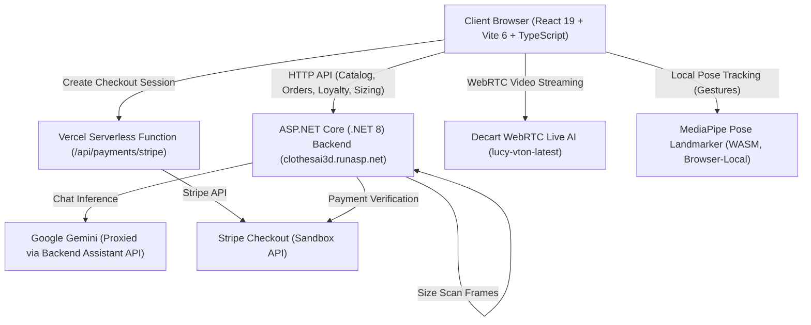
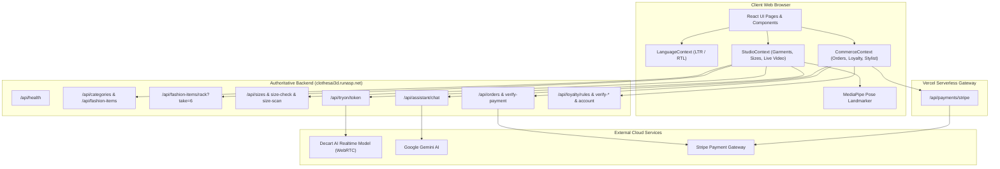
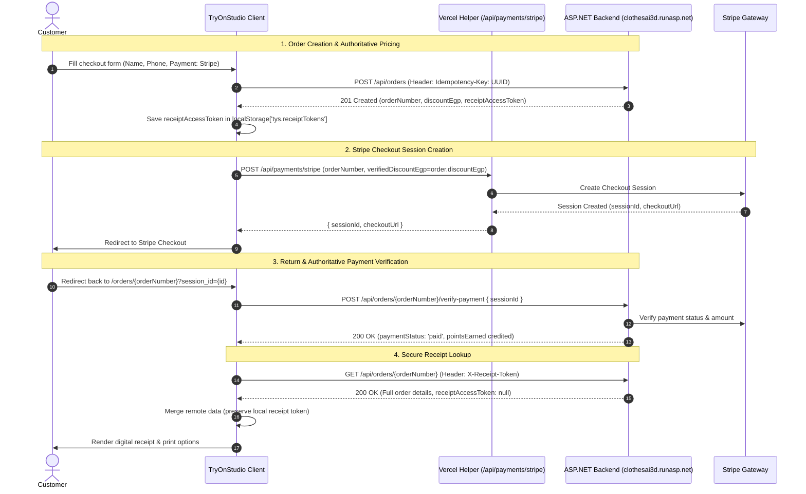

# Try On Studio

A next-generation virtual fitting room and fashion e-commerce progressive web application. **Try On Studio** pairs real-time camera-based clothing visualization powered by Decart AI with AI-assisted body size scanning, intelligent conversational styling powered by Google Gemini on the backend, and an integrated e-commerce checkout supporting Cash on Delivery, Stripe Sandbox payments, and a verified customer loyalty rewards ledger.

---

## Table of Contents

- [1. Project Overview](#1-project-overview)
  - [What is Try On Studio?](#what-is-try-on-studio)
  - [Target Users](#target-users)
  - [Verified Operational Capabilities vs. External Dependencies](#verified-operational-capabilities-vs-external-dependencies)
- [2. Actual Technology Stack](#2-actual-technology-stack)
- [3. Verified Project Structure](#3-verified-project-structure)
- [4. Application Architecture & Data Flow](#4-application-architecture--data-flow)
  - [4.1 System Architecture](#41-system-architecture)
  - [4.2 Application Bootstrap & Provider Hierarchy](#42-application-bootstrap--provider-hierarchy)
- [5. Features & User Journeys](#5-features--user-journeys)
  - [5.1 Product Discovery & 360° Rotational Rack](#51-product-discovery--360-rotational-rack)
  - [5.2 Realtime Virtual Try-On (Decart WebRTC)](#52-realtime-virtual-try-on-decart-webrtc)
  - [5.3 MediaPipe Hand-Swipe Gesture Navigation](#53-mediapipe-hand-swipe-gesture-navigation)
  - [5.4 AI Fashion Stylist (Native Backend Integration)](#54-ai-fashion-stylist-native-backend-integration)
  - [5.5 AI Camera Body Size Scan & Fit Estimation](#55-ai-camera-body-size-scan--fit-estimation)
  - [5.6 Single-Product Checkout & Idempotency](#56-single-product-checkout--idempotency)
  - [5.7 Stripe Payments & Backend Payment Verification](#57-stripe-payments--backend-payment-verification)
  - [5.8 Customer Loyalty Rewards & Verification Behavior](#58-customer-loyalty-rewards--verification-behavior)
  - [5.9 Digital Receipts & Tokenized Persistence](#59-digital-receipts--tokenized-persistence)
  - [5.10 Bi-Directional Arabic (RTL) & English (LTR) Localization](#510-bi-directional-arabic-rtl--english-ltr-localization)
  - [5.11 Responsive Mobile & Desktop Layouts](#511-responsive-mobile--desktop-layouts)
- [6. Authoritative Backend Contract & Swagger API Reference](#6-authoritative-backend-contract--swagger-api-reference)
  - [6.1 Source of Truth & Critical Route Corrections](#61-source-of-truth--critical-route-corrections)
  - [6.2 Standard Error Response Structure & HTTP Status Codes](#62-standard-error-response-structure--http-status-codes)
  - [6.3 Authoritative Rate Limits](#63-authoritative-rate-limits)
  - [6.4 Health & Media Endpoints](#64-health--media-endpoints)
  - [6.5 Catalog & Categories Endpoints](#65-catalog--categories-endpoints)
  - [6.6 Sizing & Camera Body Scan Endpoints](#66-sizing--camera-body-scan-endpoints)
  - [6.7 Virtual Try-On Token Endpoint](#67-virtual-try-on-token-endpoint)
  - [6.8 AI Fashion Assistant Endpoints](#68-ai-fashion-assistant-endpoints)
  - [6.9 Orders & Payment Verification Endpoints](#69-orders--payment-verification-endpoints)
  - [6.10 Customer Loyalty Program Endpoints](#610-customer-loyalty-program-endpoints)
  - [6.11 Frontend Serverless Helper Routes (Non-Swagger)](#611-frontend-serverless-helper-routes-non-swagger)
- [7. Order, Stripe, Receipt & Loyalty Workflows](#7-order-stripe-receipt--loyalty-workflows)
  - [7.1 Single-Product Order Creation & Price Validation](#71-single-product-order-creation--price-validation)
  - [7.2 Stripe Hosted Checkout & Backend Synchronization](#72-stripe-hosted-checkout--backend-synchronization)
  - [7.3 Digital Receipt & `X-Receipt-Token` Authorization](#73-digital-receipt--x-receipt-token-authorization)
  - [7.4 Loyalty Verification & Redemption Rules](#74-loyalty-verification--redemption-rules)
- [8. Environment Variables & Local Setup](#8-environment-variables--local-setup)
- [9. Testing & Verification Status](#9-testing--verification-status)
  - [9.1 Verification Hierarchy & Test Categorization](#91-verification-hierarchy--test-categorization)
  - [9.2 Verified Automated Test Results](#92-verified-automated-test-results)
  - [9.3 17-Step Full User Journey Integration Checklist](#93-17-step-full-user-journey-integration-checklist)
- [10. Developer Contribution Guide & Git Workflow](#10-developer-contribution-guide--git-workflow)
- [11. Team Assignments](#11-team-assignments)
  - [Person 1 — Clothing Catalog & Product Browsing](#person-1--clothing-catalog--product-browsing)
  - [Person 2 — Interactive Studio, Virtual Try-On & Size Detection](#person-2--interactive-studio-virtual-try-on--size-detection)
  - [Person 3 — Cart & Shopping Selection Management](#person-3--cart--shopping-selection-management)
  - [Person 4 — Loyalty Program & Points Management](#person-4--loyalty-program--points-management)
  - [Person 5 — Checkout, Orders, Payments & Digital Receipts](#person-5--checkout-orders-payments--digital-receipts)
  - [Shared Team Integration Rules](#shared-team-integration-rules)
- [12. Documentation Index](#12-documentation-index)

---

## 1. Project Overview

### What is Try On Studio?
Try On Studio bridges the physical fitting room experience and modern digital commerce. E-commerce shoppers frequently abandon carts or return apparel due to sizing uncertainty, color mismatch, and lack of styling advice. Try On Studio resolves these pain points by enabling customers to:

- Browse a curated catalog of apparel categorized into T-Shirts, Polo Shirts, Hoodies, and Jackets.
- Inspect garments using an interactive **360° rotational rack** that preloads approximately 24 ordered frames captured around each garment (ordered back to front).
- Step in front of their webcam to experience **real-time AI garment try-on** powered by Decart AI (`lucy-vton-latest`) over WebRTC.
- Switch garment variants hands-free while in front of the camera using **MediaPipe hand-swipe gestures**.
- Scan their physical body proportions via computer vision camera frame capture to receive **authoritative size recommendations** (`S`, `M`, `L`, `XL`, etc.) with borderline range warnings directly from the backend.
- Consult an embedded **AI Fashion Assistant** powered natively by the backend, dynamically discovering model capabilities and grounded with live catalog inventory, personal undertone analysis, and body proportion guidance.
- Complete single-item purchases with transparent dual-currency pricing (USD and EGP at 50 EGP/USD), supporting **Cash on Delivery** and **Stripe Sandbox**.
- Earn and redeem **customer loyalty points** backed by secure OTP verification and an authoritative backend ledger.

### Target Users
- **Shoppers:** Individuals seeking accurate sizing, realistic visual previews, and tailored styling advice before ordering.
- **Retailers & Brands:** Fashion merchandisers looking to decrease e-commerce return rates and increase purchase conversion through high-fidelity visual try-on.
- **Developers & Integrators:** Engineers integrating headless commerce, WebRTC media streams, and computer-vision microservices into a unified web application.

### Verified Operational Capabilities vs. External Dependencies

| Capability | Local Frontend Engine | Backend API (`clothesai3d.runasp.net`) | External Provider / Status |
| :--- | :--- | :--- | :--- |
| **Catalog & Products** | In-memory cache & React state | Authoritative SQL DB & Media CDN | Fully operational (15 products, 4 categories, 425 media assets) |
| **360° Clothing Rack** | Canvas frame rotation & gesture drag | Ordered ~24-frame WebP sequence (`/api/fashion-items/rack?take=6`) | Fully operational (frames ordered back to front) |
| **Realtime Try-On** | WebRTC video player & camera stream | Token proxy (`POST /api/tryon/token`) | Decart AI WebRTC service (`lucy-vton-latest`). Ephemeral tokens (~2 min; never persisted) |
| **Hand-Swipe Gesture** | In-browser MediaPipe Pose Landmarker | None (client-side edge compute) | Runs locally at 30–60 FPS with zero network overhead |
| **Camera Size Scan** | 20-frame camera capture (3 sec) | `POST /api/fashion-items/{id}/size-scan` | Upstream AI service proxy. Returns size + borderline range |
| **AI Stylist Chat** | Slide-out panel & product cards | `GET/POST /api/assistant/chat` | Native backend proxy to Google Gemini. 55s timeout, rate-limited at 18 req/min |
| **Order Placement** | Draft preparation & checkout form | `POST /api/orders` | ASP.NET Core DB. Authoritative server pricing, single-item orders only |
| **Stripe Checkout** | Client redirect & return handler | `POST /api/orders/{id}/verify-payment` | Vercel helper `api/payments/stripe.ts` creates session; backend confirms payment |
| **Loyalty Ledger** | In-memory verified token state | `POST /api/loyalty/verify-*`, `GET /account` | Demo mode: fixed OTP `123456`, in-memory token (never persisted), no SMS gateway |
| **Digital Receipt** | Receipt view & print handler | `GET /api/orders/{orderNumber}` | Requires `X-Receipt-Token`. Token stored in `localStorage['tys.receiptTokens']` |

---

## 2. Actual Technology Stack



Verified directly against [package.json](file:///c:/Users/Gamal%202003/TryOnStudio/package.json) and project source files:

- **Frontend Core:** React 19 (`^19.1.0`), React DOM (`^19.1.0`), TypeScript (`~5.8.3`), Vite (`^6.3.5`).
- **Routing:** React Router DOM (`^7.6.0`) using HTML5 history routing via `BrowserRouter`.
- **Computer Vision & AI:** `@mediapipe/tasks-vision` (`1.2.0`) with WebAssembly runtime; `@decartai/sdk` (`^0.2.14`) for WebRTC virtual try-on.
- **Icons & Presentation:** Lucide React (`^1.65.0`).
- **Styling & Design System:** Pure Vanilla CSS Design System (`tokens.css`, `global.css`, `studio.css`, `commerce.css`). Fully responsive, zero heavy external utility frameworks.
- **Testing & Code Quality:** Vitest (`^3.1.3`), ESLint (`^9.25.0`), TypeScript compiler check (`tsc -b --noEmit`).
- **Backend Infrastructure:** ASP.NET Core (.NET 8) hosted on `https://clothesai3d.runasp.net` with IIS reverse proxy.

---

## 3. Verified Project Structure

```text
TryOnStudio/
├── .github/
│   └── workflows/
│       └── ci.yml                          # Automated CI: Typecheck, Lint, Test, Build
├── api/                                    # Vercel Serverless Gateway Functions
│   ├── assistant/
│   │   └── chat.ts                         # Legacy Vercel assistant fallback (pending deprecation)
│   └── payments/
│       └── stripe.ts                       # Stripe Checkout session creator (Sandbox)
├── docs/                                   # Engineering & Quality Documentation
│   ├── API_INTEGRATION_MATRIX.md           # Complete endpoint verification matrix
│   ├── FRONTEND_INTEGRATION_AUDIT.md       # Architectural audit report
│   └── PRODUCTION_READINESS_CHECKLIST.md   # Release readiness checklist
├── reference/                              # Authoritative Specifications & Handoffs
│   ├── BACKEND_COMMERCE_SPEC.md            # Authoritative backend commerce contract
│   ├── FRONTEND_GUIDE.md                   # Try On Studio mirror implementation guide
│   ├── FRONTEND_MESSAGE.md                 # Initial backend delivery notes
│   └── FRONTEND_MESSAGE_SIZE_SCAN.md       # Camera size scan integration notes
├── BACKEND_COMMERCE_SPEC.md                # Authoritative root commerce contract copy
├── src/
│   ├── __tests__/                          # Automated Vitest test suites
│   │   ├── commerce.test.ts                # Cart, pricing, loyalty, and checkout unit tests
│   │   ├── liveBackend.test.ts             # Live backend contract integration test suite
│   │   └── tryOnStudio.test.ts             # Studio and size recommendation unit tests
│   ├── app/                                # Application Entrypoint, Pages & Contexts
│   │   ├── pages/
│   │   │   ├── BrowsePage.tsx              # Catalog filtering, search, and category view
│   │   │   ├── CheckoutPage.tsx            # Single-product checkout, COD/Stripe, points redemption
│   │   │   ├── FashionAssistantPage.tsx    # Standalone AI Stylist chat view
│   │   │   ├── HowItWorksPage.tsx          # Educational walkthrough of virtual try-on
│   │   │   ├── LoyaltyPage.tsx             # OTP challenge, ledger balance, transaction history
│   │   │   ├── ReceiptPage.tsx             # Digital receipt view, Stripe payment confirmation
│   │   │   ├── SizeGuidePage.tsx           # Global sizing charts and fit guide
│   │   │   └── StudioPage.tsx              # Interactive Studio, live try-on, size scanning
│   │   ├── App.tsx                         # BrowserRouter root shell and route definitions
│   │   ├── CommerceContext.tsx             # Commerce state (orders, loyalty, assistant, pricing)
│   │   └── StudioContext.tsx               # Studio state (catalog, outfit selection, camera)
│   ├── components/                         # Shared Presentation Components
│   │   ├── GarmentImage.tsx                # Resilient image loader with CDN retry
│   │   └── Layout.tsx                      # Global navigation header, language toggle, footer
│   ├── features/                           # Domain Feature Modules
│   │   ├── assistant/
│   │   │   ├── AssistantFloatingDrawer.tsx # Slide-out AI Stylist chat drawer
│   │   │   └── FashionAssistantPanel.tsx   # Reusable chat interface and product cards
│   │   ├── catalog/
│   │   │   ├── ClothingRack360.tsx         # 360° rotational garment rack
│   │   │   ├── GarmentSelectorPanel.tsx    # Category tabs and garment grid
│   │   │   └── SelectedOutfitCard.tsx      # Current outfit details, size selector, try-on actions
│   │   ├── size-scan/
│   │   │   ├── SizeResultCard.tsx          # Recommended size, alternative, borderline badge
│   │   │   ├── SizeScanPanel.tsx           # Camera instructions, 3-2-1 countdown, scanning state
│   │   │   └── useSizeScan.ts              # Multi-frame capture and upload hook
│   │   └── tryon/
│   │       ├── CameraMirrorPanel.tsx       # Webcam mirror and WebRTC video overlay
│   │       ├── swipeDetector.ts            # Mathematical hand-swipe gesture detector
│   │       ├── useDecartTryOn.ts           # Decart WebRTC session lifecycle hook
│   │       ├── useGestureNavigation.ts     # MediaPipe pose tracking loop
│   │       └── WorkflowStepsRail.tsx       # Sequential workflow progression indicators
│   ├── hooks/
│   │   └── useCamera.ts                    # Webcam stream acquisition and track management
│   ├── i18n/
│   │   └── LanguageContext.tsx             # Bilingual dictionary (English/Arabic) and RTL engine
│   ├── services/                           # Authoritative Backend API Clients
│   │   ├── captureFrames.ts                # Video canvas frame extractor (1280px max)
│   │   ├── commerceApi.ts                  # Orders, loyalty, assistant, and payment client
│   │   └── fashionApi.ts                   # Catalog, categories, rack, sizes, and scan client
│   ├── styles/                             # Pure Vanilla CSS Design System
│   │   ├── commerce.css                    # Checkout, receipt, loyalty, and assistant styles
│   │   ├── global.css                      # Reset, typography, layout primitives
│   │   ├── studio.css                      # Studio, rack, camera, and try-on styles
│   │   └── tokens.css                      # CSS custom properties (colors, radii, elevation)
│   ├── types/                              # Authoritative TypeScript Data Contracts
│   │   ├── api.ts                          # Catalog, sizing, tryon, and error types
│   │   └── commerce.ts                     # Orders, checkout, loyalty, and assistant types
│   ├── utils/                              # Pure Helper Functions
│   │   ├── commerceHelpers.ts              # Currency formatting, dual price display, masking
│   │   └── garmentHelpers.ts               # Garment classification and prompt utilities
│   ├── main.tsx                            # React application bootstrap entrypoint
│   └── vite-env.d.ts                       # Environment variable type declarations
├── package.json                            # Scripts and dependencies
├── tsconfig.json                           # TypeScript compiler configuration
├── vercel.json                             # Vercel deployment and routing rules
└── vite.config.ts                          # Vite build and test configuration
```

---

## 4. Application Architecture & Data Flow

### 4.1 System Architecture



### 4.2 Application Bootstrap & Provider Hierarchy
The application wraps all views inside a deterministic hierarchy of context providers in `src/app/App.tsx`:

1. `LanguageProvider`: Injects active language (`'en'` | `'ar'`), text direction (`'ltr'` | `'rtl'`), and the localized dictionary.
2. `BrowserRouter`: HTML5 history routing (`react-router-dom`).
3. `StudioProvider`: Loads catalog items, manages current outfit selection, controls camera streams, and evaluates size availability.
4. `CommerceProvider`: Manages checkout drafts, executes orders, handles loyalty OTP challenges, manages in-memory verification tokens, and controls the AI Stylist conversation.
5. `Layout`: Shared navigation header, language toggle, and footer wrapping active page routes.

---

## 5. Features & User Journeys

### 5.1 Product Discovery & 360° Rotational Rack
- **Browse Catalog:** Customers filter by category or search by keywords.
- **360° Clothing Rack:** Fetches items from `GET /api/fashion-items/rack?take=6`. Each item contains approximately 24 ordered WebP rotation frames (`frames[0]` = back view, last frame = front view). Users rotate garments by dragging horizontally across the canvas.
- **Garment Cards:** Render prices in USD and EGP (at 50 EGP/USD) with color swatches and available size pills.

### 5.2 Realtime Virtual Try-On (Decart WebRTC)
- **Token Acquisition:** Ephemeral WebRTC client token requested via `POST /api/tryon/token`.
- **Peer Connection:** Connects directly to Decart model `lucy-vton-latest` using `@decartai/sdk`.
- **Variant Prompting:** Drapes garment using the variant's `tryOnPrompt` and high-resolution image URL.
- **Security:** Tokens have a ~2-minute lifespan and are **never persisted**.

### 5.3 MediaPipe Hand-Swipe Gesture Navigation
- Runs client-side MediaPipe Pose Landmarker on the camera stream via `useGestureNavigation.ts` and `swipeDetector.ts`.
- Analyzes wrist and hip coordinates: horizontal travel of $\ge 0.85$ shoulder widths in $< 0.7$ seconds with a 1.5-second cooldown cycles to the next/previous color variant hands-free.

### 5.4 AI Fashion Stylist (Native Backend Integration)
- Embedded chat drawer (`AssistantFloatingDrawer.tsx`) and full page (`FashionAssistantPage.tsx`) connected to backend `POST /api/assistant/chat`.
- Provides personalized style advice in English or Arabic, grounded by active catalog items.
- Displays 0–4 real catalog recommendations as interactive product cards.
- Respects a 55-second request timeout and dynamically reads the active model from the backend.

### 5.5 AI Camera Body Size Scan & Fit Estimation
- **Capture Process:** The user stands 1–2 metres back; the frontend currently captures 20 camera frames over approximately 3 seconds (scaled to $\le 1280$px).
- **Upload:** Submits multipart form-data to `POST /api/fashion-items/{id}/size-scan` (browser automatically generates multipart boundary).
- **Result:** Returns recommended size, alternative size, confidence score, and `borderline` flag.
- **Display Rule:** When `borderline: true`, the UI displays `sizeRange` (e.g. "Between M and L"). When `false`, displays `size`.

### 5.6 Single-Product Checkout & Idempotency
- **Single-Product Constraint:** The authoritative backend creates orders for **exactly one clothing item**. Multi-item cart checkout is constrained to single-product checkout.
- **Idempotency:** Generates a unique UUID in the `Idempotency-Key` header to prevent duplicate orders during retries.
- **Server Pricing:** Backend recalculates prices; client prices and totals are previews only and are never trusted as authoritative.
- **Inventory/Stock Rule:** Sizing availability from the backend indicates manufacturability, not inventory stock availability.

### 5.7 Stripe Payments & Backend Payment Verification
- Stripe Checkout session created via Vercel helper `POST /api/payments/stripe`.
- Payment verified on return via backend `POST /api/orders/{orderNumber}/verify-payment` using `{ "sessionId": "..." }`.
- Backend marks order as `paid` and awards loyalty points.
- If Stripe is selected but payable total is zero, backend handles `zero_payable_total`; user must choose COD.

### 5.8 Customer Loyalty Rewards & Verification Behavior
- **Earning:** 1 point per 10 EGP spent on the final paid total (`Math.Floor(finalTotalEgp / 10)`).
- **Redemption:** 100 points = 10 EGP discount (multiples of 100, up to 100% of order value).
- **Verification:** Phone OTP challenge (`POST /api/loyalty/verify-request`, demo code `123456`) returns a verification token.
- **Security Rule:** Verification token is kept **strictly in React memory only**; never saved to `localStorage`, `sessionStorage`, or cookies.

### 5.9 Digital Receipts & Tokenized Persistence
- Order creation returns `receiptAccessToken` once in the `201 Created` response.
- Stored by order number in `localStorage` under `tys.receiptTokens`.
- Subsequent retrieval via `GET /api/orders/{orderNumber}` requires `X-Receipt-Token` header.
- Remote GET returns `receiptAccessToken: null`. Frontend merges remote data while preserving the locally stored token.
- No fake fallback orders or fake receipts are ever presented as successful purchases.

### 5.10 Bi-Directional Arabic (RTL) & English (LTR) Localization
- Seamless toggle between Arabic and English across all UI components.
- Arabic uses RTL layout, Cairo typography, and native translations.
- Product names, prices, and size codes remain unchanged in English/numbers wrapped in `<bdi>` tags.

### 5.11 Responsive Mobile & Desktop Layouts
- **Mobile (< 640px):** Single-column stacked layouts, sticky action bar, compact floating AI assistant button.
- **Tablet (640px–1024px):** Dual-column layout with collapsible navigation.
- **Desktop (1024px+):** Multi-column studio experience with live camera mirror, 360° rack, and variant selectors.

---

## 6. Authoritative Backend Contract & Swagger API Reference

### 6.1 Source of Truth & Critical Route Corrections

The authoritative backend runs at `https://clothesai3d.runasp.net`. Swagger is published at `https://clothesai3d.runasp.net/swagger`.

> [!IMPORTANT]
> The project owner's latest backend handoff takes precedence over older documentation or outdated Swagger annotations whenever a conflict arises.

| Outdated / Deprecated Route | Authoritative Correct Route | Method | Notes |
| :--- | :--- | :---: | :--- |
| `/api/loyalty/challenge` | `/api/loyalty/verify-request` | `POST` | Initiates OTP challenge (demo code `123456`) |
| `/api/loyalty/verify` | `/api/loyalty/verify-confirm` | `POST` | Validates OTP and issues scoped verification token |
| `/api/loyalty/account/{phone}` | `/api/loyalty/account` | `GET` | Requires `Authorization: Bearer <verificationToken>` header |
| `/api/fashion-items/categories` | `/api/categories` | `GET` | Top-level categories endpoint |
| `/api/fashion-items/rack-items` | `/api/fashion-items/rack?take=6` | `GET` | Query parameter clamped 1–20; returns ~24 ordered frames |
| `POST /api/fashion-items/size-check` | `POST /api/fashion-items/{id}/size-check` | `POST` | Item ID is a required path parameter |

---

### 6.2 Standard Error Response Structure & HTTP Status Codes

All backend endpoints return standardized error payloads:
```json
{
  "error": "Descriptive error message.",
  "code": "error_identifier_code",
  "errors": {
    "FieldName": ["Validation failure description"]
  }
}
```

#### Confirmed HTTP Status Behavior:

| HTTP Status | Meaning | Application Handling |
| :---: | :--- | :--- |
| **200** | Successful request | Process JSON response body. |
| **201** | Resource / order created | Order created successfully; extract `receiptAccessToken`. |
| **304** | Cached response | Browser uses cached asset (ETag match). |
| **400** | Validation error | Display validation errors from `errors` object. Loyalty returns `invalid_code`. |
| **401** | Unauthorized | Missing, invalid, or expired loyalty token (`Authorization: Bearer <token>`). |
| **403** | Phone mismatch | Authenticated token phone does not match checkout customer phone. |
| **404** | Not Found | Resource missing, or order not found / invalid `X-Receipt-Token`. |
| **409** | Conflict | Business conflict: `balance_changed`, `idempotency_key_reused`, or product has no sizes. |
| **413** | Payload too large | Frame upload exceeds 2 MB per image or 20 MB total. |
| **422** | Size scan failed | AI engine could not compute body measurements (`no_pose`, `too_close`, `turned`, `bad_height`). |
| **429** | Rate limited | IP limit reached. Read and honor the `Retry-After` header. Loyalty returns `otp_locked`. |
| **502** | Provider unavailable | Upstream AI engine (Decart, size scanner) waking up or unreachable. |
| **503** | Service not configured | Required server feature or secret is unconfigured. |
| **500** | Server error | Unexpected internal server error; display retry action. |

---

### 6.3 Authoritative Rate Limits

Rate limits enforced per IP per minute by the ASP.NET Core backend:

| Operation | Limit (req/min/IP) | Notes |
| :--- | :---: | :--- |
| **Try-On Token (`/api/tryon/token`)** | 10 | Ephemeral token acquisition for WebRTC |
| **Size Scan (`/api/fashion-items/{id}/size-scan`)** | 10 | Multi-frame camera upload |
| **Assistant Chat (`/api/assistant/chat`)** | 18 | Conversational AI stylist inference |
| **Orders & Payment Verification (`/api/orders/*`)** | 10 | Combined limit for order creation and payment confirmation |
| **Loyalty OTP Challenges (`/api/loyalty/verify-*`)** | 10 | Combined limit for challenge request and confirmation |

---

### 6.4 Health & Media Endpoints

#### `GET /api/health`
- **Purpose:** Server telemetry, database connectivity, and upstream provider status.
- **Response (`200 OK`):**
  ```json
  {
    "status": "healthy",
    "database": "ok",
    "storage": "writable",
    "products": 15,
    "mediaFiles": 425,
    "missingFiles": 0,
    "aiSizeService": "ok"
  }
  ```

#### `GET /api/media/{id}`
- **Format:** WebP binary format.
- **Caching:** Immutable 1-year cache duration (`Cache-Control: public, max-age=31536000, immutable`).
- **Headers:** Supports ETag validation and CORS (`*`).
- **Usage:** Clients must use the exact media URL returned by backend responses.

---

### 6.5 Catalog & Categories Endpoints

#### `GET /api/categories`
- **Response (`200 OK`):**
  ```json
  [
    { "id": 1, "name": "T-Shirts", "slug": "t-shirts", "itemCount": 7 },
    { "id": 2, "name": "Polo Shirts", "slug": "polo-shirts", "itemCount": 2 },
    { "id": 3, "name": "Hoodies & Sweatshirts", "slug": "hoodies", "itemCount": 4 },
    { "id": 4, "name": "Jackets", "slug": "jackets", "itemCount": 2 }
  ]
  ```

#### `GET /api/categories/{categoryId}/fashion-items`
- Retrieves items belonging to a specific category ID.

#### `GET /api/fashion-items`
- **Query Parameters:** `CategoryId` (int32, optional), `Search` (string, optional).
- Returns filtered array of catalog items.

#### `GET /api/fashion-items/rack?take=6`
- **Query Parameters:** `take` (int32, clamped 1–20, default 6).
- **Response (`200 OK`):** Array of rack items. Rack `id` is a **string**.
- **Frames:** Returns approximately 24 WebP frames ordered from back to front (`frames[0]` = back view, last frame = front view).

#### `GET /api/fashion-items/{id}`
- Returns full product details with `variants[]` and `availableSizes[]`.

#### `GET /api/fashion-items/{id}/variants`
- Returns array of color variants with `colorName`, `colorHex`, `imageUrl`, and `tryOnPrompt`.

---

### 6.6 Sizing & Camera Body Scan Endpoints

#### `GET /api/sizes`
- **Response (`200 OK`):** `["XS","S","M","L","XL","XXL","XXXL"]`.

#### `GET /api/fashion-items/{id}/sizes`
- **Response (`200 OK`):** Manufactured sizes available for the item (e.g. `["S","M","XXL"]`).

#### `POST /api/fashion-items/{id}/size-check`
- **Request Body:** `{ "size": "L" }`.
- **Response (`200 OK`):**
  ```json
  {
    "fashionItemId": 8,
    "requestedSize": "L",
    "isAvailable": false,
    "availableSizes": ["S","M","XXL"],
    "nearestAvailableSizes": ["M","XXL"]
  }
  ```

#### `POST /api/fashion-items/{id}/size-scan`
- **Content-Type:** `multipart/form-data` (browser automatically generates multipart boundary).
- **Backend Acceptance:** 8–40 JPEG/PNG frames, max 2 MB per image, max 20 MB total upload.
- **Frontend Current Capture:** Captures 20 JPEG frames over ~3 seconds, max dimension 1280px.
- **Timeout:** 60 seconds.
- **Response (`200 OK`):**
  ```json
  {
    "size": "M",
    "alternative": "L",
    "borderline": true,
    "sizeRange": "M-L",
    "confidence": "high"
  }
  ```
- **Display Rule:** When `borderline: true`, the UI displays `sizeRange` (e.g. "Between M and L"). When `false`, displays `size`.
- **Error Codes on 422:** `no_pose`, `too_close`, `turned`, `bad_height`.
- **Error on 409:** Indicates the selected product has no available sizes.

---

### 6.7 Virtual Try-On Token Endpoint

#### `POST /api/tryon/token`
- **Request Body:** `{}` (empty JSON object).
- **Response (`200 OK`):** `{ "apiKey": "eyJhbGciOi...", "expiresAt": "2026-11-11T05:00:00Z" }`.
- **Model:** Scoped for `lucy-vton-latest`. Token validity is ~2 minutes. Never persist to disk or storage.

---

### 6.8 AI Fashion Assistant Endpoints

#### `GET /api/assistant/chat`
- **Response (`200 OK`):** Telemetry:
  ```json
  {
    "configured": true,
    "provider": "google-gemini",
    "model": "gemini-3.5-flash",
    "usdToEgpRate": 50
  }
  ```
  *Note:* The model name must be read dynamically from the backend rather than hardcoded.

#### `POST /api/assistant/chat`
- **Timeout:** 55 seconds.
- **Constraints:** Last 16 messages evaluated; latest message must be from `user` (max 1200 characters).
- **Request Body:**
  ```json
  {
    "messages": [
      { "role": "user", "content": "Suggest a stylish jacket for cooler evenings." }
    ],
    "language": "en",
    "context": {
      "selectedItem": { "id": 1, "name": "Minimalist Denim Jacket", "categoryName": "Jackets", "priceUsd": 45 },
      "outfitConfirmed": true,
      "scannedSize": "L",
      "stylePreferences": { "aesthetic": "Casual", "fit": "Regular", "budgetEgp": 3000 },
      "verifiedLoyaltyPoints": 450
    }
  }
  ```
- **Response (`200 OK`):**
  ```json
  {
    "reply": "The Minimalist Denim Jacket in Classic Indigo pairs well with neutral chinos...",
    "model": "gemini-3.5-flash",
    "recommendedItems": [
      {
        "id": 1,
        "name": "Minimalist Denim Jacket",
        "categoryName": "Jackets",
        "priceUsd": 45.0,
        "priceEgp": 2250,
        "thumbnailUrl": "https://clothesai3d.runasp.net/api/media/denim-1",
        "variantCount": 5
      }
    ]
  }
  ```
- **Recommendations:** May return 0 to 4 real catalog items.

---

### 6.9 Orders & Payment Verification Endpoints

#### `POST /api/orders`
- **Headers:** `Content-Type: application/json`, `Idempotency-Key: <UUID>`.
- **Constraint:** Single clothing product per order only.
- **Request Body (`CreateOrderPayload`):**
  ```json
  {
    "fashionItemId": 1,
    "variantId": 1,
    "size": "L",
    "quantity": 1,
    "customer": {
      "fullName": "Mohamed Gamal",
      "phone": "01012345678"
    },
    "paymentMethod": "cod",
    "pointsToRedeem": 500,
    "loyaltyVerificationToken": "tok_loyalty_98234_abc"
  }
  ```
- **Status Responses:**
  - `201 Created`: New order created.
  - `200 OK`: Idempotent duplicate request returned identical existing order.
- **Response Fields:**
  ```json
  {
    "orderNumber": "TYS-20261111-8921",
    "receiptNumber": "REC-TYS-20261111-8921",
    "transactionReference": "COD-TYS-20261111-8921",
    "customerName": "Mohamed Gamal",
    "customerPhoneMasked": "010••••••78",
    "currency": "EGP",
    "items": [...],
    "subtotalEgp": 2250,
    "discountEgp": 50,
    "pointsRedeemed": 500,
    "finalTotalEgp": 2200,
    "paymentMethod": "cod",
    "paymentStatus": "pending_collection",
    "orderStatus": "confirmed",
    "createdAt": "2026-11-11T05:00:00Z",
    "pointsEarned": 220,
    "updatedLoyaltyBalance": 450,
    "checkoutUrl": null,
    "receiptAccessToken": "rcpt_sec_9942a8b3e"
  }
  ```

#### `GET /api/orders/{orderNumber}`
- **Required Header:** `X-Receipt-Token: <receiptAccessToken>`.
- **Response (`200 OK`):** Authoritative order and digital receipt.
- *Crucial Rule:* The backend response intentionally returns `"receiptAccessToken": null`. Clients must **preserve** their locally stored receipt token when merging remote order data.

#### `POST /api/orders/{orderNumber}/verify-payment`
- **Request Body:** `{ "sessionId": "cs_test_..." }`.
- **Response (`200 OK`):** Authoritative verification of completed Stripe session. Transitions status to `paid` / `confirmed` and permanently awards loyalty points.

---

### 6.10 Customer Loyalty Program Endpoints

#### `GET /api/loyalty/rules`
- **Response (`200 OK`):**
  ```json
  {
    "earnUnitAmountEgp": 10.0,
    "pointsEarnedPerUnit": 1,
    "redemptionBlockPoints": 100,
    "redemptionBlockValueEgp": 10.0,
    "minRedemptionPoints": 100,
    "maxRedemptionRatio": 1.0
  }
  ```

#### `POST /api/loyalty/verify-request`
- **Request Body:** `{ "phone": "01012345678" }`.
- **Response (`200 OK`):** `{ "challengeSent": true, "expiresInSeconds": 300, "message": "Demo mode: no SMS is sent. Enter the code 123456." }`.
- *Demo Note:* Fixed code `123456`. Expires in 5 minutes. Max 5 wrong attempts then `429 otp_locked` (not 404).

#### `POST /api/loyalty/verify-confirm`
- **Request Body:** `{ "phone": "01012345678", "code": "123456" }`.
- **Response (`200 OK`):** Returns `verificationToken` (30 min expiry), `expiresAt`, and `account` summary.
- *Security Rule:* Store strictly in React memory only. Never persist to disk or storage.

#### `GET /api/loyalty/account`
- **Required Header:** `Authorization: Bearer <verificationToken>`.
- **Response (`200 OK`):** `LoyaltyAccountSummary`.

---

### 6.11 Frontend Serverless Helper Routes (Non-Swagger)

#### `POST /api/payments/stripe` (Vercel Serverless Function)
- **Implementation:** `api/payments/stripe.ts`.
- **Request Body:**
  ```json
  {
    "orderNumber": "TYS-20261111-8921",
    "fashionItemId": 1,
    "variantId": 1,
    "size": "L",
    "quantity": 1,
    "verifiedDiscountEgp": 50,
    "idempotencyKey": "chk-uuid"
  }
  ```
  *Crucial Rule:* `verifiedDiscountEgp` **must equal** `order.discountEgp` from the backend order creation response (never client `appliedDiscountEgp`).
- **Response (`200 OK`):** `{ "sessionId": "cs_...", "checkoutUrl": "https://checkout.stripe.com/...", "mode": "sandbox" }`.

#### `GET /api/payments/stripe` (Vercel Serverless Function)
- **Status:** Legacy / diagnostic only. The authoritative payment verification process is handled by backend `POST /api/orders/{orderNumber}/verify-payment`.

---

## 7. Order, Stripe, Receipt & Loyalty Workflows



### 7.1 Single-Product Order Creation & Price Validation
1. Customer selects a garment, variant, and size.
2. Proceeds to `/checkout` and enters full name (3–100 chars) and mobile phone.
3. Client submits single-item payload to `POST /api/orders` with a unique UUID in `Idempotency-Key`.
4. Backend recalculates prices (50 EGP/USD), validates loyalty token if points are redeemed, and persists order.
5. Returns 201 Created with `orderNumber`, `finalTotalEgp`, and `receiptAccessToken`.

### 7.2 Stripe Hosted Checkout & Backend Synchronization
1. For Stripe orders, client calls Vercel helper `POST /api/payments/stripe` passing `verifiedDiscountEgp = order.discountEgp`.
2. Vercel creates session and returns `checkoutUrl`.
3. Customer completes payment on Stripe and redirects to `/orders/{orderNumber}?session_id={id}`.
4. Client immediately triggers backend `POST /api/orders/{orderNumber}/verify-payment` with `{ sessionId }`.
5. Backend verifies payment with Stripe directly, updates status to `paid`, and permanently awards points.

### 7.3 Digital Receipt & `X-Receipt-Token` Authorization
1. On order creation, client saves `receiptAccessToken` in `localStorage` under `tys.receiptTokens` keyed by order number.
2. When loading `/orders/{orderNumber}`, client sends `X-Receipt-Token`.
3. Backend returns order details with `receiptAccessToken: null`.
4. Client preserves its stored token during state merge, ensuring receipt access survives page refreshes.

### 7.4 Loyalty Verification & Redemption Rules
1. Customer enters phone number on `/loyalty` or during checkout.
2. Initiates challenge (`POST /api/loyalty/verify-request`).
3. Enters demo code `123456` (`POST /api/loyalty/verify-confirm`).
4. Receives temporary verification token stored **in React memory only**.
5. Redeems points in multiples of 100 during checkout.

---

## 8. Environment Variables & Local Setup

### Environment Variables Separation:
- **Frontend Client (`.env` in project root):**
  - `VITE_API_BASE_URL=https://clothesai3d.runasp.net`
  - *Rule:* Never place secret keys (e.g. `STRIPE_SECRET_KEY`) in browser-accessible environment variables.
- **Vercel Serverless Gateway:**
  - `STRIPE_SECRET_KEY=sk_test_...` (Sandbox secret key)
  - `USD_TO_EGP_RATE=50` (Conversion rate fallback)
  - *Legacy Deprecation:* `GEMINI_API_KEY` and `GEMINI_MODEL` on Vercel are deprecated and scheduled for removal once native backend assistant is confirmed in production.

### Local Development Setup:
```bash
# 1. Clone repository
git clone https://github.com/gamalwessam21/TryOnStudio.git
cd TryOnStudio

# 2. Checkout the dev branch
git checkout dev

# 3. Install dependencies
npm install

# 4. Configure local environment (.env)
# VITE_API_BASE_URL=https://clothesai3d.runasp.net

# 5. Start Vite local server
npm run dev
```

### Available Scripts:
- `npm run dev`: Starts Vite local development server on `http://localhost:5173`.
- `npm run build`: Runs TypeScript compiler and Vite production bundle.
- `npm run preview`: Locally previews production build.
- `npm run typecheck`: Validates TypeScript types across the project (`tsc -b --noEmit`).
- `npm run lint`: Runs ESLint check across all files.
- `npm test`: Runs Vitest automated test suite.

---

## 9. Testing & Verification Status

### 9.1 Verification Hierarchy & Test Categorization
To maintain rigorous engineering standards, testing claims are strictly separated into discrete categories:

1. **Frontend Unit Tests:** Client-side business logic, helpers, and component unit tests.
2. **Frontend Integration Tests:** Live contract tests verifying HTTP communication against the deployed ASP.NET Core backend.
3. **Backend Automated HTTP Tests:** 154 automated backend test cases executed on the ASP.NET Core server using mocked external providers (Stripe and Gemini).
4. **Mocked Provider Tests:** Automated runs simulating Decart, Gemini, and Stripe gateway responses.
5. **Real Sandbox End-to-End Tests:** *Pending confirmation* — full end-to-end checkout with real user interaction in Stripe Checkout Sandbox.
6. **Real Production Purchase Tests:** *Pending confirmation* — live real-money transaction verification.

### 9.2 Verified Automated Test Results
- **Frontend Test Suite (`npm test`):**
  - `src/__tests__/commerce.test.ts` (19 tests passed)
  - `src/__tests__/tryOnStudio.test.ts` (10 tests passed)
  - `src/__tests__/liveBackend.test.ts` (1 live integration contract test passed against `https://clothesai3d.runasp.net`)
  - **Total:** 30 passed out of 30 tests.
- **Backend Automated Suite:** 154 automated HTTP tests passed with mocked providers.

### 9.3 17-Step Full User Journey Integration Checklist
- [ ] **1. Browse Products:** Open `/browse`, verify category counts, and search for apparel.
- [ ] **2. Inspect Product Details:** Open product modal, verify image gallery, description, and dual pricing ($ / EGP).
- [ ] **3. Select Variant & Size:** Pick a color swatch and select an available size.
- [ ] **4. Build Outfit:** Navigate to `/studio`, verify selected item appears on the mannequin.
- [ ] **5. Confirm / Unconfirm Outfit:** Click Confirm Outfit; verify stage locks. Click again to unconfirm.
- [ ] **6. Run Virtual Try-On:** Click Try On with AI; verify Decart WebRTC stream opens and drapes garment.
- [ ] **7. Perform Size Scan:** Open camera size scan, stand back 1–2m, complete capture, verify size and borderline result.
- [ ] **8. Add Item to Cart:** Add confirmed item to cart; verify quantity and price breakdown.
- [ ] **9. Verify Loyalty Account:** Open loyalty widget, enter phone, receive challenge, enter demo OTP `123456`.
- [ ] **10. Apply Eligible Points:** Redeem points in multiples of 100; verify discount reflects on order total.
- [ ] **11. Enter Customer Details:** Enter customer full name and phone number on `/checkout`.
- [ ] **12. Create Order:** Submit order with `Idempotency-Key`; verify backend returns 201 Created and order number.
- [ ] **13. Complete Payment:** Choose COD or redirect to Stripe Checkout session.
- [ ] **14. Verify Stripe Payment:** Return from Stripe; verify backend marks order as `paid`.
- [ ] **15. Open Digital Receipt:** View receipt on `/orders/{orderNumber}`; verify line items, discount, and status.
- [ ] **16. Refresh Receipt Page:** Refresh browser; verify receipt re-fetches using stored `X-Receipt-Token`.
- [ ] **17. Confirm Loyalty Ledger:** Open `/loyalty`; verify earned points are credited and ledger updated.

---

## 10. Developer Contribution Guide & Git Workflow

- **`main`:** Production branch. Protected; direct pushes and commits are prohibited.
- **`dev`:** Shared integration branch. All feature branches branch from and target `dev`.
- **Feature Branches:**
  - `feature/catalog-browse` (Person 1)
  - `feature/interactive-studio` (Person 2)
  - `feature/cart` (Person 3)
  - `feature/loyalty` (Person 4)
  - `feature/checkout-receipt` (Person 5)

---

# 11. Team Assignments

The project implementation and maintenance responsibilities are divided among five team members.

---

## Person 1 — Clothing Catalog & Product Browsing

**Main responsibility:** Everything related to browsing, discovering, and viewing clothing products.

### Frontend Tasks
- Implement the Browse Clothing page (`BrowsePage.tsx`).
- Display clothing categories and their products with active category counts.
- Implement category filtering and product search by name and description.
- Implement product cards (`GarmentSelectorPanel.tsx`) with images, names, dual prices ($ / EGP), and color swatches.
- Implement product details panel/modal with full variant picker and available size selector.
- Display product variants and available sizes.
- Implement the clothing rack / 360-degree product viewing experience (`ClothingRack360.tsx`).
- Handle loading skeletons, empty search results, and error recovery states.
- Ensure responsive layout on desktop, tablet, and mobile.

### Backend API Integration
- `GET /api/categories` — Load categories with product counts.
- `GET /api/categories/{id}/fashion-items` — Load products by category ID.
- `GET /api/fashion-items?categoryId=&search=` — Filter and search catalog items.
- `GET /api/fashion-items/{id}` — Load detailed item data with variants and sizes.
- `GET /api/fashion-items/{id}/variants` — Load variant swatches and try-on prompts.
- `GET /api/fashion-items/rack?take=6` — Load 360° rotational rack items.
- `GET /api/sizes` — Load global manufactured size scale.
- `GET /api/fashion-items/{id}/sizes` — Load available sizes for selected item.

### Important Requirements
- Treat product IDs as returned by the backend; rack IDs are **strings**.
- Use exact media URLs returned by the backend (`https://clothesai3d.runasp.net/api/media/{id}`).
- Rack frames are ordered from back to front (`frames[0]` = back view, last frame = front view).
- Preload rack frames where appropriate for smooth dragging.
- Do not hardcode catalog data when backend data is available.
- Do not assume that a manufacturable size means that the item is currently in stock.

### Coordination
- Coordinate with **Person 2** for selected product information and interactive try-on.
- Coordinate with **Person 3** for cart product data.

---

## Person 2 — Interactive Studio, Virtual Try-On & Size Detection

**Main responsibility:** The interactive experience where users select clothing, visualize outfits, try on products, and scan their size.

### Frontend Tasks
- Implement the Interactive Studio interface (`StudioPage.tsx`, `CameraMirrorPanel.tsx`, `WorkflowStepsRail.tsx`).
- Allow users to select and deselect clothing items (`SelectedOutfitCard.tsx`).
- Implement outfit confirmation and allow users to undo confirmation.
- Display selected outfits clearly.
- Implement virtual try-on via `@decartai/sdk`.
- Handle camera permissions, WebRTC connection states, and connection errors.
- Implement size-check experience (`fashionApi.checkSize`).
- Implement size-scan experience (`SizeScanPanel.tsx`, `SizeResultCard.tsx`, `useSizeScan.ts`).
- Display size recommendations, alternative sizes, confidence, and borderline results.
- Integrate the fashion AI assistant interface (`AssistantFloatingDrawer.tsx`, `FashionAssistantPanel.tsx`).
- Handle loading, validation, and provider errors.

### Backend API Integration
- `POST /api/fashion-items/{id}/size-check` — Validate selected size.
- `POST /api/fashion-items/{id}/size-scan` — Multipart camera body size scan.
- `POST /api/tryon/token` — Temporary Decart API key for WebRTC session.
- `GET /api/assistant/chat` — Assistant configuration and status check.
- `POST /api/assistant/chat` — Conversational stylist inference.

### Important Requirements
- Size-check requests use the selected product ID and requested size.
- Size scan uses multipart form data with repeated `frames` fields (browser automatically generates multipart boundary).
- Accepted scan frames: 8–40 JPEG/PNG images, max 2 MB per frame, max 20 MB total request.
- Frontend current capture implementation: 20 JPEG frames captured over ~3 seconds, max dimension 1280 pixels.
- Do not manually set multipart `Content-Type`.
- Handle 422 error codes: `no_pose`, `too_close`, `turned`, `bad_height`.
- Handle 409 when a product has no available sizes.
- Request a fresh Decart token before every new connection or reconnection. Never persist the temporary Decart API key.
- Read assistant model dynamically from backend status rather than hardcoding.

### Assistant Integration
- Read assistant configuration through `GET /api/assistant/chat`.
- Send conversations through `POST /api/assistant/chat`.
- Support Arabic and English using the `language` field.
- Include relevant context (selected item, confirmed outfit, scanned size, style preferences) when available.
- Display up to four real catalog recommendations returned by the backend.
- Use a 55-second timeout.

### Coordination
- Coordinate with **Person 1** for product data.
- Coordinate with **Person 3** for selected outfit/cart handoff.
- Coordinate with **Person 4** when loyalty context is relevant to the assistant.

---

## Person 3 — Cart & Shopping Selection Management

**Main responsibility:** Managing the products selected by the customer before checkout.

### Frontend Tasks
- Implement shopping cart interface.
- Add selected products to the cart.
- Allow customers to remove products.
- Allow customers to update quantities (1–20).
- Display selected variants and sizes.
- Display product images and prices ($ / EGP).
- Calculate and display subtotal previews.
- Provide clear transition from cart to checkout.
- Handle empty cart and invalid selection states.
- Preserve cart data according to existing application architecture.

### Backend Integration Requirements
- Coordinate with **Person 1** for product IDs, variants, and sizes.
- Coordinate with **Person 4** for loyalty discounts and redemption information.
- Coordinate with **Person 5** for the final order payload and checkout flow.

### Important Requirements
- The backend currently supports **one product per order**.
- Do not assume a multi-product cart can be submitted as one order.
- If the UI supports multiple cart items, implement a clear strategy that respects the backend contract (e.g. prompt customer to checkout items individually).
- Do not treat frontend-calculated prices or discounts as authoritative. Backend calculates the final order amount.
- Keep quantity within the supported range of 1–20 per order item.

---

## Person 4 — Loyalty Program & Points Management

**Main responsibility:** Customer verification, loyalty accounts, earning points, and redeeming points.

### Frontend Tasks
- Implement loyalty program interface (`LoyaltyPage.tsx`).
- Display loyalty rules and redemption information.
- Implement phone-number verification.
- Implement OTP request and confirmation screens.
- Display customer's points balance.
- Display points earned and redeemed.
- Allow eligible customers to select points for redemption during checkout.
- Display loyalty-related errors clearly.
- Handle expired verification sessions.

### Backend API Integration
- `GET /api/loyalty/rules` — Retrieve points rules.
- `POST /api/loyalty/verify-request` — Send OTP challenge.
- `POST /api/loyalty/verify-confirm` — Validate OTP and receive token + account summary.
- `GET /api/loyalty/account` — Authorized ledger retrieval.

### Important Requirements
- Demo OTP is currently `123456`; SMS delivery is not currently implemented.
- Successful verification returns a temporary `verificationToken` (expires after 30 minutes).
- **Security Rule:** Store loyalty verification token in **React memory only**. Never store it in `localStorage`, `sessionStorage`, cookies, or persistent browser storage.
- Retrieve loyalty account using `Authorization: Bearer <verificationToken>`.
- Handle `400 invalid_code` and `429 otp_locked` (do not treat as 404).
- Maximum five incorrect OTP attempts before lockout.
- A new OTP request invalidates the previous OTP.

### Loyalty Rules
- Every EGP 10 spent earns 1 point (calculated using final order total).
- 100 points can be redeemed for EGP 10 discount.
- Redemption must be in multiples of 100.
- Minimum redemption is 100 points.
- Maximum redemption is 100% of eligible order total.
- Backend is authoritative for all points calculations.

### Coordination
- Work closely with **Person 5** to pass verified loyalty token and redemption points into the order request.
- Never independently update the authoritative customer balance on the frontend.

---

## Person 5 — Checkout, Orders, Payments & Digital Receipts

**Main responsibility:** Completing purchases, communicating with the order API, handling payments, and displaying receipts.

### Frontend Tasks
- Implement checkout page (`CheckoutPage.tsx`).
- Collect customer full name (3–100 chars) and phone number.
- Display selected product, size, variant, and quantity.
- Display backend-calculated order totals and discounts.
- Support Cash on Delivery (COD) and Stripe Checkout.
- Implement order submission and duplicate-submission protection.
- Implement payment return handling.
- Implement digital receipt page (`ReceiptPage.tsx`).
- Allow users to retrieve receipts after refreshing the page.
- Display payment and order statuses correctly.
- Handle failed, pending, cancelled, and successful payment states.

### Backend API Integration
- `POST /api/orders` — Authoritative order creation.
- `GET /api/orders/{orderNumber}` — Authoritative receipt retrieval.
- `POST /api/orders/{orderNumber}/verify-payment` — Authoritative backend payment verification.

### Stripe Integration
- Preserve the existing Vercel endpoint: `POST /api/payments/stripe` (creates Stripe Checkout sessions; used by web and mobile clients).
- **Request Fields:** `orderNumber`, `fashionItemId`, `variantId`, `size`, `quantity`, `verifiedDiscountEgp`, `idempotencyKey`.
- **Response Fields:** `sessionId`, `checkoutUrl`, `mode`.
- **Important Requirements:**
  - `verifiedDiscountEgp` **must equal** backend `order.discountEgp` (never client `appliedDiscountEgp`).
  - Backend payment verification via `POST /api/orders/{orderNumber}/verify-payment` is authoritative.
  - Do not trust frontend calculations or redirect parameters alone.

### Order Submission Requirements
- Send a unique UUID in the `Idempotency-Key` header.
- Reuse the same key when retrying the exact same request.
- Generate a new key for a new purchase attempt or changed payload.
- Include required order fields (`fashionItemId`, `variantId`, `size`, `quantity`, `customer`, `paymentMethod`, `pointsToRedeem`, `loyaltyVerificationToken`).
- Never trust frontend prices, discounts, or points calculations.

### Payment and Points Behavior
- **COD:** Points are earned immediately; status is `pending_collection` / `confirmed`.
- **Stripe Pending:** Points are not earned while payment is pending (`pending_payment`); redeemed points are held.
- **Stripe Paid:** Points are awarded after successful backend verification (`paid` / `confirmed`).
- **Stripe Cancelled / Expired:** If payment expires or is cancelled, held redeemed points are returned.
- Handle `zero_payable_total` if Stripe is selected with no payable amount (prompt user to choose COD).

### Digital Receipt Requirements
- Save `receiptAccessToken` by order number in `localStorage` using `tys.receiptTokens`.
- Do not store loyalty verification token.
- Retrieve receipt using `GET /api/orders/{orderNumber}` passing `X-Receipt-Token: <receiptAccessToken>`.
- The backend GET response returns `receiptAccessToken: null`.
- Preserve locally stored receipt token when merging remote order data.
- Receipt retrieval must work after page refresh and after returning from Stripe.
- Never generate fake order numbers or fake successful receipts when backend request fails.

---

## Shared Team Integration Rules

### 1. Backend Source of Truth
- Use actual backend responses as the source of truth.
- Do not invent API fields, endpoints, response values, or business rules.
- Refer to the latest backend handoff and Swagger specification.
- If Swagger conflicts with the confirmed latest handoff, flag the conflict and follow the confirmed handoff contract.

### 2. API Configuration
- Backend base URL: `https://clothesai3d.runasp.net`
- Swagger: `https://clothesai3d.runasp.net/swagger`
- Health: `GET /api/health`
- Use the existing centralized API service architecture (`fashionApi.ts`, `commerceApi.ts`).
- Do not hardcode backend URLs in individual components.

### 3. Error Handling
- Backend errors return `error`, `errors`, and `code`.
- Use machine-readable `code` for application logic.
- Handle validation, authorization, conflicts, payload limits, rate limits, provider errors, and server errors.
- Respect `Retry-After` headers when provided.

### 4. Authentication and Sensitive Data
- Never expose secret API keys in frontend code or environment variables.
- Never persist loyalty verification tokens (React memory only).
- Never persist Decart temporary API keys.
- Store receipt access tokens only in `localStorage` under `tys.receiptTokens`.

### 5. Performance and Timeouts
- The backend free tier may sleep after approximately three hours of inactivity.
- The first request after inactivity may take 10–30 seconds.
- Use suitable timeouts:
  - General requests: at least 30 seconds where needed.
  - Assistant: 55 seconds.
  - Size scan: 60 seconds.
- Handle loading and retry states gracefully.

### 6. Team Coordination
- Do not independently rewrite shared API services.
- Coordinate changes to shared contexts (`CommerceContext.tsx`, `StudioContext.tsx`) and types (`types/api.ts`, `types/commerce.ts`).
- Avoid conflicting edits to the same files.
- Each member must document endpoints and components they integrate.
- Test the full user journey across team boundaries before declaring a task complete.

### 7. Completion Report
Each member must provide upon completing their assignment:
- Completed tasks.
- Modified frontend files.
- API endpoints integrated.
- Remaining issues or blockers.
- Testing evidence.
- Confirmation that no fake/mock success behavior remains in production purchase flows.

---

## 12. Documentation Index

- [Authoritative Backend Commerce Specification](file:///c:/Users/Gamal%202003/TryOnStudio/BACKEND_COMMERCE_SPEC.md)
- [Reference Backend Commerce Contract](file:///c:/Users/Gamal%202003/TryOnStudio/reference/BACKEND_COMMERCE_SPEC.md)
- [API Integration Matrix](file:///c:/Users/Gamal%202003/TryOnStudio/docs/API_INTEGRATION_MATRIX.md)
- [Frontend Integration Audit](file:///c:/Users/Gamal%202003/TryOnStudio/docs/FRONTEND_INTEGRATION_AUDIT.md)
- [Production Readiness Checklist](file:///c:/Users/Gamal%202003/TryOnStudio/docs/PRODUCTION_READINESS_CHECKLIST.md)
