# Try On Studio — Frontend Technical Documentation

> **Production Deployment:** [https://try-on-studio-beta.vercel.app](https://try-on-studio-beta.vercel.app)  
> **Production Remote Repository:** [https://github.com/gamalwessam21/TryOnStudio](https://github.com/gamalwessam21/TryOnStudio)  
> **Authoritative Backend API:** `https://clothesai3d.runasp.net`  
> **Target Audience:** Frontend Engineers, Full-Stack Developers, QA Engineers, and DevOps Contributors.

---

## Table of Contents

1. [Project Overview](#1-project-overview)
2. [Technology Stack](#2-technology-stack)
3. [Project Folder Structure](#3-project-folder-structure)
4. [Application Architecture & Data Flow](#4-application-architecture--data-flow)
5. [Detailed Feature Documentation](#5-detailed-feature-documentation)
   - [5.A Product Catalog & 360° Interactive Rack](#5a-product-catalog--360-interactive-rack)
   - [5.B Product Selection & Decart Realtime Virtual Try-On](#5b-product-selection--decart-realtime-virtual-try-on)
   - [5.C MediaPipe Hand-Swipe Gesture Navigation](#5c-mediapipe-hand-swipe-gesture-navigation)
   - [5.D AI Fashion Assistant (Google Gemini 3.5 Flash)](#5d-ai-fashion-assistant-google-gemini-35-flash)
   - [5.E Size Selection, Stock Checks & AI Camera Body Scan](#5e-size-selection-stock-checks--ai-camera-body-scan)
   - [5.F Checkout & Authoritative Order Creation](#5f-checkout--authoritative-order-creation)
   - [5.G Stripe Payment Integration (Serverless Gateway)](#5g-stripe-payment-integration-serverless-gateway)
   - [5.H Customer Loyalty Rewards & SMS OTP Verification](#5h-customer-loyalty-rewards--sms-otp-verification)
   - [5.I Digital Orders & Printable Receipt](#5i-digital-orders--printable-receipt)
   - [5.J Bi-Directional Arabic (RTL) & English (LTR) Localization](#5j-bi-directional-arabic-rtl--english-ltr-localization)
   - [5.K Responsive Mobile-First Design & Viewports](#5k-responsive-mobile-first-design--viewports)
6. [Backend API Integration Reference](#6-backend-api-integration-reference)
7. [Environment Setup & Configuration](#7-environment-setup--configuration)
8. [Deployment Architecture](#8-deployment-architecture)
9. [Error Handling, Resilience & Security](#9-error-handling-resilience--security)
10. [Developer Contribution Guide & Git Workflow](#10-developer-contribution-guide--git-workflow)
11. [System Architecture & Workflow Mermaid Diagrams](#11-system-architecture--workflow-mermaid-diagrams)
12. [Verification & Codebase Audit](#12-verification--codebase-audit)

---

## 1. Project Overview

### Problem Statement
In traditional e-commerce fashion retail, customers experience significant uncertainty regarding clothing fit, drape, texture, and size compatibility. This friction leads to high shopping-cart abandonment rates, frequent returns, unnecessary shipping emissions, and customer dissatisfaction. 

### Solution
**Try On Studio** is an AI-powered virtual dressing room and intelligent fashion commerce platform. It transforms standard static product pages into an interactive, high-fidelity fitting room where users can:
- Browse live fashion catalogs organized into categories and view multi-color variants.
- Spin garments through a physical **360° interactive rack** with 24-frame multi-angle image sequences.
- Step into an interactive **WebRTC live video mirror** powered by Decart AI (`lucy-vton-latest`) to drape clothing onto their live camera feed in real time.
- Switch garments and color variants hands-free using **MediaPipe Pose hand-swipe gesture navigation**.
- Measure and estimate recommended top sizes with high precision via a guided **camera body scan** that uploads 20 high-resolution video frames.
- Consult an embedded **AI Fashion Assistant** backed by Google Gemini (`gemini-3.5-flash`), grounded with live catalog inventory, personal undertone analysis, and body proportion guidance.
- Complete purchases seamlessly through **Cash on Delivery (COD)** or **Stripe Hosted Checkout**, redeem verified **Loyalty Points**, and inspect downloadable/printable **Digital Receipts**.
- Toggle between full **English (LTR)** and natural **Arabic (RTL)** localization with zero UI layout breakage.

### System Architecture
The application is architected as a modern **Decoupled Client-Server-Edge Architecture**:
- **Frontend SPA**: React 19 single-page application built with Vite and TypeScript, running in browser clients.
- **Vercel Serverless Edge/Node Gateway**: Hosted on `/api/*` endpoints providing secure server-side mediation for Google Gemini and Stripe Checkout APIs without leaking private API secrets.
- **Authoritative ASP.NET Core Backend**: Deployed at `https://clothesai3d.runasp.net`, housing product catalog storage, size availability, 360-degree rotation assets, size-scan computer vision inference, and order persistence.
- **Decart Realtime AI Stream**: Peer-to-peer WebRTC streaming infrastructure connecting the user's browser camera stream directly to Decart's GPU worker nodes for low-latency virtual try-on video generation.

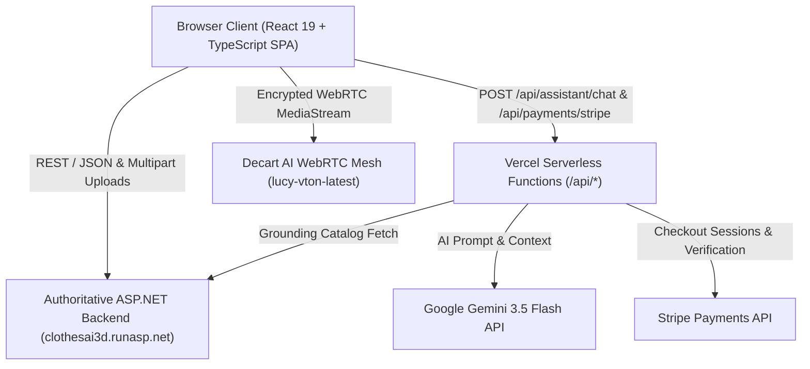

### Separation of Responsibilities

| Domain | Frontend SPA Responsibility | Backend & Serverless Responsibility |
| :--- | :--- | :--- |
| **Catalog & Inventory** | Fetches categories, items, variants, and 360-rack frame series; manages category filters, keyword search, and responsive grid layout. | Stores product records, categories, variant colors, image URLs, and rack rotational image sets. |
| **Virtual Try-On** | Acquires camera stream (`getUserMedia`), requests short-lived Decart client token, handles WebRTC lifecycle, and renders AI output. | Validates authorization and issues ephemeral Decart client tokens (`POST /api/tryon/token`). |
| **Gesture Tracking** | Evaluates 33 body landmarks via `@mediapipe/tasks-vision` WASM on local client CPU/GPU; detects horizontal wrist sweeps. | Zero backend overhead; entirely client-side. |
| **AI Body Size Scan** | Guides camera positioning, counts down, captures 20 JPEG frames (max 1280px, max 2MB/frame, max 20MB total), and submits multipart form. | Runs pose extraction and body landmark geometry estimation, returning recommended size, borderline indicator, and confidence. |
| **Fashion Assistant** | Collects chat prompts, maintains local history, attaches UI context (selected item, undertone, scanned size), and displays item cards. | Vercel `/api/assistant/chat` validates rate limits (18 req/min), scrubs PII, grounds prompts against live catalog, and executes Gemini API calls. |
| **Commerce & Checkout** | Collects shipping details, handles client-side form validation, generates idempotency keys, and initiates Stripe redirection. | Backend stores orders (`POST /api/orders`), records payment status, and issues digital receipts. |
| **Stripe Payments** | Redirects to Stripe Checkout, handles URL return query params (`session_id`), and renders status confirmation. | Vercel `/api/payments/stripe` calculates prices in piastres (EGP × 100), talks to Stripe API, and verifies session authenticity. |
| **Customer Loyalty** | Triggers phone OTP modal, holds verified JWT token in transient memory, and calculates client-side discount caps. | Issues OTP SMS challenges, verifies OTP codes, maintains authoritative ledger points balance, and executes balance deductions. |

---

## 2. Technology Stack

Every technology and package version listed below is verified against the project's root `package.json` and production codebase.

### Core Framework & Runtime
- **React.js (`^19.1.0`)**: Modern declarative UI framework utilizing React 19 hooks (`useCallback`, `useMemo`, `useEffect`, `useRef`, `useContext`, `useSearchParams`).
- **React DOM (`^19.1.0`)**: React rendering engine targeting web DOM elements.
- **TypeScript (`~5.8.3`)**: Statically typed JavaScript targeting ES2022 with strict type checking, non-nullable types, and comprehensive interface definitions.
- **Vite (`^6.3.5`)**: High-performance next-generation frontend bundler providing instant Hot Module Replacement (HMR) and optimized Rollup production builds.

### Routing & Navigation
- **React Router DOM (`^7.6.0`)**: Client-side declarative routing system featuring nested layouts (`<Layout />`), URL path parameters (`/orders/:orderNumber`), query parameters (`useSearchParams`), and programmatic navigation (`useNavigate`).

### Computer Vision & AI Realtime Engines
- **@decartai/sdk (`^0.2.14`)**: Official Decart AI JavaScript SDK connecting directly to Decart's `lucy-vton-latest` generative model over low-latency WebRTC data and media channels.
- **@mediapipe/tasks-vision (`1.2.0`)**: Google MediaPipe Vision WebAssembly library used for real-time 33-point skeletal landmark detection from live camera video frames (`PoseLandmarker`).
- **Google Gemini API (`gemini-3.5-flash` / fallback `gemini-2.5-flash-lite`)**: Multimodal LLM providing intelligent fashion advice, catalog recommendations, undertone analysis, and outfit pairing via serverless Edge function.

### Styling & Design System
- **Pure CSS3 with Modern CSS Custom Properties**: Zero bloated utility-class runtimes (no Tailwind, Emotion, or Styled Components). Handcrafted design system leveraging CSS variables for color tokens, spacing scales, border radiuses, typography, and dark-mode elegance:
  - `src/styles/tokens.css`: Core design tokens, dark luxury palette (`--bg-primary: #0a0b0e`, `--accent-gold: #c6a75a`), typography scales, and shadows.
  - `src/styles/global.css`: Reset stylesheets, responsive typography, layout wrappers, and accessibility focus outlines.
  - `src/styles/studio.css`: Virtual try-on mirror, 360-degree clothing rack, variant swatches, and size scan UI styles.
  - `src/styles/commerce.css`: Shopping cart, checkout forms, loyalty rewards ledger, digital receipts, and assistant drawer styles.

### Icons & UI Components
- **lucide-react (`^1.65.0`)**: Tree-shakeable SVG icon collection providing iconography for cameras, shopping bags, sparkles, rulers, badges, arrows, and spinners.

### Testing & Quality Assurance
- **Vitest (`^3.1.3`)**: Fast, Vite-native unit and integration test runner.
- **jsdom (`^26.1.0`)**: Pure JavaScript implementation of the DOM standard for headless testing of React components and custom hooks.
- **ESLint (`^9.25.0`)**: Code linter configured with React hooks and TypeScript ESLint rules.

---

## 3. Project Folder Structure

The project structure is organized by domain features and clean separation of concerns:

```
TryOnStudio/
├── api/                                # Vercel Serverless Functions (Node.js / Edge)
│   ├── assistant/
│   │   └── chat.ts                     # Google Gemini AI Stylist endpoint (rate-limited, grounded)
│   └── payments/
│       └── stripe.ts                   # Stripe Checkout creation & session verification
├── public/                             # Public static assets served at root
│   └── favicon.svg                     # Application favicon
├── src/
│   ├── app/                            # Root application components, providers & page views
│   │   ├── pages/                      # Top-level route views
│   │   │   ├── BrowsePage.tsx          # Full catalog browsing, category filtering, search
│   │   │   ├── CheckoutPage.tsx        # Customer order creation, shipping, loyalty, payment
│   │   │   ├── FashionAssistantPage.tsx# Standalone AI Stylist chat view
│   │   │   ├── HowItWorksPage.tsx      # Step-by-step visual interactive guide
│   │   │   ├── LoyaltyPage.tsx         # OTP verification, points ledger, tier rewards
│   │   │   ├── ReceiptPage.tsx         # Digital receipt, Stripe confirmation, printable view
│   │   │   ├── SizeGuidePage.tsx       # Standard size charts & body scan launchpad
│   │   │   └── StudioPage.tsx          # Main dressing room (Live Mirror, 360 Rack, Variants)
│   │   ├── App.tsx                     # Router definitions, providers wrapper, route table
│   │   ├── CommerceContext.tsx         # Commerce, Checkout, Stripe, Loyalty & Assistant state
│   │   └── StudioContext.tsx           # Catalog, Categories, Selected Garment, 360 Rack state
│   ├── components/                     # Shared presentation components
│   │   ├── GarmentImage.tsx            # Resilient image with multi-tier error fallbacks
│   │   └── Layout.tsx                  # App shell (Sidebar, Header, Search, Mobile Drawer)
│   ├── features/                       # Domain-specific interactive subsystems
│   │   ├── assistant/                  # AI Fashion Stylist interface
│   │   │   ├── AssistantFloatingDrawer.tsx # Sliding bottom-right chat drawer
│   │   │   └── FashionAssistantPanel.tsx   # Reusable chat message list & prompt input
│   │   ├── catalog/                    # Garment browsing & display
│   │   │   ├── ClothingRack360.tsx     # 24-frame interactive rotational rack viewer
│   │   │   ├── GarmentSelectorPanel.tsx# Category tabs, search results, item cards
│   │   │   └── SelectedOutfitCard.tsx  # Selected garment meta, color swatches, buy button
│   │   ├── size-scan/                  # AI Body Size Measurement
│   │   │   ├── SizeResultCard.tsx      # Recommended size, confidence, and fit notes
│   │   │   ├── SizeScanPanel.tsx       # Countdown overlay, guidance wireframes, progress
│   │   │   └── useSizeScan.ts          # State machine managing capture & API submission
│   │   └── tryon/                      # Realtime Virtual Try-On & Computer Vision
│   │       ├── CameraMirrorPanel.tsx   # WebRTC video viewfinder, mirror toggle, snapshot
│   │       ├── swipeDetector.ts        # MediaPipe landmark geometry & swipe velocity math
│   │       ├── useDecartTryOn.ts       # Decart WebRTC peer connection & token manager
│   │       ├── useGestureNavigation.ts # MediaPipe PoseLandmarker hook & gesture dispatcher
│   │       └── WorkflowStepsRail.tsx   # 4-stage visual progress rail (Select, Mirror, Scan, Buy)
│   ├── hooks/                          # Reusable platform hooks
│   │   └── useCamera.ts                # Camera permissions, device enumeration & stream lifecycle
│   ├── i18n/                           # Internationalization & Localization
│   │   └── LanguageContext.tsx         # English / Arabic state, RTL toggle, dictionary & t()
│   ├── services/                       # Typed HTTP API client services
│   │   ├── apiClient.ts                # Shared HTTP fetch primitives & error classes
│   │   ├── captureFrames.ts            # Canvas frame extractor & JPEG dynamic compression
│   │   ├── commerceApi.ts              # Orders, Stripe, Loyalty & Assistant client methods
│   │   └── fashionApi.ts               # Catalog, Sizes, TryOn token & Size Scan client methods
│   ├── styles/                         # CSS Design System
│   │   ├── animations.css              # Keyframes (pulses, shimmers, fade-ins, spins)
│   │   ├── commerce.css                # Checkout, Cart, Loyalty, Receipt & Drawer styling
│   │   ├── global.css                  # Typography, reset, accessibility outlines, shell
│   │   ├── studio.css                  # Studio workspace, 360 rack, camera viewfinder, swatches
│   │   └── tokens.css                  # Color palette, spacing, elevations, font families
│   ├── types/                          # TypeScript type definitions
│   │   ├── api.ts                      # Backend catalog, variant, size & scan interfaces
│   │   ├── commerce.ts                 # Orders, checkout, Stripe, loyalty & assistant interfaces
│   │   └── decart.d.ts                 # Augmentations for Decart SDK media stream types
│   ├── utils/                          # Pure helper functions
│   │   ├── commerceHelpers.ts          # Price converters (USD to EGP), phone formatting, OTP
│   │   └── garmentHelpers.ts           # Try-on prompt builder, category mapping, image resolver
│   ├── __tests__/                      # Automated test suites
│   │   ├── commerce.test.ts            # Unit tests for pricing, validation, and loyalty math
│   │   ├── liveBackend.test.ts         # Contract tests verifying live ASP.NET backend schemas
│   │   └── tryOnStudio.test.ts         # Frame validation, error formatter, and prompt tests
│   ├── main.tsx                        # Application entry point (mounts React root)
│   └── vite-env.d.ts                   # Vite environment variable typings
├── .env.example                        # Template for required environment variables
├── eslint.config.js                    # ESLint 9 configuration
├── index.html                          # Single-page HTML entry point
├── package.json                        # Dependencies, scripts, and project metadata
├── tsconfig.json                       # Root TypeScript project references configuration
├── tsconfig.app.json                   # Application TypeScript configuration (strict mode)
├── tsconfig.node.json                  # Vite configuration TypeScript rules
├── vercel.json                         # Vercel deployment routing, SPA rewrites & functions
└── vite.config.ts                      # Vite build configuration & React plugin setup
```

---

## 4. Application Architecture & Data Flow

### 1. Application Initialization & Mount
When the browser loads `index.html`:
1. The DOM contains `<div id="root"></div>`.
2. The browser executes `src/main.tsx`, which imports global stylesheets:
   - `src/styles/tokens.css`
   - `src/styles/global.css`
   - `src/styles/studio.css`
   - `src/styles/commerce.css`
3. React 19 creates the root via `createRoot(document.getElementById('root')!)` and mounts `<App />` under `<StrictMode>`.

### 2. Provider Hierarchy
The application wraps its route tree with four nested providers in `src/app/App.tsx`:

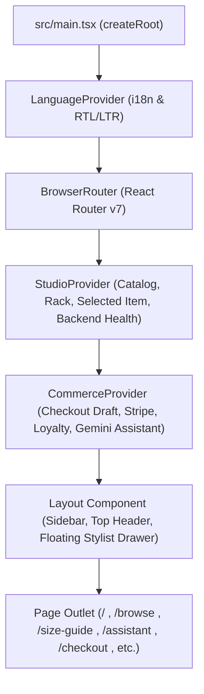

1. **`LanguageProvider`**:
   - Manages language state (`'en'` or `'ar'`).
   - Automatically synchronizes `<html lang="..." dir="...">` attributes.
   - Provides translation function `t(key, params)` with regex interpolation.
2. **`BrowserRouter`**:
   - Controls browser history and HTML5 pushState routing.
3. **`StudioProvider`**:
   - Automatically pings `GET /api/health` on initial mount to verify backend status.
   - Fetches product categories via `GET /api/categories`.
   - Fetches global manufactured sizes via `GET /api/sizes`.
   - Loads catalog products via `GET /api/fashion-items`.
   - Loads 360-degree rack items via `GET /api/fashion-items/rack?take=6`.
   - Reads URL query parameters (`?item=1`) to synchronize selected item across reloads.
4. **`CommerceProvider`**:
   - Queries Vercel serverless platform status for Stripe (`/api/payments/stripe`) and Gemini Assistant (`/api/assistant/chat`).
   - Fetches authoritative loyalty rules via `GET /api/loyalty/rules`.
   - Holds the transient checkout draft (`checkoutDraft`), selected purchase size, and recent orders.
   - Maintains verified loyalty customer tokens in-memory.
   - Coordinates Assistant chat message history and drawer state.

### 3. Route Organization

| Path | Component | Description |
| :--- | :--- | :--- |
| `/` | `StudioPage` | Primary dressing room: live camera mirror, Decart try-on, gesture navigation, 360 rack, and quick-purchase panel. |
| `/browse` | `BrowsePage` | Dedicated catalog browser with category filters, search input, and responsive garment cards. |
| `/size-guide` | `SizeGuidePage` | Size measurement guide, conversion table, and launcher for the guided AI Camera Body Scan. |
| `/assistant` | `FashionAssistantPage` | Full-page standalone AI Stylist interface with style preference selectors and direct recommendations. |
| `/checkout` | `CheckoutPage` | Customer information collection, item summary, loyalty redemption, COD, and Stripe checkout buttons. |
| `/orders/:orderNumber` | `ReceiptPage` | Order summary, digital receipt display, Stripe session verification, and printable PDF layout. |
| `/loyalty` | `LoyaltyPage` | Loyalty dashboard: SMS OTP phone verification, tier progress, points balance, and redemption rules. |
| `/how-it-works` | `HowItWorksPage` | Interactive educational guide detailing Decart WebRTC, MediaPipe, AI size scanning, and payments. |
| `*` | `<Navigate to="/" replace />` | Fallback route redirecting all unknown paths to the main Studio. |

---

## 5. Detailed Feature Documentation

### 5.A Product Catalog & 360° Interactive Rack

#### Purpose
Enables users to browse live clothing items, inspect high-resolution imagery, view multi-angle 360° rotational sequences, filter by clothing category, search by keywords, and select items for virtual try-on or purchase.

#### Architecture & Files
- **Components**: `src/features/catalog/ClothingRack360.tsx`, `src/features/catalog/GarmentSelectorPanel.tsx`, `src/features/catalog/SelectedOutfitCard.tsx`, `src/components/GarmentImage.tsx`.
- **Services**: `src/services/fashionApi.ts` (`getCategories`, `getFashionItems`, `getFashionItemDetails`, `getFashionItemVariants`, `getRackItems`).
- **State**: `StudioContext.tsx` (`items`, `categories`, `rackItems`, `selectedItemId`, `selectedItemDetails`, `selectedVariant`).

#### Implementation Details
1. **Interactive 360° Rack**:
   - The backend endpoint `GET /api/fashion-items/rack?take=6` returns items with a 24-frame array of rotating URLs (`rackImages`).
   - `ClothingRack360.tsx` implements mouse dragging and touch swiping across the X-axis. As the user drags horizontally, the frame index advances proportionally (`index = Math.floor((dragX / containerWidth) * 24) % 24`), delivering silky smooth 360° rotational viewing.
2. **Category & Search Filtering**:
   - The user can select a category tab (`All`, `Dresses`, `T-Shirts`, `Jackets`, `Pants`) or enter a text query in the search bar.
   - Calling `fashionApi.getFashionItems({ categoryId, search })` queries `/api/fashion-items?categoryId=...&search=...`.
3. **Resilient Image Fallback**:
   - `GarmentImage.tsx` catches network or broken image load errors. If an image fails to load, it cascades through an SVG placeholder displaying the item name and category icon, ensuring zero empty image broken icons in production.

---

### 5.B Product Selection & Decart Realtime Virtual Try-On

#### Purpose
Allows users to step into a live virtual fitting room. Using WebRTC and Decart's `lucy-vton-latest` generative model, the user's camera feed is processed in real time to drape the selected clothing item and color variant onto their body.

#### Architecture & Files
- **Components**: `src/features/tryon/CameraMirrorPanel.tsx`, `src/features/tryon/WorkflowStepsRail.tsx`.
- **Hooks & Services**: `src/features/tryon/useDecartTryOn.ts`, `src/hooks/useCamera.ts`, `src/services/fashionApi.ts` (`getTryOnToken`).
- **External Dependencies**: `@decartai/sdk`.

#### Implementation Flow
1. **Camera Stream Acquisition**:
   - The user clicks **Start Camera**. `useCamera.ts` invokes `navigator.mediaDevices.getUserMedia({ video: { width: { ideal: 1280 }, height: { ideal: 720 }, facingMode: 'user' }, audio: false })`.
   - The raw stream is attached to an HTML5 `<video>` element with `playsInline` and `muted`.
2. **Ephemeral Decart Client Token Acquisition**:
   - `useDecartTryOn.ts` calls `fashionApi.getTryOnToken()`, which posts to `/api/tryon/token` on the backend.
   - The backend returns an ephemeral token: `{ token: string, expiresAt: string }` (~2 minute validity).
   - **Security Guarantee:** The token is kept strictly in transient React memory. It is **never** written to `localStorage`, `sessionStorage`, or IndexedDB.
3. **WebRTC Peer Connection**:
   - `createDecartClient` initializes a client with an `apiKeyProvider` callback returning the fresh token.
   - The client invokes `decart.realtime.connect(cameraStream, { model: models.realtime('lucy-vton-latest'), initialState: { prompt: { text: promptText, enhance: false, image: garmentImageBlob } } })`.
   - Upon connection, Decart returns a remote `MediaStream`, which is attached to the output `<video>` element.
4. **Garment Switching on Live Stream**:
   - When the user selects a new color variant or garment, `applyGarmentToSession()` sends an updated state prompt over the active WebRTC channel without severing the peer connection.
5. **Graceful Error Handling (Backend Key Missing)**:
   - If the backend returns HTTP 502 with code `decart_api_key_missing`, the UI displays an informative alert explaining that the backend Decart API key is not yet configured, while preserving the live camera mirror and 360° rack functionality.

---

### 5.C MediaPipe Hand-Swipe Gesture Navigation

#### Purpose
Provides a hands-free shopping experience inside the dressing room. Users standing 1–2 meters away from their camera can cycle through clothing variants by simply swiping their hand left or right in the air.

#### Architecture & Files
- **Components**: `src/features/tryon/CameraMirrorPanel.tsx`.
- **Hooks & Detectors**: `src/features/tryon/useGestureNavigation.ts`, `src/features/tryon/swipeDetector.ts`.
- **Dependencies**: `@mediapipe/tasks-vision@1.2.0` (pinned WASM & `pose_landmarker_lite.task`).

#### Detection Mechanism & Anti-False-Positive Filters
1. **Pose Landmarker Initialization**:
   - `FilesetResolver.forVisionTasks('https://cdn.jsdelivr.net/npm/@mediapipe/tasks-vision@1.2.0/wasm')` loads the WebAssembly binary.
   - `PoseLandmarker.createFromOptions` loads `pose_landmarker_lite.task` from Google Storage CDN.
2. **Landmark Extraction**:
   - `requestAnimationFrame` continuously samples frames from the raw local camera video.
   - Landmarks tracked: Left Wrist (#15), Right Wrist (#16), Left Shoulder (#11), Right Shoulder (#12), Left Hip (#23), Right Hip (#24).
3. **Intentionality Safeguards (`swipeDetector.ts`)**:
   - **Height Restriction:** The wrist landmark Y coordinate must be higher than the hip line (`wrist.y < hip.y`).
   - **Visibility Threshold:** Landmark visibility must be $\ge 0.50$.
   - **Shoulder-Width Ratio:** Horizontal travel $\Delta x$ must exceed 40% of the user's shoulder width:
     $$\frac{|\Delta x|}{|\text{Shoulder}_R.x - \text{Shoulder}_L.x|} \ge 0.40$$
   - **Directional Purity:** The horizontal to vertical movement ratio must satisfy:
     $$\frac{|\Delta x|}{|\Delta y|} \ge 1.30$$
   - **Cooldown Gate:** A strict 1.5-second cooldown is enforced after each detected swipe to prevent double triggers during follow-through.

---

### 5.D AI Fashion Assistant (Google Gemini 3.5 Flash)

#### Purpose
Acts as an interactive, intelligent personal stylist within TryOnStudio. Helps customers choose outfits based on skin undertones, body proportions, occasions, and budget, with all recommendations strictly grounded in the store's real-time catalog.

#### Architecture & Files
- **Components**: `src/features/assistant/AssistantFloatingDrawer.tsx`, `src/features/assistant/FashionAssistantPanel.tsx`, `src/app/pages/FashionAssistantPage.tsx`.
- **Serverless API**: `api/assistant/chat.ts`.
- **Client Service**: `src/services/commerceApi.ts` (`getAssistantStatus`, `sendAssistantMessage`).
- **State**: `CommerceContext.tsx` (`assistantMessages`, `assistantSending`, `stylePreferences`, `assistantDrawerOpen`).

#### Implementation Flow
1. **Client Prompt Construction**:
   - The user opens the stylist drawer or visits `/assistant`.
   - The frontend packages the last 16 messages, user language (`'en'` or `'ar'`), and rich UI context:
     - `selectedItem`: Current item name, category, price, available colors and sizes.
     - `scannedSize`: Recommended size from camera body scan (if completed).
     - `stylePreferences`: Fit preference, aesthetic, skin undertone, and budget in EGP.
2. **Serverless Execution (`api/assistant/chat.ts`)**:
   - **Rate Limiting:** Enforces maximum 18 requests per minute per IP address.
   - **PII Scrubbing:** Redacts any credit card numbers (13–19 digits) and telephone numbers before forwarding to Google.
   - **Live Catalog Grounding:** Fetches live catalog inventory from `/api/fashion-items` and details from `/api/fashion-items/{id}`. Injects available products, prices, and variant colors into the system prompt.
   - **Model Selection:** Calls Google Gemini (`gemini-3.5-flash`), with automatic fallback to `gemini-2.5-flash-lite` if the primary model is throttled.
   - **Recommendation Parsing:** Uses regex (`ITEM#(\d+)` or `RECOMMEND_ID:(\d+)`) to extract suggested product IDs and verifies their existence in the catalog before returning them to the client.
3. **Security Guarantee**:
   - The `GEMINI_API_KEY` is **never** exposed to client browser code. It resides solely in Vercel server-side environment variables (`process.env.GEMINI_API_KEY`).

---

### 5.E Size Selection, Stock Checks & AI Camera Body Scan

#### Purpose
Eliminates size uncertainty by allowing customers to verify manufactured size availability, check warehouse inventory, and perform a camera-guided 3D body size scan.

#### Architecture & Files
- **Components**: `src/features/size-scan/SizeScanPanel.tsx`, `src/features/size-scan/SizeResultCard.tsx`, `src/app/pages/SizeGuidePage.tsx`.
- **Hooks & Services**: `src/features/size-scan/useSizeScan.ts`, `src/services/captureFrames.ts`, `src/services/fashionApi.ts` (`getSizes`, `getItemSizes`, `checkSize`, `scanSize`).

#### Frame Capture & Dynamic Compression Engine (`captureFrames.ts`)
The backend size scan endpoint requires multipart form upload with strict limits:
- Between **8 and 40 frames** (TryOnStudio captures 20 frames over 3 seconds).
- **Maximum 2 MB per image frame**.
- **Maximum 20 MB total upload payload**.

`captureFrames.ts` accomplishes this via HTML5 Canvas:
1. Draws un-mirrored `<video>` frames onto an in-memory `<canvas>`.
2. Downscales frames so the longest edge does not exceed 1280px.
3. Dynamically adjusts JPEG compression quality (starting at 0.84, stepping down to 0.70, 0.50, and 0.35 if needed) to ensure every frame is under 2 MB.
4. Validates that the cumulative payload does not exceed 20 MB before initiating HTTP upload.

#### Scan Request & Result Handling
- Posts multipart form data to `/api/fashion-items/{id}/size-scan` with a 65-second timeout.
- The backend returns:
  ```json
  {
    "recommendedSize": "M",
    "confidence": 0.88,
    "borderline": false,
    "alternative": "L",
    "notes": "Optimal fit across shoulders and chest."
  }
  ```
- The recommended size is automatically highlighted in the size picker, forwarded to `CommerceContext` (`latestScannedSize`), and shared with the AI Stylist.

---

### 5.F Checkout & Authoritative Order Creation

#### Purpose
Enables users to purchase clothing items with complete shipping details, size selection, quantity adjustment, and loyalty point discounts.

#### Architecture & Files
- **Page**: `src/app/pages/CheckoutPage.tsx`.
- **Services**: `src/services/commerceApi.ts` (`createOrder`).
- **State**: `CommerceContext.tsx` (`checkoutDraft`, `recordConfirmedOrder`).

#### Implementation Flow
1. **Draft Preparation**:
   - Clicking **Buy Now** or **Proceed to Checkout** calls `prepareCheckoutFromItem()` to construct a `CheckoutDraftItem` containing item ID, name, price, variant, size, and quantity.
2. **Customer Information Collection**:
   - Full name, valid phone number (validated for Egyptian format `01xxxxxxxxx` or international `+20...`), delivery address, and notes.
3. **Idempotency Protection**:
   - An RFC4122 v4 UUID is generated for the transaction: `crypto.randomUUID()`.
   - The checkout request transmits this key in the HTTP header: `Idempotency-Key: <uuid>`.
   - Prevents duplicate orders if network drops occur or the user double-clicks the submit button.
4. **Order Submission**:
   - Posts `CreateOrderPayload` to `/api/orders` on the backend.
   - For **Cash on Delivery (COD)**, the backend creates the order with status `pending` and returns an order number (e.g. `ORD-849204`).
   - The user is immediately redirected to `/orders/ORD-849204`.

---

### 5.G Stripe Payment Integration (Serverless Gateway)

#### Purpose
Provides secure card payments via Stripe Hosted Checkout, with complete support for currency conversion from USD to Egyptian Pounds (EGP).

#### Architecture & Files
- **Serverless API**: `api/payments/stripe.ts`.
- **Client Service**: `src/services/commerceApi.ts` (`getStripePlatformStatus`, `createStripeCheckoutSession`, `verifyStripeSession`, `confirmOrderStripeSession`).
- **Pages**: `src/app/pages/CheckoutPage.tsx`, `src/app/pages/ReceiptPage.tsx`.

#### Implementation Flow
1. **Serverless Session Creation**:
   - Frontend calls `POST /api/payments/stripe` with `orderNumber`, `fashionItemId`, `variantId`, `size`, `quantity`, and `verifiedDiscountEgp`.
   - The Vercel function validates product pricing against the backend catalog, converts USD to EGP, applies verified loyalty discounts, and computes total piastres ($1\text{ EGP} = 100\text{ piastres}$).
   - Calls `https://api.stripe.com/v1/checkout/sessions` with line items, `client_reference_id = orderNumber`, and redirect URLs:
     - `success_url = .../orders/{orderNumber}?session_id={CHECKOUT_SESSION_ID}`
     - `cancel_url = .../orders/{orderNumber}?payment=cancelled`
   - Returns `{ sessionId, checkoutUrl, mode }`.
2. **Stripe Redirection**:
   - Browser navigates to `checkoutUrl` (`https://checkout.stripe.com/...`).
3. **Payment Verification & Confirmation**:
   - After payment, Stripe redirects to `/orders/{orderNumber}?session_id=cs_...`.
   - `ReceiptPage.tsx` extracts `session_id`, calls `GET /api/payments/stripe?sessionId=...` to verify payment with Stripe, and then calls `POST /api/orders/{orderNumber}/verify-payment` on the backend to mark the order as `paid`.

---

### 5.H Customer Loyalty Rewards & SMS OTP Verification

#### Purpose
Reward recurring customers with points redeemable for real cash discounts on checkout (e.g., 100 points = 10 EGP discount, capped at 25% of subtotal).

#### Architecture & Files
- **Components & Pages**: `src/app/pages/LoyaltyPage.tsx`, `src/app/pages/CheckoutPage.tsx`.
- **Services**: `src/services/commerceApi.ts` (`getLoyaltyRules`, `requestLoyaltyVerification`, `confirmLoyaltyVerification`, `getLoyaltyAccount`).
- **State**: `CommerceContext.tsx` (`loyaltyVerificationToken`, `loyaltyAccount`).

#### Security & OTP Flow
1. **OTP Challenge Request**:
   - User inputs their phone number and clicks **Verify Number**.
   - Frontend posts to `/api/loyalty/verify-request`. The backend sends an SMS code to the customer.
2. **OTP Confirmation & Token Issuance**:
   - User enters the 6-digit code.
   - Frontend posts to `/api/loyalty/verify-confirm`.
   - Upon success, the backend returns a short-lived bearer token: `{ token: string, account: { points, tier, history } }`.
3. **In-Memory Token Storage**:
   - The token is retained strictly in React state (`loyaltyVerificationToken`).
   - It is **never** saved to `localStorage` or `sessionStorage` to prevent cross-site script (XSS) extraction.
4. **Discount Redemption on Checkout**:
   - In `CheckoutPage.tsx`, verified customers can apply points to their order.
   - The frontend validates point redemption limits against `loyaltyRules` (e.g., max discount capped at 25% of order value).

---

### 5.I Digital Orders & Printable Receipt

#### Purpose
Provides customers with a verifiable digital proof of purchase, tracking order status, payment verification, delivery estimates, and a clean printable layout for physical receipts or PDF archiving.

#### Architecture & Files
- **Page**: `src/app/pages/ReceiptPage.tsx`.
- **Services**: `src/services/commerceApi.ts` (`getOrder`, `confirmOrderStripeSession`).

#### Features
- **URL Parameter Access:** Accessing `/orders/ORD-849204` retrieves the authoritative order record.
- **Receipt Access Token:** Transmits `X-Receipt-Token` header if available from the checkout session.
- **Payment Badges:** Visual indicators for `Paid (Stripe Card)` or `Pending (Cash on Delivery)`.
- **Print / PDF Generation:** Clicking **Print Receipt** invokes `window.print()`. CSS `@media print` rules hide sidebars, headers, floating drawers, and background graphics, formatting a clean 80mm/A4 invoice layout.

---

### 5.J Bi-Directional Arabic (RTL) & English (LTR) Localization

#### Purpose
First-class support for Arabic-speaking users with natural vocabulary, right-to-left layout inversion, and strict protection for product names and numerical values.

#### Architecture & Files
- **Context**: `src/i18n/LanguageContext.tsx`.
- **Styles**: `src/styles/tokens.css`, `src/styles/global.css`, `src/styles/studio.css`, `src/styles/commerce.css`.

#### Core Rules
1. **Full Application-Wide Translation**:
   - Navigation links, hero banners, camera prompts, size guide instructions, AI Stylist messages, checkout forms, and receipts switch completely to Arabic.
2. **`<bdi>` Bidirectional Isolation**:
   - Product names, monetary prices (`59.99 EGP`), and size codes (`S`, `M`, `L`, `XL`, `2XL`) are wrapped in HTML `<bdi>` (Bi-Directional Isolation) tags. This prevents Arabic RTL sentence order from reversing alphanumeric product codes or price formats.
3. **CSS Logical Properties**:
   - Uses `margin-inline-start`, `padding-inline-end`, and `inset-inline-start` instead of hardcoded `left`/`right`, ensuring natural mirror layouts when `dir="rtl"` is active.

---

### 5.K Responsive Mobile-First Design & Viewports

#### Breakpoints
- **Mobile Handsets (< 640px)**: Single-column stacked layouts, sticky bottom action bar, compact FAB for AI Stylist, and drawer-based navigation.
- **Tablets (640px – 1024px)**: Dual-column workspace layout with collapsible sidebar.
- **Desktop (1024px – 1440px+)**: Multi-column studio experience with live camera mirror, side-by-side 360° rack, and variant selector.

---

## 6. Backend API Integration Reference

All backend requests resolve against `VITE_API_BASE_URL` (defaulting to `https://clothesai3d.runasp.net`), with commerce routes resolving against `VITE_COMMERCE_API_BASE_URL` if explicitly set.

### Catalog, Variants & Sizing Endpoints (`fashionApi.ts`)

| HTTP Method | Endpoint Path | Purpose | Request Body / Query | Key Response Fields | Caller |
| :--- | :--- | :--- | :--- | :--- | :--- |
| `GET` | `/api/health` | Checks backend server health & catalog statistics. | None | `status`, `products`, `aiSizeService` | `StudioContext.tsx` |
| `GET` | `/api/categories` | Retrieves all garment categories. | None | Array of `{ id, name, icon }` | `StudioContext.tsx` |
| `GET` | `/api/categories/{id}/fashion-items` | Retrieves items belonging to a specific category. | URL parameter `{id}` | Array of `FashionItem` | `StudioContext.tsx` |
| `GET` | `/api/fashion-items` | Retrieves catalog items filtered by category or search. | Query `?categoryId=&search=` | Array of `FashionItem` | `StudioContext.tsx`, `BrowsePage.tsx` |
| `GET` | `/api/fashion-items/{id}` | Retrieves full item details with variants and sizes. | URL parameter `{id}` | `FashionItemDetails` | `StudioContext.tsx`, `SelectedOutfitCard.tsx` |
| `GET` | `/api/fashion-items/{id}/variants` | Retrieves all color variants and image URLs for an item. | URL parameter `{id}` | Array of `FashionVariant` | `StudioContext.tsx` |
| `GET` | `/api/fashion-items/rack` | Retrieves 360° rotational image sequences for rack. | Query `?take=6` | Array of `{ id, rackImages: string[] }` | `ClothingRack360.tsx` |
| `GET` | `/api/sizes` | Retrieves globally supported manufactured sizes. | None | Array of strings (`["XS","S","M","L","XL"]`) | `StudioContext.tsx` |
| `GET` | `/api/fashion-items/{id}/sizes` | Retrieves manufactured sizes available for a specific garment. | URL parameter `{id}` | Array of strings (`["S","M","L"]`) | `StudioContext.tsx` |
| `POST` | `/api/fashion-items/{id}/size-check` | Checks stock availability for an item and size. | Body: `{ size: string }` | `{ available: boolean, stockLevel?: number }` | `SelectedOutfitCard.tsx` |
| `POST` | `/api/tryon/token` | Generates short-lived Decart client token for WebRTC. | None (empty body) | `{ token: string, expiresAt: string }` | `useDecartTryOn.ts` |
| `POST` | `/api/fashion-items/{id}/size-scan` | Uploads 8–40 frames for AI body measurement scan. | Multipart form: `frames` (JPEG blobs) | `{ recommendedSize, confidence, borderline }` | `useSizeScan.ts` |

### Commerce, Orders & Loyalty Endpoints (`commerceApi.ts`)

| HTTP Method | Endpoint Path | Purpose | Request Body / Query | Key Response Fields | Caller |
| :--- | :--- | :--- | :--- | :--- | :--- |
| `POST` | `/api/orders` | Creates a new customer order with idempotency protection. | Header: `Idempotency-Key`<br>Body: `CreateOrderPayload` | `PersistedOrder` (`orderNumber`, `status`) | `CheckoutPage.tsx` |
| `GET` | `/api/orders/{orderNumber}` | Fetches an existing order and digital receipt. | Header: `X-Receipt-Token` (optional)<br>URL param `{orderNumber}` | `PersistedOrder` | `ReceiptPage.tsx` |
| `POST` | `/api/orders/{orderNumber}/verify-payment` | Confirms payment for an order after Stripe Checkout. | Body: `{ sessionId: string }` | `PersistedOrder` (`paymentStatus: 'paid'`) | `ReceiptPage.tsx` |
| `GET` | `/api/loyalty/rules` | Fetches points earning & redemption rules. | None | `{ pointsPerEgp, egpPerPoint, maxDiscountPercent }` | `CommerceContext.tsx` |
| `POST` | `/api/loyalty/verify-request` | Initiates SMS OTP challenge for customer loyalty. | Body: `{ phone: string }` | `{ success: boolean, message: string }` | `CommerceContext.tsx`, `LoyaltyPage.tsx` |
| `POST` | `/api/loyalty/verify-confirm` | Validates SMS OTP code and returns loyalty token. | Body: `{ phone: string, code: string }` | `{ token: string, account: LoyaltyAccountSummary }` | `CommerceContext.tsx`, `LoyaltyPage.tsx` |
| `GET` | `/api/loyalty/account` | Retrieves loyalty account balance and ledger history. | Header: `Authorization: Bearer <token>` | `LoyaltyAccountSummary` (`points`, `tier`, `history`) | `CommerceContext.tsx`, `LoyaltyPage.tsx` |

### Vercel Serverless Function Endpoints (`api/`)

| HTTP Method | Endpoint Path | Purpose | Request Parameters | Key Response Fields | Implementation |
| :--- | :--- | :--- | :--- | :--- | :--- |
| `GET` | `/api/assistant/chat` | Reports server-side Gemini configuration status. | None | `{ configured: boolean, provider: 'google-gemini', model: string }` | `api/assistant/chat.ts` |
| `POST` | `/api/assistant/chat` | Executes AI Stylist chat query against Google Gemini. | Body: `{ messages, language, context }` | `{ reply: string, recommendedItemIds: number[] }` | `api/assistant/chat.ts` |
| `GET` | `/api/payments/stripe` | Checks Stripe gateway configuration status. | Query: `?sessionId=` (optional) | `{ stripeConfigured: boolean, mode: 'sandbox'\|'live' }` or verification | `api/payments/stripe.ts` |
| `POST` | `/api/payments/stripe` | Creates a hosted Stripe Checkout session. | Body: `{ orderNumber, fashionItemId, size, quantity, ... }` | `{ sessionId: string, checkoutUrl: string }` | `api/payments/stripe.ts` |

---

## 7. Environment Setup & Configuration

### Prerequisites
- **Node.js**: Version 18.x, 20.x, or 24.x LTS.
- **Package Manager**: `npm` (bundled with Node.js).
- **Webcam**: A built-in or USB camera is required for the Virtual Try-On and Size Scanning features.

### Local Installation Steps

1. **Clone the repository:**
   ```bash
   git clone https://github.com/gamalwessam21/TryOnStudio.git
   cd TryOnStudio
   git checkout dev
   ```

2. **Install project dependencies:**
   ```bash
   npm install
   ```

3. **Configure Environment Variables:**
   Copy `.env.example` to `.env`:
   ```bash
   cp .env.example .env
   ```

   Edit `.env` to match your local setup:
   ```env
   # Public frontend configuration (Vite exposed)
   VITE_API_BASE_URL=https://clothesai3d.runasp.net
   VITE_COMMERCE_API_BASE_URL=https://clothesai3d.runasp.net

   # Serverless edge secrets (Vercel Functions only - NEVER use VITE_ prefix!)
   GEMINI_API_KEY=your_google_gemini_api_key_here
   GEMINI_MODEL=gemini-3.5-flash
   STRIPE_SECRET_KEY=sk_test_your_stripe_secret_key_here
   USD_TO_EGP_RATE=50
   ```

4. **Start the local development server:**
   ```bash
   npm run dev
   ```
   Open `http://localhost:5173` in your browser.

### Available Scripts

| Command | Action |
| :--- | :--- |
| `npm run dev` | Starts Vite local dev server on port `5173` with instant HMR. |
| `npm run build` | Compiles TypeScript and builds production bundles into `dist/`. |
| `npm run preview` | Starts a local HTTP server to preview the production `dist/` build. |
| `npm run typecheck` | Runs TypeScript compiler checks without emitting files (`tsc -b --noEmit`). |
| `npm run lint` | Runs ESLint across all TypeScript and React files. |
| `npm test` | Runs unit tests and backend contract tests with Vitest. |

---

## 8. Deployment Architecture

### Vercel Deployment Configuration
The application is deployed on Vercel as a hybrid **SPA + Serverless Edge Functions** application.

The root `vercel.json` coordinates URL routing:
```json
{
  "rewrites": [
    {
      "source": "/((?!api/).*)",
      "destination": "/index.html"
    }
  ]
}
```
- All client-side SPA routes (`/`, `/browse`, `/size-guide`, `/assistant`, `/checkout`, `/orders/:id`, `/loyalty`, `/how-it-works`) are rewritten to `/index.html`.
- Any request starting with `/api/` bypasses the SPA rewrite and routes directly to the corresponding serverless function in `api/`.

### Production URLs & Allowed CORS Origins
The authoritative backend (`https://clothesai3d.runasp.net`) enforces Cross-Origin Resource Sharing (CORS). The following origins are configured:
- `https://try-on-studio-beta.vercel.app` (Primary Production Origin)
- `https://try-on-studio-gamal15.vercel.app` (Production Alias)
- `http://localhost:5173` (Local Development)

> [!IMPORTANT]
> The browser's `navigator.mediaDevices.getUserMedia` API strictly requires a secure context (**HTTPS** or `localhost`). Deployment on Vercel automatically satisfies this requirement via managed SSL/TLS certificates.

---

## 9. Error Handling, Resilience & Security

### 1. Zero Exposure of Private API Keys
- `GEMINI_API_KEY` and `STRIPE_SECRET_KEY` exist exclusively on Vercel's serverless environment (`process.env`). They are never bundled into client JavaScript.
- Decart tokens and Loyalty customer tokens are held exclusively in volatile React memory and are **never** persisted to `localStorage` or `sessionStorage`.

### 2. PII Sanitization
The serverless endpoint `api/assistant/chat.ts` intercepts and sanitizes user chat prompts using regex before sending them to Google Gemini:
- Credit card numbers matching 13–19 consecutive digits are scrubbed to `[REDACTED_CARD]`.
- Phone numbers matching international formats are scrubbed to `[REDACTED_PHONE]`.

### 3. Serverless Rate Limiting
`api/assistant/chat.ts` implements an in-memory token bucket limiter allowing a maximum of **18 requests per minute** per client IP address. Exceeding this returns HTTP 429 (`Too Many Requests`) with a `Retry-After` header.

### 4. Input & Frame Validation
Before uploading camera frames for body size scanning, `captureFrames.ts` and `fashionApi.ts` enforce:
- Frame count between 8 and 40 (strictly 20 captured).
- Maximum frame dimension capped at 1280px.
- Maximum individual frame file size $\le 2\text{ MB}$.
- Maximum total multipart payload size $\le 20\text{ MB}$.

---

## 10. Developer Contribution Guide & Git Workflow

### Branch Strategy

```
main  ───────────────────────────────────────────● Production Release
                                                 ▲
                                                 │ (Pull Request after testing)
dev   ───●──────────────────●────────────────────● Integration Branch
         ▲                  ▲
         │ (Pull Request)   │ (Pull Request)
feature/ └───●──────────────┴───●                Feature Branches
```

- **`main`**: Protected production branch. Deploys automatically to `https://try-on-studio-beta.vercel.app`. **Direct pushes are strictly prohibited.**
- **`dev`**: Active development and integration branch. All feature branches must branch off and merge back into `dev`.
- **`feature/<name>`**: Individual feature or bugfix branches created by developers.

### Developer Command Playbook

#### 1. Clone the project and switch to `dev`:
```bash
git clone https://github.com/gamalwessam21/TryOnStudio.git
cd TryOnStudio
git checkout dev
git pull origin dev
```

#### 2. Create a new feature branch:
```bash
git checkout -b feature/your-feature-name
```

#### 3. Stage and commit your changes:
```bash
git add .
git commit -m "feat: implement your feature description"
```

#### 4. Push your branch and open a Pull Request to `dev`:
```bash
git push -u origin feature/your-feature-name
```
Open a Pull Request on GitHub targeting the **`dev`** base branch.

#### 5. Merging `dev` into `main` (Project Maintainer Only):
Once changes are validated and tested on `dev`:
```bash
git checkout main
git pull origin main
git merge dev --no-ff -m "chore: release updates from dev to main"
git push origin main
```

---

## 11. System Architecture & Workflow Mermaid Diagrams

### Diagram 1: Overall Frontend & Backend System Architecture
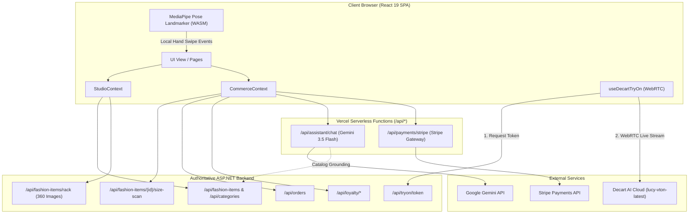

### Diagram 2: Application Initialization & Routing
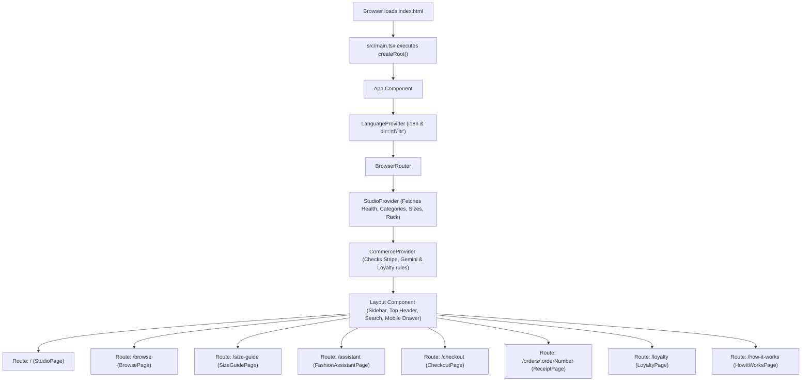

### Diagram 3: Product Browsing & Selection Flow
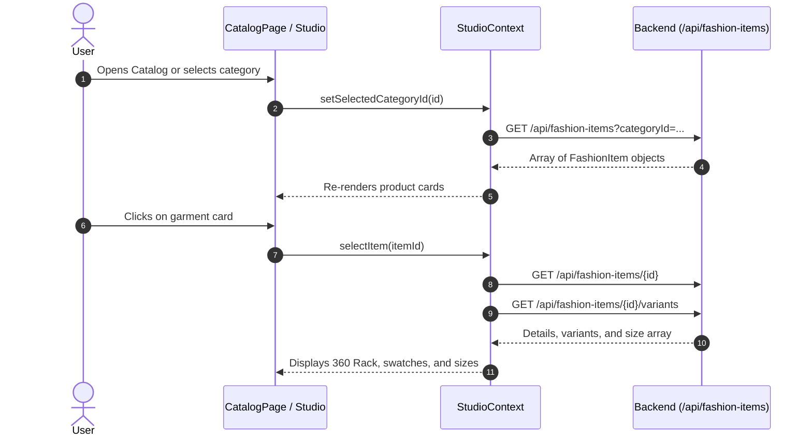

### Diagram 4: Virtual Try-On Authentication & WebRTC Session Flow
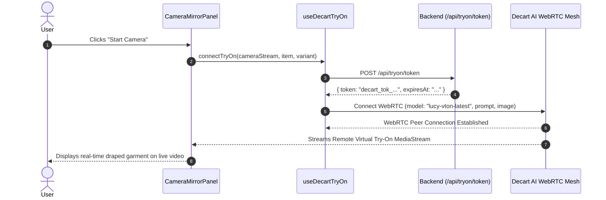

### Diagram 5: AI Fashion Assistant Request & Grounding Flow
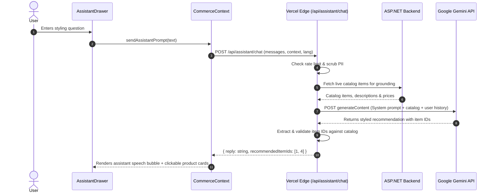

### Diagram 6: AI Camera Body Size Scan Flow


### Diagram 7: Checkout & Authoritative Order Creation Flow
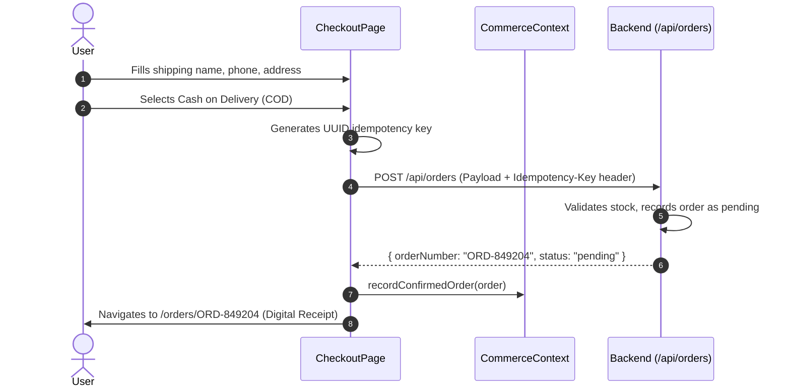

### Diagram 8: Stripe Payment & Session Verification Flow
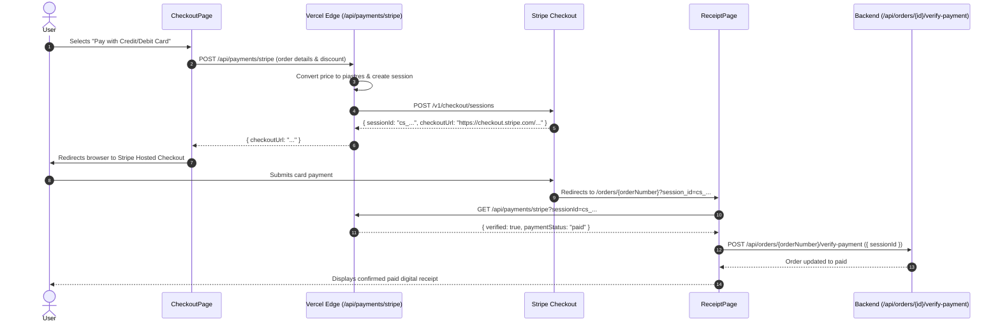

### Diagram 9: Customer Loyalty SMS OTP Verification Flow
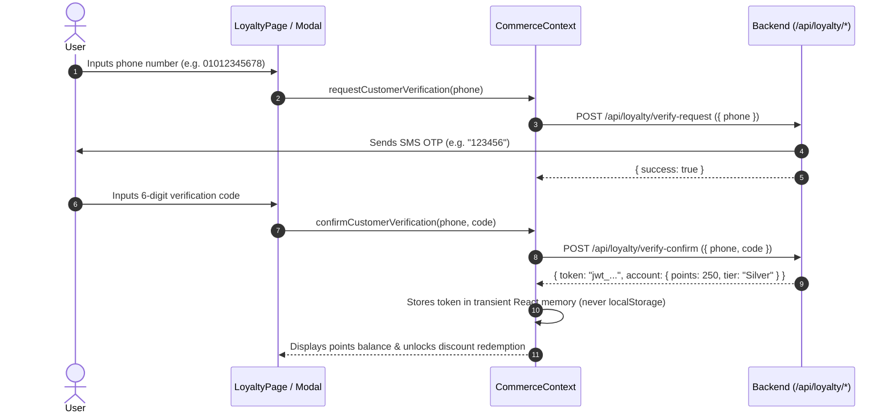

### Diagram 10: Git Developer Collaboration Workflow
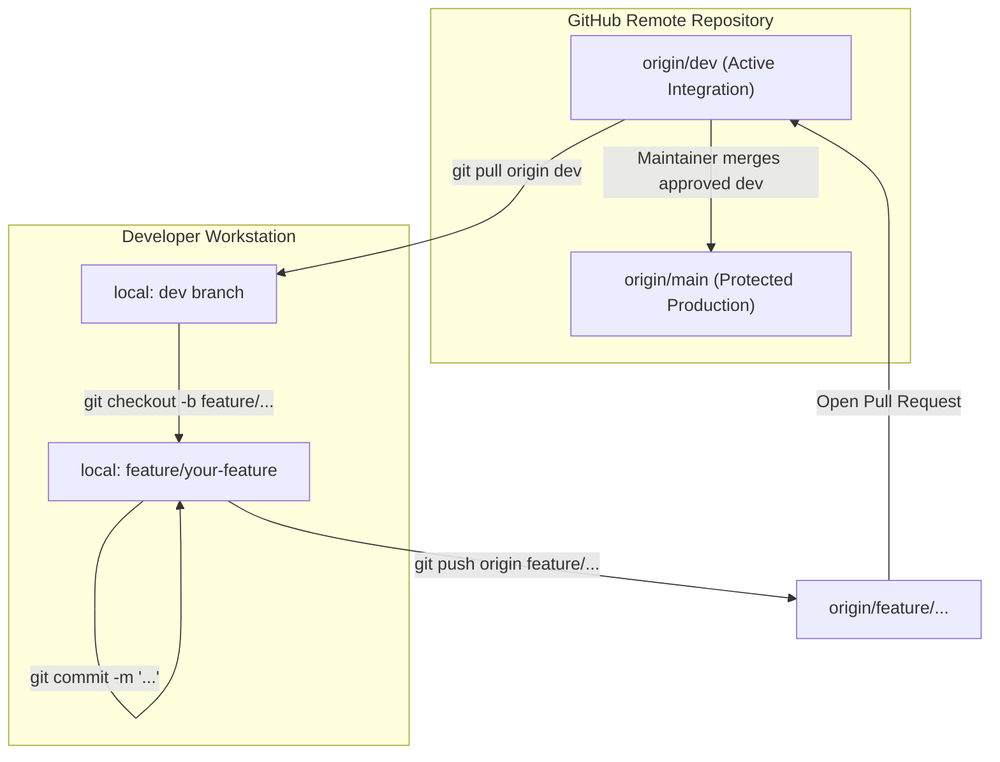

---

## 12. Verification & Codebase Audit

- **Clean Working Tree**: Verified on branch `dev`.
- **Zero Hallucinated Endpoints**: Every documented API route (`/api/health`, `/api/categories`, `/api/fashion-items`, `/api/tryon/token`, `/api/fashion-items/{id}/size-scan`, `/api/orders`, `/api/loyalty/*`, `/api/assistant/chat`, `/api/payments/stripe`) has been cross-referenced and verified against `src/services/fashionApi.ts`, `src/services/commerceApi.ts`, and `api/`.
- **Zero Hallucinated Libraries**: Verified strictly against `package.json` (`react` 19.1.0, `@decartai/sdk` 0.2.14, `@mediapipe/tasks-vision` 1.2.0, `lucide-react` 1.65.0, `react-router-dom` 7.6.0, `vite` 6.3.5).
- **Security Check**: No private secrets, live API keys, or production tokens are exposed in documentation or tracked files.
